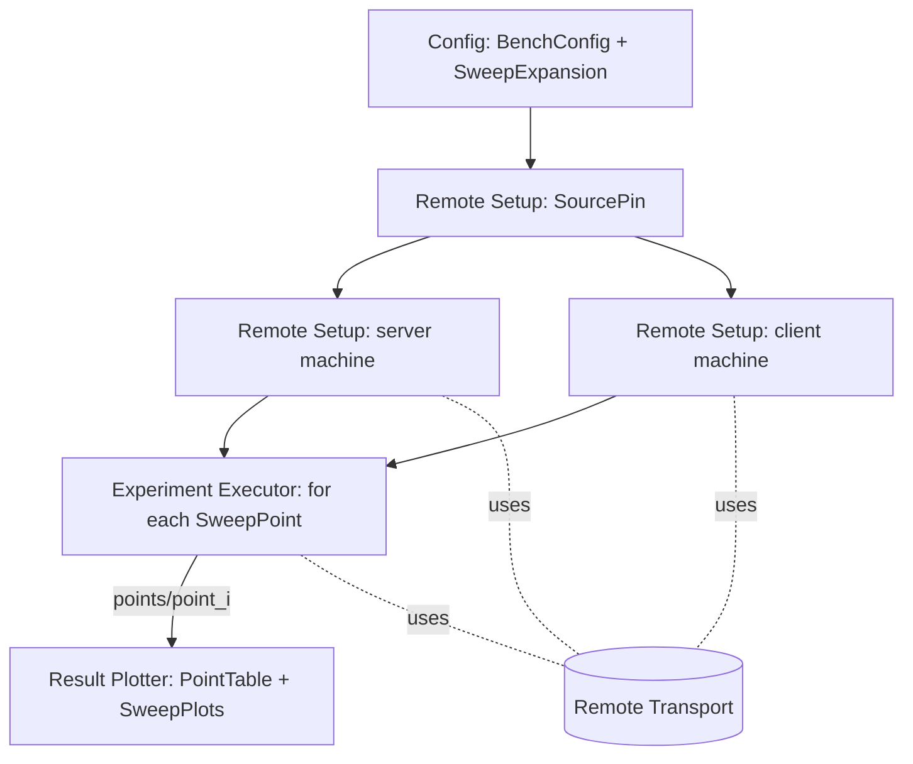

# Benchmark Runner — Design

## Structure



| Subcomponent | Responsibility | Spec |
|---|---|---|
| Config | Load and validate the TOML BenchConfig, expand the sweep | [config/description.md](config/description.md) |
| Remote Transport | Commands and file copies on a machine, over SSH or locally | [remote_transport/description.md](remote_transport/description.md) |
| Remote Setup | SourcePin, clone/checkout, tool check, build via the BuildManifest | [remote_setup/description.md](remote_setup/description.md) |
| Experiment Executor | One SweepPoint: server lifecycle, client run, download | [experiment_executor/description.md](experiment_executor/description.md) |
| Result Plotter | PointTable and SweepPlots | [result_plotter/description.md](result_plotter/description.md) |

## Run flow

```
function bench_run(config_path):
    config = config.load_config(config_path)                    # exit 2 on ConfigError
    points = config.expand_sweep(config)
    pin    = remote_setup.source_pin(config.repo_url)           # exit 2 on PinError
    check_placement_support(config, pin)                        # exit 2 on PinError
    prepare_output_dir(config.run.output_dir, config_path, pin, len(points))
    server_t = remote_transport.open(config.machines.server)
    client_t = remote_transport.open(config.machines.client)
    in parallel:                                                # exit 2 if either fails
        ready_server = remote_setup.setup_machine(server_t, "server", config.machines.server, pin, config.run.setup_timeout_s)
        ready_client = remote_setup.setup_machine(client_t, "client", config.machines.client, pin, config.run.setup_timeout_s)
    warn_unpinned(config, ready_server, ready_client)
    run_id = last path component of config.run.output_dir
    any_failed = false
    for point in points (in id order):
        result = experiment_executor.run_point(point, config, ready_server, ready_client, run_id)
        if result == FAILED:
            any_failed = true
            if config.run.on_failure == "stop": break
        if point is not the last: sleep(config.run.cooldown_s)
    result_plotter.plot(config.run.output_dir)
    exit 1 if any_failed else 0
```

```
function check_placement_support(config, pin):
    if any of [server], [load_gen], [ingress] sets threads and pin.manifest.thread_env is none:
        PinError("threads is set, but implementation/<lang>/benchmark_manifest.toml has no thread_env")

function warn_unpinned(config, ready_server, ready_client):
    ingress_role = config.ingress.machine                                 # IngressPlacement
    for (role, ready, sections) in [("server", ready_server, [server] + ([ingress] if ingress_role == "server" else [])),
                                    ("client", ready_client, [load_gen] + ([ingress] if ingress_role == "client" else []))]:
        if any of sections sets cpu_set and not ready.cpu_pinning:
            print to stderr, once per role: "warning: cpu_set ignored on <role>: taskset not found"
```

ProcessPlacement ([config/design.md#processplacement](config/design.md#processplacement)) is checked before setup,
because the manifest is known from the SourcePin. A missing pinning tool is only a warning: the programs still run,
with their thread counts applied, and each point's `placement.json` records what was actually used.

`bench setup` runs everything up to and including the parallel setup. `bench plot` runs only
`result_plotter.plot`.

`prepare_output_dir` creates the directory if needed, then writes `config.toml` (a byte copy) and `run.json`. If
the directory already has a `run.json` with a different `commit`, it stops with a SourcePin error, because a resumed
run must not mix commits.

## Why setup happens once

Cloning and building are slow and identical for every SweepPoint. Points differ only in program parameters, which
are command-line arguments. Running setup once also means every point measures the same binaries.

## Interrupts

If the operator interrupts `bench run` (e.g. Ctrl-C), the executor stops the current point's server
([experiment_executor/design.md#serverlifecycle](experiment_executor/design.md#serverlifecycle)), marks that point
`failed` with reason `interrupted`, writes the plots for the points finished so far, and exits `1`.

## Design specific to Python

Shared tool `implementation/scripts/` (tooling language Python 3.11+; see `AGENTS.md` "Shared tooling"). Identical on
every `impl/<lang>` branch. Plotting needs `matplotlib` (`python3 -m pip install -r implementation/scripts/requirements.txt`).
Tests: `python3 -B -m unittest discover -s implementation/scripts/tests -t implementation/scripts`.

### Python choices

- Entry point `bench.py` (argparse subcommands `run`, `setup`, `plot`). The package `benchrunner/` has one module per leaf: `config.py`, `transport.py`, `remote_setup.py`, `executor.py`, `plotter.py`.
- The operator repository is found with `git rev-parse --show-toplevel` from the script's own directory, so `bench.py` can be run from any working directory.
- `check_placement_support` raises `PinError`, which `bench_run` already maps to exit `2`. `warn_unpinned` prints to standard error right after the `setup done` log line.
- `run` checks that `matplotlib` can be imported *before* setup and exits `2` if it can't, so a long sweep never ends without plots. `setup` doesn't need it.
- An operator interrupt is Python's `KeyboardInterrupt`. `run_point` finishes its cleanup and re-raises it, and `bench_run` catches it, plots, and exits `1`.

### Traceability

Generated from the `# Design:` tags in the code by `implementation/spec_tools/tracegen.py` (see `AGENTS.md`). Each link points at the first code line after the tag.
Regenerate from the repository root with `python3 implementation/spec_tools/tracegen.py --lang Python --impl implementation/scripts --ext .py --comment '#' --write`.

<!-- trace:begin -->
| Design subsection | Implementation (file:line) |
|---|---|
| [Structure](#structure) | [bench.py:81](../../implementation/scripts/bench.py#L81) |
| [Run flow](#run-flow) | [bench.py:40](../../implementation/scripts/bench.py#L40), [bench.py:58](../../implementation/scripts/bench.py#L58), [bench.py:65](../../implementation/scripts/bench.py#L65), [bench.py:81](../../implementation/scripts/bench.py#L81), [bench.py:128](../../implementation/scripts/bench.py#L128) |
| [Why setup happens once](#why-setup-happens-once) | [bench.py:95](../../implementation/scripts/bench.py#L95) |
| [Interrupts](#interrupts) | [bench.py:119](../../implementation/scripts/bench.py#L119) |
<!-- trace:end -->
