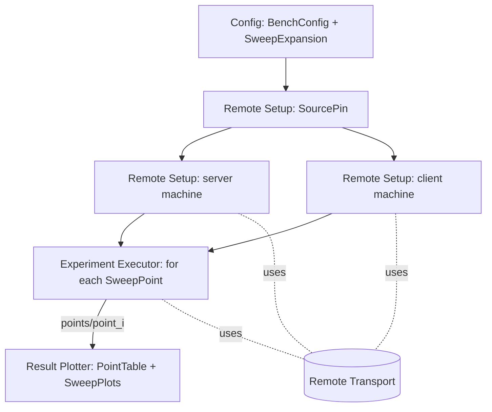

# Benchmark Runner — Design

## Structure



| Subcomponent | Responsibility | Spec |
|---|---|---|
| Config | Load and validate the TOML BenchConfig, expand the sweep | [config/description.md](config/description.md) |
| Remote Transport | Commands and file copies on a machine, over SSH or locally | [remote_transport/description.md](remote_transport/description.md) |
| Remote Setup | SourcePin, clone/checkout, tool check, build via the BuildManifest | [remote_setup/description.md](remote_setup/description.md) |
| Experiment Executor | One SweepPoint: server lifecycle, client run, download | [experiment_executor/description.md](experiment_executor/description.md) |
| Result Plotter | PointTable and SweepPlots | [result_plotter/description.md](result_plotter/description.md) |

## Run flow

```
function bench_run(config_path):
    config = config.load_config(config_path)                    # exit 2 on ConfigError
    points = config.expand_sweep(config)
    pin    = remote_setup.source_pin(config.repo_url)           # exit 2 on PinError
    prepare_output_dir(config.run.output_dir, config_path, pin, len(points))
    server_t = remote_transport.open(config.machines.server)
    client_t = remote_transport.open(config.machines.client)
    in parallel:                                                # exit 2 if either fails
        ready_server = remote_setup.setup_machine(server_t, "server", config.machines.server, pin, config.run.setup_timeout_s)
        ready_client = remote_setup.setup_machine(client_t, "client", config.machines.client, pin, config.run.setup_timeout_s)
    run_id = last path component of config.run.output_dir
    any_failed = false
    for point in points (in id order):
        result = experiment_executor.run_point(point, config, ready_server, ready_client, run_id)
        if result == FAILED:
            any_failed = true
            if config.run.on_failure == "stop": break
        if point is not the last: sleep(config.run.cooldown_s)
    result_plotter.plot(config.run.output_dir)
    exit 1 if any_failed else 0
```

`bench setup` runs everything up to and including the parallel setup. `bench plot` runs only
`result_plotter.plot`.

`prepare_output_dir` creates the directory if needed, then writes `config.toml` (a byte copy) and `run.json`. If
the directory already has a `run.json` with a different `commit`, it stops with a SourcePin error, because a resumed
run must not mix commits.

## Why setup happens once

Cloning and building are slow and identical for every SweepPoint. Points differ only in program parameters, which
are command-line arguments. Running setup once also means every point measures the same binaries.

## Interrupts

If the operator interrupts `bench run` (e.g. Ctrl-C), the executor stops the current point's server
([experiment_executor/design.md#serverlifecycle](experiment_executor/design.md#serverlifecycle)), marks that point
`failed` with reason `interrupted`, writes the plots for the points finished so far, and exits `1`.
