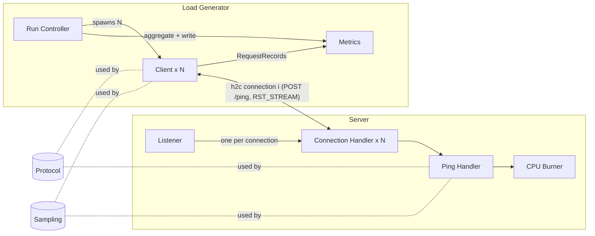

# HTTP/2 Cancellation Testbed — Design

## Components

| Component | Role | Spec |
|---|---|---|
| Protocol | RequestId encoding, PaddedJsonBody build/parse, status codes | [protocol/description.md](protocol/description.md) |
| Sampling | Seeded RNG, exponential sampler, per-stream seed derivation | [sampling/description.md](sampling/description.md) |
| Server | Accepts connections and serves `/ping` with a CPU-bound cost | [server/description.md](server/description.md) |
| Load Generator | Simulates N clients, applies SLOCancellation, records latency | [load_generator/description.md](load_generator/description.md) |

Protocol and Sampling are shared leaves. Server and Load Generator both depend on them and
never on each other. The only coupling between Server and Load Generator is the wire contract in
[api.md](api.md#wire-contract-ping).

## End-to-end flow of one request

1. Client `i` reaches scheduled arrival `seq` (a GatedArrival: it waits if request `seq-1` is unresolved).
2. Client builds RequestId `(seq << 32) | i` and a PaddedJsonBody of `request_bytes`, then sends
   `POST /ping` on its own connection and starts an SLO timer.
3. The server's Connection Handler for that connection queues the request. Its SerialStreamWorker
   takes requests one at a time, samples a ServiceTime, and runs the CPU Burner.
4. Exactly one of these happens:
   - The response (`202`) arrives before the SLO. The client records `ok`.
   - The SLO fires first. The client sends `RST_STREAM(CANCEL)` and records `cancelled`. On the server, in
     `cooperative` mode the burner sees the flag and stops (or a queued request is skipped). In
     `ignore` mode the server burns the full time and its response is dropped.
5. The client moves on to scheduled arrival `seq+1`.

## Why the server is serial per connection

The server processes requests on one connection **one at a time, in arrival order**. Clients are
closed loops, so normally only one request is live per connection. After a cancellation, though,
the client sends its next request while the server may still be working on the cancelled one. In
`ignore` mode the new request waits behind the abandoned work, and that wait is the effect this
testbed measures. See [server/connection_handler/design.md](server/connection_handler/design.md).

## Time bounds of a run

The active phase is `[0, duration_s)` from the run start. The DrainPhase that follows lasts at
most `slo_ms`, because every in-flight request is resolved by its response or its SLO timer. See
[load_generator/run_controller/design.md](load_generator/run_controller/design.md#drainphase).
