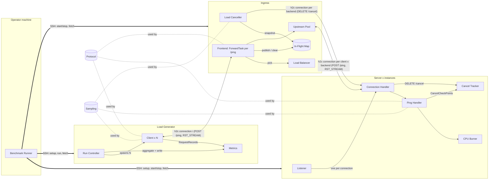

# HTTP/2 Cancellation Testbed — Design

## Components

| Component | Role | Spec |
|---|---|---|
| Protocol | RequestId encoding, PaddedJsonBody and CancelBody, status codes | [protocol/description.md](protocol/description.md) |
| Sampling | Seeded RNG, exponential and uniform-integer samplers, per-stream seed derivation | [sampling/description.md](sampling/description.md) |
| Server | Accepts connections, serves `/ping` with a CPU-bound cost, applies RST and `/cancel` cancellation | [server/description.md](server/description.md) |
| Load Generator | Simulates N clients, applies SLOCancellation, records latency | [load_generator/description.md](load_generator/description.md) |
| Ingress | Load-balances `/ping` across server instances, relays answers, and cancels in-flight requests from inside (Load Canceller) | [ingress/description.md](ingress/description.md) |
| Benchmark Runner | Sets up two machines, runs a parameter sweep of the three programs, downloads and plots results | [benchmark_runner/description.md](benchmark_runner/description.md) |

Protocol and Sampling are shared leaves. Server, Load Generator and Ingress all depend on them and never on
each other's internals. The only coupling between the three programs is the wire contract in
[api.md](api.md#wire-contract-ping) and [api.md](api.md#wire-contract-cancel). The Ingress speaks the `/ping`
contract on both sides, so the load generator cannot tell it from a server, and it relies on one more server
behavior: each connection is bound to one client and served serially
([ingress/design.md#why-one-upstream-connection-per-client-and-backend](ingress/design.md#why-one-upstream-connection-per-client-and-backend)).

The Benchmark Runner depends on no other component's internals. It uses only the programs' command-line
parameters, their output files and the server's `listening on` and CancelCounters lines, all from
[api.md](api.md). It learns how to build an implementation from that implementation's BuildManifest
([benchmark_runner/remote_setup/design.md](benchmark_runner/remote_setup/design.md#buildmanifest)).

## End-to-end flow of one request

1. Client `i` reaches scheduled arrival `seq` (a GatedArrival: it waits if request `seq-1` is unresolved).
2. Client builds RequestId `(i << 32) | seq` and a PaddedJsonBody of `request_bytes`, then sends
   `POST /ping` on its own connection to the Ingress and starts an SLO timer.
   The Ingress's ForwardTask picks a backend, records the request in the InFlightMap, and forwards it unchanged on
   its connection for client `i` and that backend. Everything below happens on that backend, and the answer (or a
   reset) travels back the same way.
3. The server's Connection Handler for that connection queues the request. On the connection's
   first `/ping` it binds the connection to client id `id >> 32`. Its SerialStreamWorker takes
   requests one at a time, samples a ServiceTime, checks for cancellation, and runs the CPU Burner,
   checking again during the burn.
4. Exactly one of these happens:
   - The burn completes. The server answers `202` and the client records `ok` (if within the SLO).
   - A matching `/cancel` is seen at a CancelCheckPoint (`cooperative` mode). The server stops, counts
     it, and answers `503`. The client records `rejected`.
   - The SLO fires first. The client sends `RST_STREAM(CANCEL)` and records `cancelled`. On the
     server, in `cooperative` mode, the worker skips or stops the request and writes nothing. In
     `ignore` mode the server burns the full time and its response is dropped.
5. The client moves on to scheduled arrival `seq+1`.

## End-to-end flow of one cancel

1. The Ingress's Load Canceller reaches a Poisson arrival and takes a snapshot of the InFlightMap. If it is empty,
   the arrival is `skipped`. Otherwise it draws one entry `(c, request_id, server_id)` uniformly.
2. It sends `DELETE /cancel` with that RequestId on its own connection to backend `server_id` and does not wait.
3. That server's handler for the canceller's connection pushes the id onto client `c`'s CancelInbox in its
   CancelRegistry and answers `202`.
4. At its next CancelCheckPoint, the worker bound to client `c` on that server drains the inbox into its local
   pending set and applies CancelMatching ([server/cancel_tracker/design.md](server/cancel_tracker/design.md#cancelmatching)).
   If the request already finished in between, it is counted `completed_before_cancel`.

## Why the server is serial per connection

The server processes requests on one connection **one at a time, in arrival order**. Clients are
closed loops, so normally only one request is live per connection. After a cancellation, though,
the client sends its next request while the server may still be working on the cancelled one. In
`ignore` mode the new request waits behind the abandoned work, and that wait is the effect this
testbed measures. Serial processing also makes the request ids seen by one worker increase
monotonically, which CancelMatching depends on. See
[server/connection_handler/design.md](server/connection_handler/design.md).

## Time bounds of a run

The active phase is `[0, duration_s)` from the run start. The DrainPhase that follows lasts at
most `slo_ms`, because every in-flight request is resolved by its response or its SLO timer. See
[load_generator/run_controller/design.md](load_generator/run_controller/design.md#drainphase).
The Ingress's Load Canceller starts at the Ingress's first `/ping` and has its own `duration_s` and drain timeout
([ingress/load_canceller/design.md](ingress/load_canceller/design.md#cancellerdrain)). The operator starts the
servers, then the Ingress, then the load generator, and stops them in reverse order
([ingress/design.md#shutdown](ingress/design.md#shutdown)).
