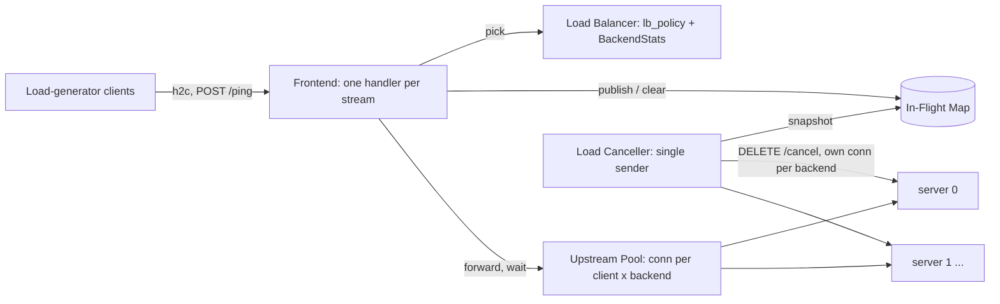

# Ingress — Design

## Structure



| Subcomponent | Responsibility | Spec |
|---|---|---|
| In-Flight Map | Lock-free `request_id → InFlightEntry` of the forwards in progress, any number per client | [inflight_map/description.md](inflight_map/description.md) |
| Load Balancer | LbPolicy (`pick`), BackendStats (`finish`) | [load_balancer/description.md](load_balancer/description.md) |
| Upstream Pool | One h2c connection per (client, backend), dialed once, dropped on connection error | [upstream_pool/description.md](upstream_pool/description.md) |
| Load Canceller | CancelSchedule from the first `/ping`, InFlightVictimChoice, `/cancel` on its own connection per backend | [load_canceller/description.md](load_canceller/description.md) |
| Frontend | Client connections, ForwardTask per `/ping`, reset propagation, StartOnce | [frontend/description.md](frontend/description.md) |

## Shared state

One of each per process, created at startup and never replaced:

| State | Owner | Shared with |
|---|---|---|
| `config: IngressConfig` | Startup | everyone, read only |
| `inflight: InFlightMap`, with client ids bounded by `num_clients` | In-Flight Map | Frontend (publish, clear), Load Canceller (snapshot) |
| `stats: array[B] of BackendStats` | Load Balancer | Frontend (outcomes), Shutdown (summary) |
| ForwardLog | Load Balancer | Frontend (one append per `finish`), Shutdown (`forwards.csv`) |
| `run_start` | set once, by the first `/ping` | Load Canceller (time base) |

`B` is the number of backends.

## Configuration validation

```
function validate(params):
    listen_addr parses as host:port                         else error
    backends = params.backends split on ","; each element trimmed
    1 <= len(backends) <= MAX_BACKENDS                      else error
    every backend parses as host:port                       else error "backend <i> must be host:port"
    1 <= num_clients <= MAX_CLIENTS                         else error
    lb_policy in {round_robin, least_outstanding, power_of_two, ewma}  else error
    0 <= ewma_beta <= 1 and finite                          else error "ewma_beta must be a number in [0, 1]"
    cancel_rate >= 0 and finite                             else error
    if cancel_rate > 0: duration_s > 0 and finite           else error "duration_s is required with cancel_rate > 0"
    seed parses as u64                                      else error
    initial_stall_ms is an integer >= 0                     else error
    return IngressConfig(..., duration_ns = round(duration_s * 1e9) if cancel_rate > 0,
                         initial_stall_ns = initial_stall_ms * 1_000_000)
```

Duplicate backends are allowed: they are separate `server_id`s that happen to share an address.

## Concurrency model

- **Frontend:** every `/ping` stream is handled by its own coroutine or thread, which blocks while the backend
  works. A reader for each client connection keeps reading frames while forwards are in progress, so a client's
  `RST_STREAM` is seen at once and passed upstream.
- **Load Canceller:** one sender activity. Its `/cancel` responses are collected by the reader of its own
  connections, never by the sender.
- **Lock-free paths:** the In-Flight Map, the BackendStats counters and each EwmaLatency (a compare-and-swap loop)
  use only atomic operations. The Upstream Pool may lock while it creates a connection, but never while a request
  is in progress on one. The ForwardLog takes its lock only to append one record
  ([load_balancer/design.md#forwardlog](load_balancer/design.md#forwardlog)).
- If the implementation uses cooperative coroutines on one thread, nothing in the Ingress may busy-wait: every
  wait is on network I/O, a timer, or a lock held only briefly.

## Time base

`now()` is a monotonic clock. `run_start` is the monotonic time at which the Frontend receives the **first**
`/ping` whose body parses. The Load Canceller's schedule is measured from `run_start`, so it starts with the load
generator's traffic, not with the Ingress process. `run_end_s` in the summary is `(time of shutdown - run_start)`
in seconds, or `0` if no `/ping` was ever received.

## Shutdown

```
procedure shutdown():                                  # on interrupt or termination signal
    stop accepting; send GOAWAY on every client connection
    deadline = now() + INGRESS_DRAIN_TIMEOUT_MS * 1e6
    wait until no forward is in progress (sum of stats[*].outstanding == 0) or now() >= deadline
    stop the Load Canceller if it is still sending, then run its drain
    close every upstream and canceller connection           # errors ignored
    write <output_path>.cancels.csv, <output_path>.forwards.csv and <output_path>.summary.json
    exit 0
```

`forwards.csv` is the ForwardLog (`load_balancer.forward_log`) with `t_ns = end_ns - run_start` for every record,
sorted stably by `t_ns`. Every record has `end_ns >= run_start`: `run_start` is set before the first `pick`. If no
`/ping` was received, the log is empty and the file has only its header.

Forwards still in progress at the deadline are abandoned: their client streams are reset and they are counted in
neither `ok` nor `rejected`. The load generator finishes before the operator stops the Ingress, so in a normal run
nothing is in progress at shutdown.

## Why one upstream connection per client and backend

The server binds each connection to the client id of its first `/ping`
([../server/description.md](../server/description.md)). Giving each (client, backend) pair its own connection
keeps that rule true behind the Ingress without changing the server. A shared connection would mix client ids and
get `400`s. It also keeps each client's ServiceTime draws on that client's own connection stream, as if the client
had connected directly.
