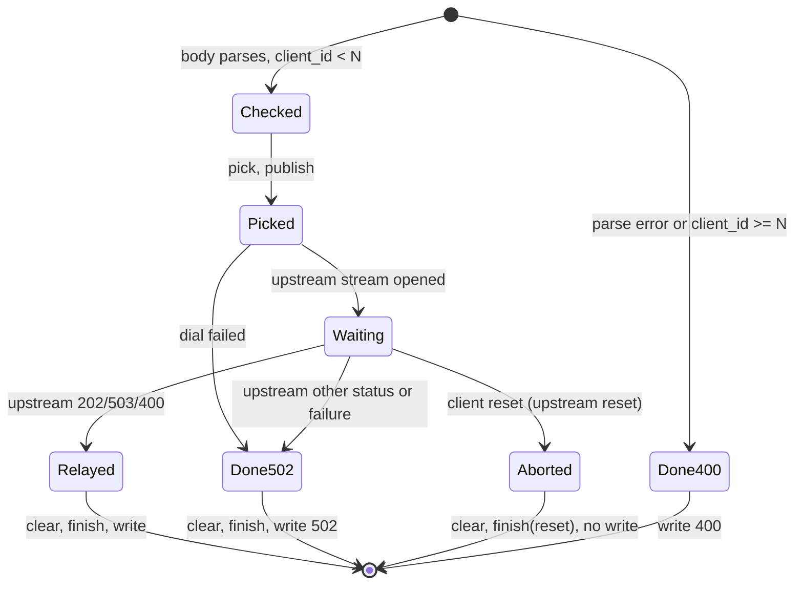

# Frontend — Design

## Client connections

```
procedure serve(config, listener):
    loop until shutdown:
        tcp = listener.accept()
        spawn serve_connection(tcp)                 # one per client connection

procedure serve_connection(tcp):
    run the HTTP/2 server side on tcp (prior knowledge, no HTTP/1.1)
    for each stream whose request is complete (END_STREAM received):
        spawn: response = route(stream); write_response(stream, response)
    a reset from the client sets that stream's reset flag and wakes its ForwardTask
```

The connection's frame reader keeps running while ForwardTasks wait on backends, so a client's `RST_STREAM` is seen
at once ([../design.md#concurrency-model](../design.md#concurrency-model)). Streams on one connection are handled
concurrently; the HTTP/2 layer bounds them with the server's `MAX_CONCURRENT_STREAMS` setting.

```
function route(stream):
    if stream.path == "/ping":
        if stream.method != "POST": return Response(405, empty)
        return handle_ping(stream, ctx)
    return Response(404, empty)

procedure write_response(stream, response):
    if response is Aborted or stream.reset: return
    send HEADERS(:status, content-type: application/json if body non-empty, content-length)
    send DATA(body, END_STREAM)                     # errors on a reset stream are ignored
```

## ForwardTask

```
function handle_ping(stream, ctx):
    id = protocol.parse_body(stream.body)
    if id is ParseError: return Response(400, empty)
    (seq, client_id) = protocol.split_request_id(id)
    if client_id >= config.num_clients: return Response(400, empty)
    start_once(ctx)                                               # StartOnce

    ticket = load_balancer.pick(ctx.lb)                           # ForwardTicket
    s = ticket.server_id
    entry = InFlightEntry(request_id = id, server_id = s)
    inflight_map.publish(ctx.inflight, entry)                     # keyed by the RequestId
    (response, outcome) = forward(ctx, client_id, s, stream)
    inflight_map.clear(ctx.inflight, entry)                       # before relaying: see below
    load_balancer.finish(ctx.lb, ticket, outcome)                 # same ticket: times the forward
    return response

function forward(ctx, c, s, stream):
    conn = upstream_pool.get(ctx.pool, c, s)
    if conn is DialError: return (Response(502, empty), bad_gateway)
    up = conn.open_stream(POST /ping, content-type: application/json, body = stream.body unchanged)
    wait for the first of:
        stream.reset (client reset):     up.reset(CANCEL); return (Aborted, reset)
        up completes with (status, body): match status:
                                              202: return (Response(202, body), ok)
                                              503: return (Response(503, body), rejected)
                                              400: return (Response(400, body), bad_request)
                                              other: return (Response(502, empty), bad_gateway)
        up fails:                         if the connection is unusable: upstream_pool.discard(ctx.pool, c, s, conn)
                                          return (Response(502, empty), bad_gateway)
```

- **Body unchanged.** The request body, and so the RequestId, reaches the server byte for byte. The server binds the
  upstream connection to the same client id, because the pool gives every client its own connection.
- **"Completes"** means the full upstream response (END_STREAM) has arrived, as for the client's SLO
  ([../../load_generator/client/design.md#slocancellation](../../load_generator/client/design.md#slocancellation)).
- **Reset wins ties.** If the client's reset and the upstream completion are observed together, whichever
  `wait for the first of` reports first wins and the other is ignored. A reset is passed upstream with HTTP/2 error
  code `CANCEL` (`RST_CODE_CANCEL`).
- **Clear before relay.** The entry is cleared as soon as the upstream answer is in, before the response is
  written to the client, so the Load Canceller never picks a request that the Ingress has already finished with.
  The `clear` checks identity ([../inflight_map/design.md#publish-and-clear](../inflight_map/design.md#publish-and-clear)).
- Every `pick` is matched by exactly one `finish` with the ticket that `pick` returned, on every path, so
  `outstanding` returns to 0. `finish` runs right after `clear`, before the response is written, so the measured
  latency of an `ok` forward ends when the full upstream answer is in
  ([../load_balancer/design.md#forwardticket](../load_balancer/design.md#forwardticket)).
- **Many per client.** A client connection carries up to `n_waiting_requests` concurrent streams, so up to that
  many ForwardTasks of one client run at once, each with its own InFlightMap entry, and those that go to the same
  backend share the client's upstream connection as concurrent streams.

## StartOnce

```
function start_once(ctx):
    if ctx.started.compare_and_swap(false, true):            # exactly one caller wins
        ctx.run_start = monotonic_now_ns()
        if config.cancel_rate > 0:
            ctx.canceller = load_canceller.canceller_start(config, ctx.inflight, ctx.run_start)
```

The winner's own request is forwarded right after, like any other. Losers never wait on the canceller: it starts its
sender asynchronously.

## State machine (per ForwardTask)



| Situation | InFlightMap | `finish` outcome | Client sees |
|---|---|---|---|
| server answers `202` | published, then cleared | `ok` | `202` + body |
| server matched a `/cancel` | published, then cleared | `rejected` | `503` + body |
| client SLO fires during the burn | published, then cleared | `reset` | nothing (it reset) |
| backend down | published, then cleared | `bad_gateway` | `502` |
| body unparseable | never published | (no pick) | `400` |

## Design specific to Go

Implementation: `implementation/go` (module `testbed`, Go 1.21, `golang.org/x/net v0.17.0`).
Build and test with `CGO_ENABLED=0 go build ./...` / `CGO_ENABLED=0 go test ./...`. On recent macOS the dynamic
loader rejects cgo-linked Go 1.21 binaries (missing `LC_UUID`), so cgo is disabled.

### Go choices

- File `internal/ingress/frontend.go`; the accept loop and lifecycle are in `ingress.go`. Each client connection is served by `http2.Server.ServeConn` on its own goroutine, and `ServeConn` runs the handler for every complete stream on another goroutine while its frame reader keeps running. A client `RST_STREAM` cancels the stream's `r.Context()`.
- `forward` builds the upstream request with that context (`http.NewRequestWithContext`), so a client reset makes `golang.org/x/net/http2` reset the upstream stream with `CANCEL`, and `RoundTrip` or the body read fails. "Reset wins ties" is decided by `ctx.Err() != nil` at the moment the upstream call fails.
- A connection is "unusable" when `ClientConn.CanTakeNewRequest()` is false after the failure; only then is it discarded.
- `Aborted` is `fwdResponse{aborted: true}`; nothing is written, and the handler returns.
- `start_once` is an `atomic.Bool` compare-and-swap; `run_start` and the canceller are stored under `startMu` so shutdown reads them safely.
- Tests: `ingress_test.go` runs two in-process servers behind the Ingress: relay and routing errors (`400`, `404`, `405`), round-robin spread and the written outputs; the Load Canceller cancelling an in-flight request (`503`, counted `cancelled_during_processing` on the right backend); a client reset reaching the backend; and `502` for an unreachable backend. The reset reaches the Ingress a few milliseconds after the client gives up, so that test waits for the forward to end before stopping the backend.

### Traceability

Generated from the `// Design:` tags in the code by `implementation/spec_tools/tracegen.py` (see `AGENTS.md`). Each link points at the first code line after the tag.
Regenerate from the repository root with `python3 implementation/spec_tools/tracegen.py --lang Go --ext .go --comment // --write`.

<!-- trace:begin -->
| Design subsection | Implementation (file:line) |
|---|---|
| [Client connections](#client-connections) | [frontend.go:28](../../../implementation/go/internal/ingress/frontend.go#L28), [ingress.go:77](../../../implementation/go/internal/ingress/ingress.go#L77) |
| [ForwardTask](#forwardtask) | [frontend.go:56](../../../implementation/go/internal/ingress/frontend.go#L56), [frontend.go:82](../../../implementation/go/internal/ingress/frontend.go#L82), [ingress_test.go:75](../../../implementation/go/internal/ingress/ingress_test.go#L75) |
| [StartOnce](#startonce) | [frontend.go:125](../../../implementation/go/internal/ingress/frontend.go#L125), [ingress_test.go:122](../../../implementation/go/internal/ingress/ingress_test.go#L122) |
| [State machine (per ForwardTask)](#state-machine-per-forwardtask) | [ingress_test.go:156](../../../implementation/go/internal/ingress/ingress_test.go#L156) |
<!-- trace:end -->
