# Frontend — Design

## Client connections

```
procedure serve(config, listener):
    loop until shutdown:
        tcp = listener.accept()
        spawn serve_connection(tcp)                 # one per client connection

procedure serve_connection(tcp):
    run the HTTP/2 server side on tcp (prior knowledge, no HTTP/1.1)
    for each stream whose request is complete (END_STREAM received):
        spawn: response = route(stream); write_response(stream, response)
    a reset from the client sets that stream's reset flag and wakes its ForwardTask
```

The connection's frame reader keeps running while ForwardTasks wait on backends, so a client's `RST_STREAM` is seen
at once ([../design.md#concurrency-model](../design.md#concurrency-model)). Streams on one connection are handled
concurrently; the HTTP/2 layer bounds them with the server's `MAX_CONCURRENT_STREAMS` setting.

```
function route(stream):
    if stream.path == "/ping":
        if stream.method != "POST": return Response(405, empty)
        return handle_ping(stream, ctx)
    return Response(404, empty)

procedure write_response(stream, response):
    if response is Aborted or stream.reset: return
    send HEADERS(:status, content-type: application/json if body non-empty, content-length)
    send DATA(body, END_STREAM)                     # errors on a reset stream are ignored
```

## ForwardTask

```
function handle_ping(stream, ctx):
    id = protocol.parse_body(stream.body)
    if id is ParseError: return Response(400, empty)
    (seq, client_id) = protocol.split_request_id(id)
    if client_id >= config.num_clients: return Response(400, empty)
    start_once(ctx)                                               # StartOnce

    task = { request_id: id, client_id, body: stream.body,
             deadline: protocol.parse_deadline(stream.body),      # RequestDeadline, none if missing or malformed
             attempts: [],                                        # ForwardAttempts, oldest first
             results: FIFO of (attempt, response, outcome), capacity 1 + config.lb_max_retries }
    admission = load_balancer.admit(ctx.lb, task.deadline)        # FilterWaitQueue: send now, or wait
    if admission is Wait(entry):
        wait for the first of:
            stream.reset (client reset):  entry.state = gone; return Aborted     # removed at the next scan
            entry.signal:                 if entry.state == dropped:            # past its deadline while waiting
                                              return Response(503, protocol.build_cancel_body(id))   # {"id":"<dec>"}
                                          ticket = entry.state.ticket           # sent from the queue
    else: ticket = admission.ticket
    start_attempt(ctx, task, 0, ticket)                           # attempt 0, already picked
    return lb_retry_loop(ctx, task, stream)                       # LbRetryLoop: relays the newest attempt's answer

function remaining_ns(task):                                      # the request's time left, for the DeadlineFilter
    if task.deadline is none: return none
    return task.deadline - wall_clock_unix_ns()                   # exact signed, saturated to i64

function forward(ctx, c, s, body, cancel):                        # cancel: set by the LbRetryLoop on a client reset
    conn = upstream_pool.get(ctx.pool, c, s)
    if conn is DialError: return (Response(502, empty), bad_gateway)
    up = conn.open_stream(POST /ping, content-type: application/json, body = body unchanged)
    wait for the first of:
        cancel:                           up.reset(CANCEL); return (Aborted, reset)
        up completes with (status, body): match status:
                                              202: return (Response(202, body), ok)
                                              503: return (Response(503, body), rejected)
                                              400: return (Response(400, body), bad_request)
                                              other: return (Response(502, empty), bad_gateway)
        up fails:                         if the connection is unusable: upstream_pool.discard(ctx.pool, c, s, conn)
                                          return (Response(502, empty), bad_gateway)
```

- **Body unchanged.** The request body, and so the RequestId, reaches the server byte for byte. The server binds the
  upstream connection to the same client id, because the pool gives every client its own connection.
- **"Completes"** means the full upstream response (END_STREAM) has arrived, as for the client's SLO
  ([../../load_generator/client/design.md#slocancellation](../../load_generator/client/design.md#slocancellation)).
- **Reset wins ties.** The [LbRetryLoop](#lbretryloop) turns a client reset into each running attempt's `cancel`
  signal. If an attempt's `cancel` and its upstream completion are observed together, whichever `wait for the first
  of` reports first wins and the other is ignored. A reset is passed upstream with HTTP/2 error code `CANCEL`
  (`RST_CODE_CANCEL`).
- **WorkerCount.** For a relayed `202` or `503` the Frontend also reads the backend's `x-worker-threads` header
  ([../../protocol/design.md#workercount](../../protocol/design.md#workercount)) and hands it to `finish`, which keeps
  it for the DeadlineFilter. The header is not relayed to the client.
- **ExecReport.** For a relayed `202` or `503`, the Frontend reads the backend's ExecutionTime from the body it is
  about to relay ([../../protocol/design.md#execreport](../../protocol/design.md#execreport)) and hands it to `finish`,
  which keeps the EwmaExecTime ([../load_balancer/design.md#ewmaexectime](../load_balancer/design.md#ewmaexectime)).
  The body is relayed byte for byte all the same. `parse_exec_report` never fails; a body without an ExecReport
  just gives none.
- **DeadlineFilter.** The Frontend reads the RequestDeadline from the body it is about to forward and gives `admit`
  (and every LbRetry's `pick`) the time left, `deadline - now`, on the Ingress's wall clock
  ([../load_balancer/design.md#deadlinefilter](../load_balancer/design.md#deadlinefilter)). It is read just before
  `pick`, so it is the time left when the backend is chosen. The RequestDeadline is the client's wall clock; any
  offset between the client's and the Ingress's clocks shifts `remaining_ns` by that much. When no backend passes,
  the request waits in the FilterWaitQueue ([../load_balancer/design.md#filterwaitqueue](../load_balancer/design.md#filterwaitqueue))
  with nothing published in the InFlightMap. If the queue drops it once its deadline has passed, the Frontend answers
  `503` with the body `{"id":"<dec>"}` (the CancelBody form, which the client's `parse_body` accepts), so the client
  records it `rejected`; no `finish` follows and the LoadCanceller never sees it. A client reset while waiting marks
  the entry `gone` and writes nothing.
- **Clear before relay.** Each attempt clears its entry as soon as its upstream answer is in
  ([ForwardAttempt](#forwardattempt)), before the response is written to the client, so the Load Canceller never picks a request that the Ingress has already finished with.
  The `clear` checks identity ([../inflight_map/design.md#publish-and-clear](../inflight_map/design.md#publish-and-clear)).
- Every `pick` is matched by exactly one `finish` with the ticket that `pick` returned, on every path and for every
  attempt, so `outstanding` returns to 0. `finish` runs right after `clear`, before the response is written, so the measured
  latency of an `ok` forward ends when the full upstream answer is in
  ([../load_balancer/design.md#forwardticket](../load_balancer/design.md#forwardticket)).
- **Many per client.** A client connection carries up to `n_waiting_requests` concurrent streams, so up to that
  many ForwardTasks of one client run at once, each with its own InFlightMap entry, and those that go to the same
  backend share the client's upstream connection as concurrent streams.

## ForwardAttempt

One upstream forward of a ForwardTask. Attempt 0 is the forward every `/ping` gets; attempt `k > 0` is the `k`-th
**LbRetry**, started only by the [LbRetryLoop](#lbretryloop).

```
function start_attempt(ctx, task, k, ticket = none):              # -> ForwardAttempt | Dropped
    if ticket is none:                                            # an LbRetry (k > 0): pick now
        ticket = load_balancer.pick(ctx.lb, remaining_ns(task), k)    # ForwardTicket (attempt = k), or Dropped
        if ticket is Dropped:
            ctx.lb_retry_refused.fetch_add(1)                     # summary lb_retry_refused; no attempt starts
            return Dropped
    if k > 0: ctx.lb_retries.fetch_add(1)                         # summary lb_retries
    a = { k, ticket, server_id: ticket.server_id, start_ns: ticket.start_ns,
          running: true, outcome: none, cancel: new one-shot signal }
    entry = InFlightEntry(request_id = task.request_id, server_id = a.server_id, attempt = k)
    inflight_map.publish(ctx.inflight, entry)                     # replaces the previous attempt's entry
    task.attempts.append(a)
    spawn attempt_activity(ctx, task, a, entry)                   # its own coroutine or thread
    return a

procedure attempt_activity(ctx, task, a, entry):
    (response, outcome) = forward(ctx, task.client_id, a.server_id, task.body, a.cancel)
    inflight_map.clear(ctx.inflight, entry)                       # identity: no-op once a newer attempt replaced it
    exec_ns = none; worker_count = none
    if outcome in {ok, rejected}:
        (exec_ns, _) = protocol.parse_exec_report(response.body)  # ExecReport; StartSlack is not used here
        worker_count = protocol.parse_worker_count(upstream x-worker-threads header)   # WorkerCount
    load_balancer.finish(ctx.lb, a.ticket, outcome, exec_ns, worker_count)   # every attempt is finished, by itself
    task.results.push((a, response, outcome))                     # never blocks: capacity covers every attempt
```

- **Each attempt finishes itself**, whether or not its answer is used and even after the ForwardTask has answered the
  client, so every `pick` is matched by exactly one `finish` and BackendStats, EwmaLatency, EwmaExecTime and the
  ForwardLog (with its `attempt` column) see every attempt.
- **Clear before finish**, as before LB retries: an attempt clears its own InFlightMap entry first. An older attempt's
  `clear` is a no-op once a newer attempt replaced the entry, so the LoadCanceller always targets the newest attempt.
- **Older attempts keep running** after a newer one starts and after the client has its answer; they are reset only
  if the client resets its stream while the ForwardTask is still waiting ([LbRetryLoop](#lbretryloop)).
- An attempt to the same backend as an earlier one shares the client's upstream connection as another stream.

## LbRetryLoop

The ForwardTask waits here for its answer. The newest attempt's answer is the one relayed; the RetryPolicy
([../retry_policy/design.md#retrypolicy](../retry_policy/design.md#retrypolicy)) decides when to start another
attempt.

```
LB_RETRY_TICK_MS = 10

function lb_retry_loop(ctx, task, stream):
    policy = ctx.retry_policy                                     # built once from lb_retry_policy
    ticking = config.lb_retry_policy != none and config.lb_max_retries > 0
    loop:
        newest = task.attempts[last]
        budget = len(task.attempts) - 1 < config.lb_max_retries
        wait for the first of:
            stream.reset (client reset):
                for a in task.attempts: if a.running: a.cancel.set()     # each ends reset and finishes itself
                return Aborted                                          # nothing is written
            (a, response, outcome) from task.results:
                a.running = false; a.outcome = outcome
                if a is not newest: continue                            # an older attempt: answer ignored
                if outcome != bad_gateway: return response              # 202 / 503 / 400 relayed
                if budget and decide(policy, retry_state(...), AttemptEnded(outcome)) == Retry:
                    if start_attempt(ctx, task, len(task.attempts)) is not Dropped: continue
                return response                                         # 502 relayed
            LB_RETRY_TICK_MS since the last tick, only if ticking and budget and newest.running:
                if decide(policy, retry_state(...), Tick) == Retry:
                    start_attempt(ctx, task, len(task.attempts))        # Dropped: keep waiting on the newest
```

`retry_state(...)` is [../retry_policy/design.md#retrystate](../retry_policy/design.md#retrystate), built from
`task`, the Load Balancer and the Heartbeat Monitor right before each `decide`.

- **Newest answer counts**, as for the client's RequestCopies: once attempt `k+1` exists, attempt `k`'s answer is
  ignored even if it is `ok`. A `reset` outcome only follows a client reset, after the loop has returned.
- **Budget.** At most `lb_max_retries` LbRetries per ForwardTask, enforced here; the policy is consulted only while
  budget remains. Client RequestCopies are separate streams and so separate ForwardTasks, each with its own budget.
- **Ties.** Events are handled one at a time in the order `wait for the first of` reports them: a result and a tick
  at the same moment are handled in either order, and a tick that starts an attempt makes any result of the old
  newest attempt an older one's.
- **Off.** With `lb_retry_policy = none` or `lb_max_retries = 0` there is no tick and the first result of attempt 0
  is relayed: exactly the ForwardTask before LB retries (one `pick`, one forward, clear, finish, relay).

Worked example, a test policy that answers `Retry` on `AttemptEnded` and on a `Tick` once the newest attempt has
run 50 ms, `lb_max_retries = 1` (times in ms from attempt 0's start):

| Time | Event | Decision | Result |
|---|---|---|---|
| 0 | attempt 0 to server 0 | — | InFlightMap: attempt 0 @ 0 |
| 10, 20, 30, 40 | `Tick` | `Wait` | — |
| 50 | `Tick` | `Retry` | attempt 1 to server 1; InFlightMap: attempt 1 @ 1; `lb_retries = 1`; budget used up, no more ticks |
| 80 | attempt 1 answers `202` | — | relayed; attempt 1 cleared and finished (`attempt = 1` in the ForwardLog) |
| 200 | attempt 0 answers `202` | — | ignored; its `clear` is a no-op, it is finished (`attempt = 0`) |

Same policy, attempt 0 to a dead backend:

| Time | Event | Decision | Result |
|---|---|---|---|
| 0 | attempt 0, dial fails: `AttemptEnded(bad_gateway)` | `Retry` | attempt 1 to the next backend `pick` gives |
| 70 | attempt 1 answers `202` | — | relayed |

With `lb_max_retries = 0` the first row would relay the `502`.

## StartOnce

```
function start_once(ctx):
    if ctx.started.compare_and_swap(false, true):            # exactly one caller wins
        ctx.run_start = monotonic_now_ns()
        ctx.run_start_unix_ns = wall_clock_unix_ns()                 # reported only (../design.md#time-base)
        if config.cancel_rate > 0:
            ctx.canceller = load_canceller.canceller_start(config, ctx.inflight, ctx.run_start)
```

The winner's own request is forwarded right after, like any other. Losers never wait on the canceller: it starts its
sender asynchronously.

## State machine (per ForwardTask)

```mermaid
stateDiagram-v2
  [*] --> Checked: body parses, client_id < N
  [*] --> Done400: parse error or client_id >= N
  Checked --> Picked: pick, publish
  Checked --> FilterQueued: admit returns Wait (FilterWaitQueue)
  FilterQueued --> Picked: a scan sends it (publish)
  FilterQueued --> Dropped503: a scan drops it past its deadline
  FilterQueued --> Aborted: client reset (entry gone)
  Picked --> Waiting: upstream stream opened
  Picked --> Done502: dial failed
  Waiting --> Relayed: upstream 202/503/400
  Waiting --> Done502: upstream other status or failure
  Waiting --> Aborted: client reset (every running attempt reset upstream)
  Waiting --> Waiting: LbRetry (RetryPolicy says Retry on a Tick or on the newest attempt's 502; a newer attempt starts)
  Relayed --> [*]: clear, finish, write
  Done502 --> [*]: clear, finish, write 502
  Aborted --> [*]: clear, finish(reset), no write
  Done400 --> [*]: write 400
  Dropped503 --> [*]: write 503 {"id"}
```



| Situation | InFlightMap | `finish` outcome | Client sees |
|---|---|---|---|
| server answers `202` | published, then cleared | `ok` | `202` + body |
| server matched a `/cancel` | published, then cleared | `rejected` | `503` + body |
| client SLO fires during the burn | published, then cleared | `reset` | nothing (it reset) |
| backend down | published, then cleared | `bad_gateway` | `502` (or, with an LbRetry, the next attempt's answer) |
| LbRetry started (RetryPolicy) | replaced by the newest attempt's entry | one `finish` per attempt, each with its `attempt` | the newest attempt's answer |
| body unparseable | never published | (no pick) | `400` |
| DeadlineFilter leaves no backend, one fits later | published once sent from the queue | as for a direct send | the answer, later |
| DeadlineFilter leaves no backend until the deadline passes | never published | (no `finish`; `filter_dropped += 1`) | `503` + `{"id":"<dec>"}` |
