# Frontend — Design

## Client connections

```
procedure serve(config, listener):
    loop until shutdown:
        tcp = listener.accept()
        spawn serve_connection(tcp)                 # one per client connection

procedure serve_connection(tcp):
    run the HTTP/2 server side on tcp (prior knowledge, no HTTP/1.1)
    for each stream whose request is complete (END_STREAM received):
        spawn: response = route(stream); write_response(stream, response)
    a reset from the client sets that stream's reset flag and wakes its ForwardTask
```

The connection's frame reader keeps running while ForwardTasks wait on backends, so a client's `RST_STREAM` is seen
at once ([../design.md#concurrency-model](../design.md#concurrency-model)). Streams on one connection are handled
concurrently; the HTTP/2 layer bounds them with the server's `MAX_CONCURRENT_STREAMS` setting.

```
function route(stream):
    if stream.path == "/ping":
        if stream.method != "POST": return Response(405, empty)
        return handle_ping(stream, ctx)
    return Response(404, empty)

procedure write_response(stream, response):
    if response is Aborted or stream.reset: return
    send HEADERS(:status, content-type: application/json if body non-empty, content-length)
    send DATA(body, END_STREAM)                     # errors on a reset stream are ignored
```

## ForwardTask

```
function handle_ping(stream, ctx):
    id = protocol.parse_body(stream.body)
    if id is ParseError: return Response(400, empty)
    (seq, client_id) = protocol.split_request_id(id)
    if client_id >= config.num_clients: return Response(400, empty)
    start_once(ctx)                                               # StartOnce

    task = { request_id: id, client_id, body: stream.body,
             deadline: protocol.parse_deadline(stream.body),      # RequestDeadline, none if missing or malformed
             attempts: [],                                        # ForwardAttempts, oldest first
             results: FIFO of (attempt, response, outcome), capacity 1 + config.lb_max_retries }
    admission = load_balancer.admit(ctx.lb, task.deadline)        # FilterWaitQueue: send now, or wait
    if admission is Wait(entry):
        wait for the first of:
            stream.reset (client reset):  entry.state = gone; return Aborted     # removed at the next scan
            entry.signal:                 if entry.state == dropped:            # past its deadline while waiting
                                              return Response(503, protocol.build_cancel_body(id))   # {"id":"<dec>"}
                                          ticket = entry.state.ticket           # sent from the queue
    else: ticket = admission.ticket
    start_attempt(ctx, task, 0, ticket)                           # attempt 0, already picked
    return lb_retry_loop(ctx, task, stream)                       # LbRetryLoop: relays the newest attempt's answer

function remaining_ns(task):                                      # the request's time left, for the DeadlineFilter
    if task.deadline is none: return none
    return task.deadline - wall_clock_unix_ns()                   # exact signed, saturated to i64

function forward(ctx, c, s, body, cancel):                        # cancel: set by the LbRetryLoop on a client reset
    conn = upstream_pool.get(ctx.pool, c, s)
    if conn is DialError: return (Response(502, empty), bad_gateway)
    up = conn.open_stream(POST /ping, content-type: application/json, body = body unchanged)
    wait for the first of:
        cancel:                           up.reset(CANCEL); return (Aborted, reset)
        up completes with (status, body): match status:
                                              202: return (Response(202, body), ok)
                                              503: return (Response(503, body), rejected)
                                              400: return (Response(400, body), bad_request)
                                              other: return (Response(502, empty), bad_gateway)
        up fails:                         if the connection is unusable: upstream_pool.discard(ctx.pool, c, s, conn)
                                          return (Response(502, empty), bad_gateway)
```

- **Body unchanged.** The request body, and so the RequestId, reaches the server byte for byte. The server binds the
  upstream connection to the same client id, because the pool gives every client its own connection.
- **"Completes"** means the full upstream response (END_STREAM) has arrived, as for the client's SLO
  ([../../load_generator/client/design.md#slocancellation](../../load_generator/client/design.md#slocancellation)).
- **Reset wins ties.** The [LbRetryLoop](#lbretryloop) turns a client reset into each running attempt's `cancel`
  signal. If an attempt's `cancel` and its upstream completion are observed together, whichever `wait for the first
  of` reports first wins and the other is ignored. A reset is passed upstream with HTTP/2 error code `CANCEL`
  (`RST_CODE_CANCEL`).
- **WorkerCount.** For a relayed `202` or `503` the Frontend also reads the backend's `x-worker-threads` header
  ([../../protocol/design.md#workercount](../../protocol/design.md#workercount)) and hands it to `finish`, which keeps
  it for the DeadlineFilter. The header is not relayed to the client.
- **ExecReport.** For a relayed `202` or `503`, the Frontend reads the backend's ExecutionTime from the body it is
  about to relay ([../../protocol/design.md#execreport](../../protocol/design.md#execreport)) and hands it to `finish`,
  which keeps the EwmaExecTime ([../load_balancer/design.md#ewmaexectime](../load_balancer/design.md#ewmaexectime)).
  The body is relayed byte for byte all the same. `parse_exec_report` never fails; a body without an ExecReport
  just gives none.
- **DeadlineFilter.** The Frontend reads the RequestDeadline from the body it is about to forward and gives `admit`
  (and every LbRetry's `pick`) the time left, `deadline - now`, on the Ingress's wall clock
  ([../load_balancer/design.md#deadlinefilter](../load_balancer/design.md#deadlinefilter)). It is read just before
  `pick`, so it is the time left when the backend is chosen. The RequestDeadline is the client's wall clock; any
  offset between the client's and the Ingress's clocks shifts `remaining_ns` by that much. When no backend passes,
  the request waits in the FilterWaitQueue ([../load_balancer/design.md#filterwaitqueue](../load_balancer/design.md#filterwaitqueue))
  with nothing published in the InFlightMap. If the queue drops it once its deadline has passed, the Frontend answers
  `503` with the body `{"id":"<dec>"}` (the CancelBody form, which the client's `parse_body` accepts), so the client
  records it `rejected`; no `finish` follows and the LoadCanceller never sees it. A client reset while waiting marks
  the entry `gone` and writes nothing.
- **Clear before relay.** Each attempt clears its entry as soon as its upstream answer is in
  ([ForwardAttempt](#forwardattempt)), before the response is written to the client, so the Load Canceller never picks a request that the Ingress has already finished with.
  The `clear` checks identity ([../inflight_map/design.md#publish-and-clear](../inflight_map/design.md#publish-and-clear)).
- Every `pick` is matched by exactly one `finish` with the ticket that `pick` returned, on every path and for every
  attempt, so `outstanding` returns to 0. `finish` runs right after `clear`, before the response is written, so the measured
  latency of an `ok` forward ends when the full upstream answer is in
  ([../load_balancer/design.md#forwardticket](../load_balancer/design.md#forwardticket)).
- **Many per client.** A client connection carries up to `n_waiting_requests` concurrent streams, so up to that
  many ForwardTasks of one client run at once, each with its own InFlightMap entry, and those that go to the same
  backend share the client's upstream connection as concurrent streams.

## ForwardAttempt

One upstream forward of a ForwardTask. Attempt 0 is the forward every `/ping` gets; attempt `k > 0` is the `k`-th
**LbRetry**, started only by the [LbRetryLoop](#lbretryloop).

```
function start_attempt(ctx, task, k, ticket = none, exclude = none):   # -> ForwardAttempt | Dropped
    if ticket is none:                                            # an LbRetry (k > 0): pick now
        ticket = load_balancer.pick(ctx.lb, remaining_ns(task), k, exclude = exclude)   # ForwardTicket (attempt = k), or Dropped
        if ticket is Dropped:
            ctx.lb_retry_refused.fetch_add(1)                     # summary lb_retry_refused; no attempt starts
            return Dropped
    if k > 0: ctx.lb_retries.fetch_add(1)                         # summary lb_retries
    retry_policy.observe(ctx.retry_policy, AttemptSent(ticket.seq, ticket.server_id, ticket.queue_at_send))
    a = { k, ticket, server_id: ticket.server_id, start_ns: ticket.start_ns,
          running: true, outcome: none, cancel: new one-shot signal }
    entry = InFlightEntry(request_id = task.request_id, server_id = a.server_id, attempt = k)
    inflight_map.publish(ctx.inflight, entry)                     # replaces the previous attempt's entry
    task.attempts.append(a)
    spawn attempt_activity(ctx, task, a, entry)                   # its own coroutine or thread
    return a

procedure attempt_activity(ctx, task, a, entry):
    (response, outcome) = forward(ctx, task.client_id, a.server_id, task.body, a.cancel)
    inflight_map.clear(ctx.inflight, entry)                       # identity: no-op once a newer attempt replaced it
    exec_ns = none; worker_count = none
    if outcome in {ok, rejected}:
        (exec_ns, _) = protocol.parse_exec_report(response.body)  # ExecReport; StartSlack is not used here
        worker_count = protocol.parse_worker_count(upstream x-worker-threads header)   # WorkerCount
    sampled = load_balancer.finish(ctx.lb, a.ticket, outcome, exec_ns, worker_count)   # every attempt is finished, by itself
    retry_policy.observe(ctx.retry_policy, AttemptFinished(a.ticket.seq, a.server_id))
    if sampled:
        retry_policy.observe(ctx.retry_policy,
                             EwmaChanged([exec_value(ctx.lb, s) for s in 0 ..= B-1],
                                         [anti_value(ctx.lb, s) for s in 0 ..= B-1]))
    task.results.push((a, response, outcome))                     # never blocks: capacity covers every attempt
```

- **Each attempt finishes itself**, whether or not its answer is used and even after the ForwardTask has answered the
  client, so every `pick` is matched by exactly one `finish` and BackendStats, EwmaLatency, EwmaExecTime and the
  ForwardLog (with its `attempt` column) see every attempt.
- **Clear before finish**, as before LB retries: an attempt clears its own InFlightMap entry first. An older attempt's
  `clear` is a no-op once a newer attempt replaced the entry, so the LoadCanceller always targets the newest attempt.
- **Older attempts keep running** after a newer one starts and after the client has its answer; they are reset only
  if the client resets its stream while the ForwardTask is still waiting ([LbRetryLoop](#lbretryloop)).
- An attempt to the same backend as an earlier one shares the client's upstream connection as another stream.
- **RetryObservations** ([../retry_policy/design.md#retryobservation](../retry_policy/design.md#retryobservation)) are
  sent for every attempt, in the order sent, finished, EWMAs: `observe` is a no-op unless the policy observes
  (`anxious`), and never waits on the policy's logic. A first attempt that waited in the FilterWaitQueue is observed
  as sent only once a scan sends it, with the QueueAtSend of that `pick`. A refused retry (its `pick` `Dropped`) is
  observed as `RetryRefused` with the newest attempt's TicketSeq.
- **RetryElsewhere** passes the newest attempt's backend as `exclude` to the retry's `pick`
  ([../load_balancer/design.md#lbpolicy](../load_balancer/design.md#lbpolicy)); `Retry` passes none.

## LbRetryLoop

The ForwardTask waits here for its answer. The newest attempt's answer is the one relayed; the RetryPolicy
([../retry_policy/design.md#retrypolicy](../retry_policy/design.md#retrypolicy)) decides when to start another
attempt.

```
LB_RETRY_TICK_MS = 10

function lb_retry_loop(ctx, task, stream):
    policy = ctx.retry_policy                                     # built once from lb_retry_policy
    ticking = config.lb_retry_policy != none and config.lb_max_retries > 0
    loop:
        newest = task.attempts[last]
        budget = len(task.attempts) - 1 < config.lb_max_retries
        wait for the first of:
            stream.reset (client reset):
                for a in task.attempts: if a.running: a.cancel.set()     # each ends reset and finishes itself
                return Aborted                                          # nothing is written
            (a, response, outcome) from task.results:
                a.running = false; a.outcome = outcome
                if a is not newest: continue                            # an older attempt: answer ignored
                if outcome != bad_gateway: return response              # 202 / 503 / 400 relayed
                if budget:
                    d = decide(policy, retry_state(...), AttemptEnded(outcome))
                    if d != Wait and retry(ctx, task, newest, d) is not Dropped: continue
                return response                                         # 502 relayed
            LB_RETRY_TICK_MS since the last tick, only if ticking and budget and newest.running:
                d = decide(policy, retry_state(...), Tick)
                if d != Wait: retry(ctx, task, newest, d)               # Dropped: keep waiting on the newest

function retry(ctx, task, newest, d):                             # d: Retry | RetryElsewhere -> ForwardAttempt | Dropped
    exclude = newest.server_id if d == RetryElsewhere else none   # ExcludedBackend
    a = start_attempt(ctx, task, len(task.attempts), exclude = exclude)
    if a is Dropped:
        retry_policy.observe(ctx.retry_policy, RetryRefused(newest.ticket.seq))
    return a
```

`retry_state(...)` is [../retry_policy/design.md#retrystate](../retry_policy/design.md#retrystate), built from
`task`, the Load Balancer and the Heartbeat Monitor right before each `decide`.

- **Newest answer counts**, as for the client's RequestCopies: once attempt `k+1` exists, attempt `k`'s answer is
  ignored even if it is `ok`. A `reset` outcome only follows a client reset, after the loop has returned.
- **Budget.** At most `lb_max_retries` LbRetries per ForwardTask, enforced here; the policy is consulted only while
  budget remains. Client RequestCopies are separate streams and so separate ForwardTasks, each with its own budget.
- **Ties.** Events are handled one at a time in the order `wait for the first of` reports them: a result and a tick
  at the same moment are handled in either order, and a tick that starts an attempt makes any result of the old
  newest attempt an older one's.
- **Off.** With `lb_retry_policy = none` or `lb_max_retries = 0` there is no tick and the first result of attempt 0
  is relayed: exactly the ForwardTask before LB retries (one `pick`, one forward, clear, finish, relay).

Worked example, a test policy that answers `Retry` on `AttemptEnded` and on a `Tick` once the newest attempt has
run 50 ms, `lb_max_retries = 1` (times in ms from attempt 0's start):

| Time | Event | Decision | Result |
|---|---|---|---|
| 0 | attempt 0 to server 0 | — | InFlightMap: attempt 0 @ 0 |
| 10, 20, 30, 40 | `Tick` | `Wait` | — |
| 50 | `Tick` | `Retry` | attempt 1 to server 1; InFlightMap: attempt 1 @ 1; `lb_retries = 1`; budget used up, no more ticks |
| 80 | attempt 1 answers `202` | — | relayed; attempt 1 cleared and finished (`attempt = 1` in the ForwardLog) |
| 200 | attempt 0 answers `202` | — | ignored; its `clear` is a no-op, it is finished (`attempt = 0`) |

Same policy, attempt 0 to a dead backend:

| Time | Event | Decision | Result |
|---|---|---|---|
| 0 | attempt 0, dial fails: `AttemptEnded(bad_gateway)` | `Retry` | attempt 1 to the next backend `pick` gives |
| 70 | attempt 1 answers `202` | — | relayed |

With `lb_max_retries = 0` the first row would relay the `502`.

## StartOnce

```
function start_once(ctx):
    if ctx.started.compare_and_swap(false, true):            # exactly one caller wins
        ctx.run_start = monotonic_now_ns()
        ctx.run_start_unix_ns = wall_clock_unix_ns()                 # reported only (../design.md#time-base)
        if config.cancel_rate > 0:
            ctx.canceller = load_canceller.canceller_start(config, ctx.inflight, ctx.run_start)
```

The winner's own request is forwarded right after, like any other. Losers never wait on the canceller: it starts its
sender asynchronously.

## State machine (per ForwardTask)

```mermaid
stateDiagram-v2
  [*] --> Checked: body parses, client_id < N
  [*] --> Done400: parse error or client_id >= N
  Checked --> Picked: pick, publish
  Checked --> FilterQueued: admit returns Wait (FilterWaitQueue)
  FilterQueued --> Picked: a scan sends it (publish)
  FilterQueued --> Dropped503: a scan drops it past its deadline
  FilterQueued --> Aborted: client reset (entry gone)
  Picked --> Waiting: upstream stream opened
  Picked --> Done502: dial failed
  Waiting --> Relayed: upstream 202/503/400
  Waiting --> Done502: upstream other status or failure
  Waiting --> Aborted: client reset (every running attempt reset upstream)
  Waiting --> Waiting: LbRetry (RetryPolicy says Retry on a Tick or on the newest attempt's 502; a newer attempt starts)
  Relayed --> [*]: clear, finish, write
  Done502 --> [*]: clear, finish, write 502
  Aborted --> [*]: clear, finish(reset), no write
  Done400 --> [*]: write 400
  Dropped503 --> [*]: write 503 {"id"}
```



| Situation | InFlightMap | `finish` outcome | Client sees |
|---|---|---|---|
| server answers `202` | published, then cleared | `ok` | `202` + body |
| server matched a `/cancel` | published, then cleared | `rejected` | `503` + body |
| client SLO fires during the burn | published, then cleared | `reset` | nothing (it reset) |
| backend down | published, then cleared | `bad_gateway` | `502` (or, with an LbRetry, the next attempt's answer) |
| LbRetry started (RetryPolicy) | replaced by the newest attempt's entry | one `finish` per attempt, each with its `attempt` | the newest attempt's answer |
| body unparseable | never published | (no pick) | `400` |
| DeadlineFilter leaves no backend, one fits later | published once sent from the queue | as for a direct send | the answer, later |
| DeadlineFilter leaves no backend until the deadline passes | never published | (no `finish`; `filter_dropped += 1`) | `503` + `{"id":"<dec>"}` |

## Design specific to Go

Implementation: `implementation/go` (module `testbed`, Go 1.21, `golang.org/x/net v0.17.0`).
Build and test with `CGO_ENABLED=0 go build ./...` / `CGO_ENABLED=0 go test ./...`. On recent macOS the dynamic
loader rejects cgo-linked Go 1.21 binaries (missing `LC_UUID`), so cgo is disabled.

### Go choices

- File `internal/ingress/frontend.go`; the accept loop and lifecycle are in `ingress.go`. Each client connection is served by `http2.Server.ServeConn` on its own goroutine, and `ServeConn` runs the handler for every complete stream on another goroutine while its frame reader keeps running. A client `RST_STREAM` cancels the stream's `r.Context()`.
- `forward` builds the upstream request with that context (`http.NewRequestWithContext`), so a client reset makes `golang.org/x/net/http2` reset the upstream stream with `CANCEL`, and `RoundTrip` or the body read fails. "Reset wins ties" is decided by `ctx.Err() != nil` at the moment the upstream call fails.
- A connection is "unusable" when `ClientConn.CanTakeNewRequest()` is false after the failure; only then is it discarded.
- `Aborted` is `fwdResponse{aborted: true}`; nothing is written, and the handler returns.
- `handlePing` keeps the `ForwardTicket` value returned by `lb.Pick()` in a local variable and passes it to `lb.Finish` after `inflight.Clear`; `ticket.ServerID` is the `s` used for the InFlightEntry and `forward`.
- DeadlineFilter: `handlePing` reads `protocol.ParseDeadline(body)` and computes `remaining(deadline, time.Now().UnixNano())`, exact signed and saturated (a deadline above `math.MaxInt64` is subtracted as u64), before `PickWithin`. A drop returns `fwdResponse{status: 503, body: protocol.BuildCancelBody(id)}` straight away, so no InFlightMap entry, `forward` or `Finish` happens. `TestDeadlineFilterDrops` checks a late request's `503 {"id"}`, that a request with time left and one without a deadline are forwarded, and `filter_dropped = 1` in the summary; `TestRemaining` the subtraction.
- WorkerCount: `forward` parses `resp.Header.Get(protocol.WorkerThreadsHeader)` with `protocol.ParseWorkerCount` and carries it in `fwdResponse.workers` (0 when absent), which `handlePing` passes to `Finish` for `ok`/`rejected`; it is never written to the client. `TestDeadlineFilterDrops` also checks the summary's `worker_count = 1` for a one-worker backend.
- ExecReport: for `OutcomeOK` and `OutcomeRejected`, `handlePing` calls `protocol.ParseExecReport(resp.body)` on the body it is about to relay and passes `(execNs, hasExec)` to `lb.Finish`; the StartSlack is discarded. `TestForwardRelayAndSpread` checks that every `ok` row of `forwards.csv` has `exec_ns` and `ewma_exec_ns` and that both backends' summary `ewma_exec_ns` is set.
- `start_once` is an `atomic.Bool` compare-and-swap; `run_start` and the canceller are stored under `startMu` so shutdown reads them safely.
- Tests: `ingress_test.go` runs two in-process servers behind the Ingress: relay and routing errors (`400`, `404`, `405`), round-robin spread and the written outputs; the Load Canceller cancelling an in-flight request (`503`, counted `cancelled_during_processing` on the right backend); a client reset reaching the backend; `502` for an unreachable backend; and `ewma` steering one sequential client to the fast one of a slow and a fast backend, with the slow one's `ewma_latency_ns` higher in the summary. The reset reaches the Ingress a few milliseconds after the client gives up, so that test waits for the forward to end before stopping the backend.
- LB retries: `handlePing` builds a `forwardTask` (RequestDeadline parsed once, `results` a channel of capacity `1 + lb_max_retries` so an attempt's send never blocks) and calls `startAttempt(task, 0)`, then `lbRetryLoop`. `startAttempt` uses `lb.PickAttempt`, a context from `context.Background()` per attempt (so an older attempt is not reset when the handler returns after answering) and `go attemptActivity(...)`, which runs today's `forward`, `Clear`, `Finish` and then sends its result. The loop `select`s on the client's `r.Context().Done()` (cancel every running attempt, return aborted), the results channel, and a `time.Ticker` of `LbRetryTick` that exists only when `lb_retry_policy != none` and `lb_max_retries > 0`. Only the task's goroutine reads or writes `attempts` and their `running`/`outcome`; `retryState` builds the RetryState from them and `lb.backendViews()`. `Listen` builds `ing.retryPolicy` once (`none` for a hand-built Config with an empty name).
- Tests (`lbretry_test.go`, with a scripted h2c `fakeBackend` and test-only policies registered in `init`): fail-over after a `502`, hedge on tick (newest answer relayed, older attempt not reset and logged with `attempt 0`, InFlightMap shows attempt 1), the budget (2 and 0), a client reset cancelling both attempts, and `none` relaying the `502` with no retry.
- FilterWaitQueue: `handlePing` calls `lb.Admit(deadline, hasDeadline)`; with a WaitEntry it `select`s on the client's `ctx.Done()` and the entry's `signal`. On a reset it calls `lb.Gone(e)`; if a scan already sent or dropped the entry (`Gone` returns false) it waits for the signal and continues as below, so a just-sent ticket is still finished (the LbRetryLoop then sees the reset and cancels the attempt). `lb.Result(e)` gives the ticket or a drop (`503 {"id"}`). `startAttempt(task, k, picked *ForwardTicket)` takes attempt 0's ticket from `Admit`/the scan and picks itself only for an LbRetry, counting a refusal in `Ingress.lbRetryRefused`. Tests: `TestFilterWaitQueueEndToEnd` (waits, then sent once load drops) and `TestFilterWaitQueueClientReset` (never forwarded) in `lbretry_test.go`; `TestDeadlineFilterDrops` (a late request is dropped at the next scan) unchanged.
- RetryObservations: `startAttempt` calls `observePolicy(ing.retryPolicy, ObsAttemptSent{Seq, ServerID, QueueAtSend})` from the ticket, after the `lb_retries` count and before publishing the InFlightEntry. `attemptActivity` keeps `Finish`'s `sampled` result, then observes `ObsAttemptFinished`; when `sampled` and the policy is a `RetryObserver`, `observeEwmas()` reads `execValue`/`antiValue` for every backend into `ObsEwmaChanged` (the lists are built only for an observing policy). `retryState` copies `ticket.Seq` into `AttemptView.TicketSeq`. `TestLbRetryAnxiousPolicy` (in `lbretry_test.go`) runs `anxious` end to end: after one warm-up ping per backend, a ping on the 300 ms backend is retried on the 20 ms one within a few ticks.
- v0.9.0: `startAttempt(task, k, picked, exclude int)` passes `exclude` to `PickExcluding`. The LbRetryLoop calls `ing.retry(task, newest, d)` for any `d != Wait`: `RetryElsewhere` sets `exclude = newest.ticket.ServerID`, `Retry` uses `NoExclude`, and a refused pick sends `ObsRetryRefused` with `newest.ticket.Seq`. `TestLbRetryElsewhereRefused` (one backend, a test policy deciding `RetryElsewhere`) checks the refusal, the relayed `502`, `lb_retry_refused` and the observation.

### Traceability

Generated from the `// Design:` tags in the code by `implementation/spec_tools/tracegen.py` (see `AGENTS.md`). Each link points at the first code line after the tag.
Regenerate from the repository root with `python3 implementation/spec_tools/tracegen.py --lang Go --ext .go --comment // --write`.

<!-- trace:begin -->
| Design subsection | Implementation (file:line) |
|---|---|
| [Client connections](#client-connections) | [frontend.go:30](../../../implementation/go/internal/ingress/frontend.go#L30), [ingress.go:97](../../../implementation/go/internal/ingress/ingress.go#L97) |
| [ForwardTask](#forwardtask) | [balancer_test.go:388](../../../implementation/go/internal/ingress/balancer_test.go#L388), [frontend.go:58](../../../implementation/go/internal/ingress/frontend.go#L58), [frontend.go:74](../../../implementation/go/internal/ingress/frontend.go#L74), [frontend.go:98](../../../implementation/go/internal/ingress/frontend.go#L98), [frontend.go:129](../../../implementation/go/internal/ingress/frontend.go#L129), [frontend.go:302](../../../implementation/go/internal/ingress/frontend.go#L302), [frontend.go:361](../../../implementation/go/internal/ingress/frontend.go#L361), [ingress_test.go:81](../../../implementation/go/internal/ingress/ingress_test.go#L81), [ingress_test.go:122](../../../implementation/go/internal/ingress/ingress_test.go#L122), [ingress_test.go:222](../../../implementation/go/internal/ingress/ingress_test.go#L222), [ingress_test.go:257](../../../implementation/go/internal/ingress/ingress_test.go#L257), [lbretry_test.go:328](../../../implementation/go/internal/ingress/lbretry_test.go#L328), [lbretry_test.go:363](../../../implementation/go/internal/ingress/lbretry_test.go#L363) |
| [ForwardAttempt](#forwardattempt) | [frontend.go:111](../../../implementation/go/internal/ingress/frontend.go#L111), [frontend.go:141](../../../implementation/go/internal/ingress/frontend.go#L141), [frontend.go:158](../../../implementation/go/internal/ingress/frontend.go#L158), [frontend.go:173](../../../implementation/go/internal/ingress/frontend.go#L173), [frontend.go:188](../../../implementation/go/internal/ingress/frontend.go#L188), [frontend.go:201](../../../implementation/go/internal/ingress/frontend.go#L201), [lbretry_test.go:161](../../../implementation/go/internal/ingress/lbretry_test.go#L161), [lbretry_test.go:394](../../../implementation/go/internal/ingress/lbretry_test.go#L394) |
| [LbRetryLoop](#lbretryloop) | [frontend.go:222](../../../implementation/go/internal/ingress/frontend.go#L222), [frontend.go:270](../../../implementation/go/internal/ingress/frontend.go#L270), [lbretry_test.go:135](../../../implementation/go/internal/ingress/lbretry_test.go#L135), [lbretry_test.go:161](../../../implementation/go/internal/ingress/lbretry_test.go#L161), [lbretry_test.go:208](../../../implementation/go/internal/ingress/lbretry_test.go#L208), [lbretry_test.go:230](../../../implementation/go/internal/ingress/lbretry_test.go#L230), [lbretry_test.go:256](../../../implementation/go/internal/ingress/lbretry_test.go#L256), [lbretry_test.go:274](../../../implementation/go/internal/ingress/lbretry_test.go#L274), [lbretry_test.go:444](../../../implementation/go/internal/ingress/lbretry_test.go#L444) |
| [StartOnce](#startonce) | [frontend.go:346](../../../implementation/go/internal/ingress/frontend.go#L346), [ingress_test.go:145](../../../implementation/go/internal/ingress/ingress_test.go#L145) |
| [State machine (per ForwardTask)](#state-machine-per-forwardtask) | [ingress_test.go:179](../../../implementation/go/internal/ingress/ingress_test.go#L179) |
<!-- trace:end -->
