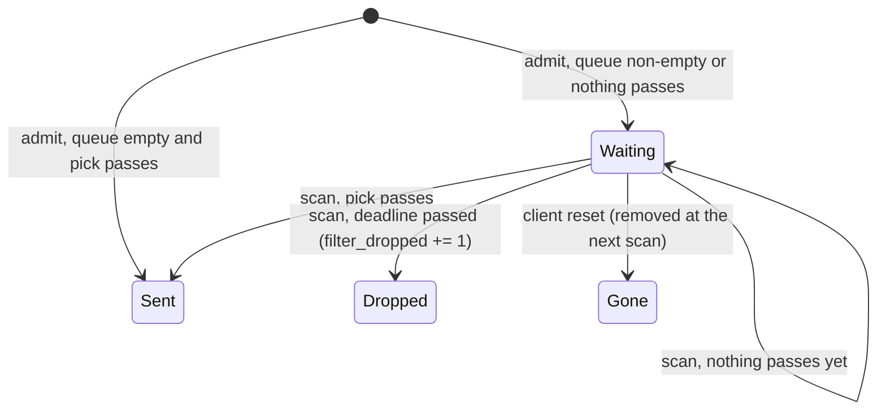

# Load Balancer — Design

`B` is the number of backends. All counters are atomic u64, incremented and decremented with relaxed ordering.
Each backend's `ewma_latency_ns` is an atomic u64 holding the bits of an IEEE-754 binary64 value
([EwmaLatency](#ewmalatency)), and so is its `ewma_exec_ns` ([EwmaExecTime](#ewmaexectime)). `stats_snapshot` runs after every forward has ended or been abandoned, so its loads
are final. `monotonic_now_ns()` is the Ingress's monotonic clock ([../design.md#time-base](../design.md#time-base)).

## LoadBalancer

```
lb = { policy, filter: lb_filter, beta: ewma_beta, monitor: HeartbeatMonitor or none,   # BackendLiveness
       filter_dropped: atomic u64 = 0,                                     # DeadlineFilter drops
       stats: array[B] of BackendStats (counters 0, ewma_latency_ns = EWMA_INITIAL_LATENCY_NS,
                                        ewma_exec_ns = bits of EXEC_NO_SAMPLE,
                                        worker_count = 0),                 # WorkerCount; 0: not known yet
       rr: atomic u64 = 0,
       rng: rng_new(derive_seed(seed, STREAM_INGRESS_LB, 0)), rng_lock: mutex,
       log: list of ForwardRecord (empty), log_lock: mutex,                     # ForwardLog
       picks: list of PickRecord (empty) }                                      # PickLog, also under log_lock

function pick(lb, remaining_ns, attempt, record = true):   # remaining_ns: i64 or none (the request's time to its deadline);
                                                     # attempt: LbRetries before this one (0 for the first);
                                                     # record: false for a FilterWaitQueue re-check
    if record: record_pick(lb)                       # PickLog: what the choice below is about to see
    s = choose(lb, remaining_ns)                     # LbPolicy over the DeadlineFilter's set
    if s is Dropped:
        return Dropped                               # no counter changes; no finish follows (callers count)
    lb.stats[s].outstanding.fetch_add(1)
    lb.stats[s].forwarded.fetch_add(1)
    return ForwardTicket(server_id = s, start_ns = monotonic_now_ns(), attempt = attempt)

function finish(lb, ticket, outcome, exec_ns, worker_count):   # exec_ns, worker_count: from the answer, or none
    s = ticket.server_id
    if outcome in {ok, rejected} and worker_count is not none:
        lb.stats[s].worker_count.store(worker_count)  # the backend's latest WorkerCount
    lb.stats[s].outstanding.fetch_sub(1)
    lb.stats[s][outcome].fetch_add(1)                # ok | rejected | bad_request | bad_gateway | reset
    end_ns = monotonic_now_ns()
    latency_ns = end_ns - ticket.start_ns
    if outcome == ok:
        e = ewma_update(lb, s, latency_ns)           # EwmaLatency after this sample
    else:
        e = binary64_from_bits(lb.stats[s].ewma_latency_ns.load())
    if outcome in {ok, rejected} and exec_ns is not none:
        x = ewma_exec_update(lb, s, exec_ns)         # EwmaExecTime after this sample
    else:
        x = exec_value(lb, s)                        # unchanged; none before the first sample
    with lb.log_lock:
        lb.log.append(ForwardRecord(end_ns, s, outcome, latency_ns, e,
                                    exec_ns if outcome in {ok, rejected} else none, x, ticket.attempt))   # ForwardLog
```

`outstanding` is incremented in `pick`, not when the forward actually starts, so the next `pick` already sees the
load it is about to add. That narrows, but does not close, the race described below.

## ForwardTicket

- `start_ns` is read in `pick` after the counters are incremented, so the latency covers the upstream connection,
  the backend's work and the response, and excludes the choice itself.
- `attempt` is passed through untouched: `pick` stores it, the ForwardRecord copies it. Each LbRetry has its own
  ticket, so every attempt is picked, counted in `outstanding` and finished on its own.
- `finish` reads the clock once, after the counters. The latency is `now - start_ns` as unsigned 64-bit; the clock
  is monotonic, so it is never negative.
- The ticket is a plain value: the LoadBalancer keeps no per-forward state, and a lost ticket only loses a sample.

## EwmaLatency

```
function ewma_update(lb, s, sample_ns):              # sample_ns: u64
    x = float(sample_ns)                             # binary64, round to nearest
    loop:
        old_bits = lb.stats[s].ewma_latency_ns.load()
        old = binary64_from_bits(old_bits)
        new = old * lb.beta + x * (1 - lb.beta)      # binary64, evaluated left to right, round to nearest
        if lb.stats[s].ewma_latency_ns.compare_and_swap(old_bits, bits_of(new)): return new
```

- **Which samples.** Only forwards that end `ok` (a `202` relayed) are samples. `rejected`, `bad_request`,
  `bad_gateway` and `reset` leave the EwmaLatency unchanged: a fast `503` or a failed dial would make a busy or dead
  backend look fast, and a reset forward has no complete response time.
- **Every policy.** The update runs under every LbPolicy, so the summary's `ewma_latency_ns` is meaningful for all of
  them. Only `ewma` reads it to choose.
- **Start value.** `EWMA_INITIAL_LATENCY_NS = 1_000_000`, not 0, so that `ewma` compares `outstanding + 1` between
  backends without samples instead of seeing every score as 0.
- **Range.** `0 <= beta <= 1`. `beta = 0` keeps only the newest sample. `beta = 1` never changes the start value,
  which makes `ewma` compare `outstanding` alone on the power_of_two pair.
- **Concurrent updates.** The compare-and-swap loop applies each sample exactly once. When several finish at once,
  they apply in the order the compare-and-swaps succeed, which depends on timing. No lock is taken.
- **Returned value.** `ewma_update` returns the value it stored, which is the EwmaLatency right after this sample
  even if another sample lands a moment later. `finish` puts it in the ForwardRecord.

## EwmaExecTime

Per backend, the **EwmaExecTime** is an exponentially weighted moving average of the ExecutionTimes the backend
reported in its ExecReports ([../../protocol/design.md#execreport](../../protocol/design.md#execreport)). It uses
the same `beta` as the EwmaLatency. No LbPolicy reads it yet.

```
EXEC_NO_SAMPLE = the binary64 quiet NaN with bits 0x7FF8000000000000    # "no sample yet"

function ewma_exec_update(lb, s, sample_ns):         # sample_ns: u64
    x = float(sample_ns)                             # binary64, round to nearest
    loop:
        old_bits = lb.stats[s].ewma_exec_ns.load()
        if old_bits == bits_of(EXEC_NO_SAMPLE):
            new = x                                  # the first sample is the average
        else:
            old = binary64_from_bits(old_bits)
            new = old * lb.beta + x * (1 - lb.beta)  # binary64, evaluated left to right, round to nearest
        if lb.stats[s].ewma_exec_ns.compare_and_swap(old_bits, bits_of(new)): return new

function exec_value(lb, s):                          # binary64 or none
    bits = lb.stats[s].ewma_exec_ns.load()
    return none if bits == bits_of(EXEC_NO_SAMPLE) else binary64_from_bits(bits)
```

- **Which samples.** Forwards that end `ok` or `rejected` and whose relayed body carried a valid `exec_ns`. A `503`
  is a sample here, unlike for the EwmaLatency: its ExecutionTime is the work the backend really did before the
  cancel. `bad_request`, `bad_gateway` and `reset` have no ExecReport.
- **Start value.** None, not a guess: the first sample becomes the average. A stored binary64 is never NaN (samples
  are finite and `beta` is in `[0, 1]`), so the sentinel cannot collide with a value.
- **Concurrency** is as for the EwmaLatency: a lock-free compare-and-swap loop that applies each sample once.

## EwmaScore

```
function ewma_score(lb, s):                          # binary64
    o = lb.stats[s].outstanding.load()
    e = binary64_from_bits(lb.stats[s].ewma_latency_ns.load())
    return float(o + 1) * e
```

`+ 1` counts the forward that is about to be added, so a backend with nothing in progress is still scored by its
latency. `o` and `e` are read separately and may change between the two loads; the score is a heuristic and the
race is accepted, as for the other counters.

## LbPolicy

```
function choose(lb, remaining_ns):
    L = [ s for s in 0 ..= B-1 if heartbeat_monitor.is_live(lb.monitor, s) ]     # LiveSet, in id order
    if L is empty: L = [0 ..= B-1]                   # every backend silent: use them all, as without a monitor
    if lb.filter != none and remaining_ns is not none:
        L = deadline_filter(lb, L, remaining_ns)     # DeadlineFilter
        if L is empty: return Dropped
    n = len(L)
    if n == 1: return L[0]                           # every policy; no random draw, no counter change
    match lb.policy:
        round_robin:
            return L[lb.rr.fetch_add(1) mod n]       # u64 counter: cannot wrap in any realistic run
        least_outstanding:
            best = L[0]
            for s in L[1 ..= n-1]:
                if outstanding[s].load() < outstanding[best].load(): best = s      # strict <: ties go to lower id
            return best
        power_of_two:
            (a, b) = random_pair(lb, L)
            return b if outstanding[b].load() < outstanding[a].load() else a       # ties go to lower id
        ewma:
            (a, b) = random_pair(lb, L)
            return b if ewma_score(lb, b) < ewma_score(lb, a) else a               # EwmaScore; ties go to lower id

function random_pair(lb, L):                         # two different members of L (n >= 2), a < b
    n = len(L)
    with lb.rng_lock:
        i = uniform_int(lb.rng, 0, n-1)
        j = uniform_int(lb.rng, 0, n-2)
    if j >= i: j = j + 1                             # j is uniform over the n-1 positions other than i
    return (L[min(i, j)], L[max(i, j)])              # L is in id order, so a < b
```

- **LiveSet.** `L` holds the backends the Heartbeat Monitor reports live
  ([../heartbeat_monitor/design.md#backendliveness](../heartbeat_monitor/design.md#backendliveness)). Without a
  monitor every backend is live, so `L = [0 ..= B-1]` and every policy is exactly as before: same choices, same
  draws, same counter. A dead backend gets no new forwards; forwards already in progress on it are left alone and
  end as they would have. When no backend is live, `L` falls back to all of them, so requests still go somewhere.
  `L` is read once per pick; a backend that changes state during the pick is seen in either state.
- **Concurrent picks race.** Two picks at the same moment may read the same counters and choose the same backend.
  That is accepted: the policies are heuristics, and the counters correct themselves on the next pick. No lock is
  taken around the read and the increment.
- **Reproducibility.** `round_robin` and `least_outstanding` use no randomness. `power_of_two` and `ewma` draw two
  numbers per pick (when `B > 1`), in pick order; with concurrent clients the pick order, and so the
  draw-to-request assignment, depends on timing. `ewma` also depends on measured latencies, so its choices are not
  reproducible across runs even with one client.
- `least_outstanding` reads each counter once per comparison; the counters may change during the scan. The
  result is the minimum among the values seen.

## DeadlineFilter

With `lb_filter` other than `none`, each request is only sent to a backend expected to finish it before its
RequestDeadline. The Frontend passes the request's time left, `remaining_ns`
([../frontend/design.md#forwardtask](../frontend/design.md#forwardtask)); `choose` keeps from the LiveSet the
backends that pass the **DeadlineStrategy** named by `lb_filter`, and the LbPolicy then chooses among them exactly as
it would among `L`. Everything but the per-backend test is shared by the strategies.

| `lb_filter` (DeadlineStrategy) | Keep backend `s` if | Character |
|---|---|---|
| `deadline_mean` | `(n + 1) × e <= T` | mean wait as if the backend ran one request at a time: about `k` times too pessimistic |
| `deadline_mean_per_worker` | `(n + 1) × e / k <= T` | mean wait with `k` workers draining the queue |
| `deadline_mean_queue_plus_share` | `(n + 1/k) × e <= T` | each request ahead at a full service time, the request's own at `1/k` of one |
| `deadline_mmk` | `Pr(t > T \| N = n) <= DEADLINE_FILTER_MISS` | M/M/k on-time probability `>= 0.99` (see [Model](#model)) |

`n`, `k`, `e` and `T` are as defined in the [Model](#model): `outstanding`, `max(WorkerCount, 1)`, EwmaExecTime and
`remaining_ns`.

### Model

Each backend is an M/M/k queue seen by the LoadBalancer, with:

| Symbol | Value | Source |
|---|---|---|
| `n` | `outstanding` of the backend at pick time: this Ingress's forwards in progress there (queued or running) | BackendStats |
| `k` | `max(worker_count, 1)`: requests the backend runs at once | WorkerCount ([../../protocol/design.md#workercount](../../protocol/design.md#workercount)) |
| `e` | EwmaExecTime, in ns: the mean service time, so `μ = 1/e` | [EwmaExecTime](#ewmaexectime) |
| `T` | `remaining_ns`: the request's time left | Frontend |

The quantity is the **conditional** probability `Pr(t <= T | N = n)` that the request's completion time `t` (its wait
plus its own service) is within `T`, given the `n` requests seen ahead of it. It is not the stationary M/M/k
response-time distribution, which averages over `N` and needs the arrival rate.

- **Given `N = n`.** Service is exponential, hence memoryless: every request in service has an `Exp(μ)` remainder,
  however long it has already run, so nothing else about the past matters. If `n < k` a worker is free and the wait
  `W` is 0. Otherwise all `k` workers are busy and the request starts after `m = n - k + 1` departures; while all
  are busy, departures form a Poisson process of rate `kμ`, so `W ~ Erlang(m, kμ)`. Later arrivals do not delay it
  (FIFO). Its own service `S ~ Exp(μ)` is independent, and `t = W + S`.
- **Late probability.** With `x = μT = T / e` and `Q(m, y) = Σ_{i=0}^{m-1} e^{-y} y^i / i!` (the probability that
  a Poisson(y) variable is `< m`, which equals `Pr(Erlang(m, rate) > y / rate)`):

| Case | `Pr(t > T \| N = n)` |
|---|---|
| `T <= 0` | 1 (already late) |
| `n < k` | `e^{-x}` (only the service) |
| `n >= k`, `k = 1` | `Q(m + 1, x)`: `W + S` is `Erlang(m + 1, μ)` |
| `n >= k`, `k >= 2` | `Q(m, kx) + e^{-x} (k / (k-1))^m (1 - Q(m, (k-1)x))` |

  The last row: `Pr(W + S > T) = Pr(W > T) + ∫_0^T f_W(w) e^{-μ(T-w)} dw`, with
  `f_W(w) = (kμ)^m w^{m-1} e^{-kμw} / (m-1)!`. The integral is
  `e^{-μT} (kμ)^m / (m-1)! ∫_0^T w^{m-1} e^{-(k-1)μw} dw = e^{-μT} (k/(k-1))^m Pr(Erlang(m, (k-1)μ) <= T)`.
  This derivation is argued here, not machine-checked; the worked example below was checked against direct numerical
  integration (agreeing to 50 digits) and a Monte Carlo of 10^6 samples per case.
- **Estimates, not truths.** `μ = 1/e` plugs the EwmaExecTime in as the true mean service time; its own uncertainty is
  not modeled, so 0.99 is a probability under the fitted model. `n` counts this Ingress's forwards, which include
  requests still in transit and superseded RequestCopies the server is still running, so it is the server's `N` only
  approximately. The order is FIFO; under the `edf` QueueDiscipline a request may overtake or be overtaken, and the
  law is an approximation.

### Filter

```
DEADLINE_FILTER_CONFIDENCE = 0.99
DEADLINE_FILTER_MISS       = 0.01            # 1 - DEADLINE_FILTER_CONFIDENCE, written as its own constant

function deadline_filter(lb, L, remaining_ns):      # L in id order -> sublist of L, in id order
    F = []
    for s in L:
        e = exec_value(lb, s)                        # EwmaExecTime, binary64 or none
        if e is none: F.append(s); continue          # no ExecutionTime sample yet: eligible
        n = lb.stats[s].outstanding.load()
        k = max(lb.stats[s].worker_count.load(), 1)  # WorkerCount; not known yet: 1
        T = float(remaining_ns)                      # i64 -> binary64, round to nearest
        match lb.filter:                             # DeadlineStrategy
            deadline_mean:            keep = float(n + 1) * e <= T
            deadline_mean_per_worker: keep = float(n + 1) * e / float(k) <= T    # left to right, each step rounded
            deadline_mean_queue_plus_share: keep = float(n) * e + e / float(k) <= T   # each product/quotient rounded, then the sum
            deadline_mmk:             keep = late_probability(n, k, e, T) <= DEADLINE_FILTER_MISS
        if keep: F.append(s)
    return F

function late_probability(n, k, e, T):               # binary64 throughout; -> Pr(t > T | N = n) in [0, 1]
    if T <= 0: return 1
    x = T / e
    if n < k: return exp(-x)
    m = n - k + 1
    if k == 1: return poisson_lower_sum(m + 1, x)
    a = poisson_lower_sum(m, k * x)
    log_b = -x + m * log1p(1 / (k - 1)) + log_poisson_upper(m, (k - 1) * x)   # ln of e^{-x} (k/(k-1))^m (1 - Q)
    return min(a + exp(log_b), 1)

function poisson_lower_sum(m, y):                    # Q(m, y), m >= 1, y > 0
    s = 0
    for i in 0 ..= m-1:                              # in increasing i
        s = s + exp(-y + i * ln(y) - lgamma(i + 1))  # each Poisson term computed in log space
    return min(s, 1)

function log_poisson_upper(m, y):                    # ln(1 - Q(m, y)), m >= 1, y > 0
    if y < m:                                        # lower regularized gamma series: no cancellation
        t = 1; s = 1; j = 1
        loop:
            t = t * y / (m + j); s = s + t; j = j + 1
            if t < 1e-17 * s: break
        return -y + m * ln(y) - lgamma(m + 1) + ln(s)
    q = poisson_lower_sum(m, y)
    return log1p(-q) if q < 1 else -infinity        # then exp(log_b) = 0
```

- **Numerics.** Every Poisson term and the `(k/(k-1))^m` factor are formed in log space, so no intermediate overflows
  or underflows even for `n` in the thousands. `1 - Q(m, y)` is never formed by subtraction when it is small (`y < m`);
  computing it as `1 - Q` there loses everything (e.g. `n = 1000`, `k = 2`, `e = 10 ms`, `T = 5 s` needs
  `1 - Q(999, 500) ≈ e^{-196}`, multiplied by `2^999`). Each product inside a sum is rounded on its own (no fused
  multiply-add). Implementations must agree with the worked example to a relative `1e-12`.
- **No backend passes.** When no backend of `L` passes, `pick` returns `Dropped`; no backend is contacted and no
  BackendStats counter, ForwardRecord or `finish` follows. For a first attempt the request then **waits** in the
  [FilterWaitQueue](#filterwaitqueue), which re-checks it every 10 ms and drops it only once its RequestDeadline has
  passed. A request whose deadline has already passed (`remaining_ns <= 0`) passes nowhere.
- **Off.** With `lb_filter = none`, or a request without a RequestDeadline (`remaining_ns` none), `L` is used as
  before: same choices and same random draws.
- **Races.** `outstanding`, WorkerCount and EwmaExecTime are read without a lock and may change during the scan, as
  for EwmaScore; the filter is a heuristic.

Worked example, `e = 200_000_000` ns (`μ = 5/s`), `T = 5_000_000_000` ns (`x = 25`); `Pr(late)` to 17 significant
digits:

| `k` | `n` | `m` | `Pr(t > T \| N = n)` | Eligible (`<= 0.01`) |
|---|---|---|---|---|
| 10 | 0 | — | 1.3887943864964040e-11 (`e^{-25}`) | yes |
| 10 | 9 | — | 1.3887943864964040e-11 | yes |
| 10 | 10 | 1 | 1.5431048738848933e-11 | yes |
| 10 | 50 | 41 | 1.0439869390746449e-9 | yes |
| 10 | 150 | 141 | 3.9304667021466753e-5 | yes |
| 10 | 200 | 191 | 0.0075996341805018727 | yes |
| 10 | 202 | 193 | 0.0093662549934202290 | yes: the largest admitted `n` |
| 10 | 203 | 194 | 0.010395504157208201 | no |
| 10 | 220 | 211 | 0.057518866812073766 | no |
| 1 | 0 | — | 1.3887943864964040e-11 | yes |
| 1 | 10 | 10 | 0.00058646162975308126 | yes |
| 1 | 13 | 13 | 0.0064674843658217432 | yes: the largest admitted `n` |
| 1 | 14 | 14 | 0.012402060718900588 | no |

Other cases: `T <= 0` gives 1 (dropped); a backend without an EwmaExecTime sample is eligible; WorkerCount 0
(unknown) is treated as `k = 1`; `lb_filter = none` or no RequestDeadline uses `L`.

Worked example of the three mean strategies, `B = 2`, both live, `e = 140_000_000` ns for both,
`outstanding = (10, 40)`, WorkerCount `(10, 10)`; the waits are `(n + 1) × e = (1_540_000_000, 5_740_000_000)`,
divided by `k` `(154_000_000, 574_000_000)`, and `n × e + e / k = (1_414_000_000, 5_614_000_000)`, all exact in
binary64:

| `remaining_ns` | `deadline_mean` keeps | `deadline_mean_per_worker` keeps | `deadline_mean_queue_plus_share` keeps |
|---|---|---|---|
| 6_000_000_000 | [0, 1] | [0, 1] | [0, 1] |
| 3_000_000_000 | [0] | [0, 1] | [0] |
| 1_540_000_000 | [0] (`<=`: exactly fits) | [0, 1] | [0] |
| 1_414_000_000 | [] | [0, 1] | [0] (`<=`: exactly fits) |
| 1_000_000_000 | [] (`Dropped`) | [0, 1] | [] |
| 500_000_000 | [] | [0] | [] |
| 154_000_000 | [] | [0] (`<=`) | [] |
| 100_000_000 | [] | [] | [] |

**Admit edges compared**, at `e = 200 ms`, `T = 5 s`: `deadline_mean` keeps `n <= 24` whatever `k` is;
`deadline_mean_queue_plus_share` keeps `n <= 24` at `k = 10` (`n <= T/e - 1/k = 24.9`) and at `k = 1`;
`deadline_mean_per_worker` keeps `n <= 249` at `k = 10` (`n <= 24` at `k = 1`); `deadline_mmk` keeps `n <= 202` at
`k = 10` and `n <= 13` at `k = 1`, stricter than the per-worker mean because it bounds the tail, not the mean.

## FilterWaitQueue

A first attempt that no backend passes under the DeadlineFilter waits here instead of being dropped. Every
`FILTER_QUEUE_TICK_MS` the queue re-checks its requests with the same `pick` (LiveSet, DeadlineFilter, LbPolicy) and
sends those that now fit; a request still waiting once its RequestDeadline has passed is dropped.

```
FILTER_QUEUE_TICK_MS = 10

wq = { waiting: FIFO of WaitEntry, lock: mutex,
       queued: u64, sent_from_queue: u64, dropped: u64, max_len: u64 }      # summary counters
WaitEntry = { deadline: u64 (Unix ns), state: waiting | sent(ticket) | dropped | gone, signal: one-shot }

function admit(lb, deadline):                        # attempt 0; deadline: RequestDeadline or none
    -> Sent(ticket) | Wait(entry)
    if lb.filter == none or deadline is none:
        return Sent(pick(lb, none, 0))               # never filtered, so never Dropped
    with wq.lock:
        if wq.waiting is empty:
            t = pick(lb, deadline - wall_clock_unix_ns(), 0)
            if t is not Dropped: return Sent(t)
        e = WaitEntry(deadline, state = waiting)     # FIFO: behind every request already waiting
        wq.waiting.push_back(e); wq.queued += 1
        return Wait(e)

procedure scan(lb):                                  # every FILTER_QUEUE_TICK_MS while lb.filter != none
    with wq.lock:
        wq.max_len = max(wq.max_len, len(wq.waiting))
        for e in wq.waiting, oldest first:
            if e.state == gone: remove e; continue                    # its client reset the stream
            remaining = e.deadline - wall_clock_unix_ns()             # exact signed, saturated to i64
            if remaining <= 0:                                        # past its SLO
                e.state = dropped; wq.dropped += 1; remove e; e.signal.set(); continue
            t = pick(lb, remaining, 0, record = false)                # a failed re-check writes no PickRecord
            if t is not Dropped:
                e.state = sent(t); wq.sent_from_queue += 1; remove e; e.signal.set()
            # else: stays in place; younger entries are still tried
```

- **FIFO admission.** A newcomer joins behind a non-empty queue even if a backend would pass it now, so it never
  overtakes a waiting request at admission. Inside a scan every entry is tried, oldest first; a younger entry (more
  time left) may be sent while an older one still does not fit.
- **Load is seen at once.** A request sent from the queue increments its backend's `outstanding` in `pick` before the
  next entry is tried, so later entries see it.
- **Waiting counts.** The time spent waiting is part of the client's latency and shrinks `remaining_ns`; the LbRetry
  `timeout` counts from the attempt's `pick`, after the wait.
- **Counters (summary).** `filter_queued`: requests that waited; `filter_sent_from_queue`: those later sent;
  `filter_dropped`: those dropped past their deadline; `filter_queue_max`: the longest queue a scan saw. `pick` itself
  counts nothing.
- **Off.** With `lb_filter = none`, or a request without a RequestDeadline, nothing waits and no scanner runs.
- **Concurrency.** `wq.lock` is held for one admission or one whole scan. `admit` holding it for its `pick` keeps
  newcomers from overtaking a scan in progress.



Worked example, `deadline_mean`, one backend, `e = 200 ms`, `outstanding = 24` throughout except as stated, so
`(n + 1) × e = 5 s`; times in ms, every request has a 5 s SLO:

| Time | Event | Queue after | Result |
|---|---|---|---|
| 0 | A arrives, 5000 left: `5000 <= 5000` passes | [] | A sent |
| 1 | B arrives (n = 25), 4999 left: `5200 > 4999` | [B] | B waits |
| 2 | C arrives with 5000 left; queue non-empty | [B, C] | C waits (FIFO), not tried |
| 10 | scan: n = 25, B (4990 left) and C (4992 left) fail | [B, C] | — |
| 300 | two forwards finish, n = 23; scan: B `4800 <= 4701`? no; C `4800 <= 4702`? no | [B, C] | both wait |
| 600 | n = 21; scan: B `4400 <= 4401` yes, sent (n = 22); C `4600 <= 4402` no | [C] | B sent; C still waits |
| 5002 | C still not sent; remaining 0 | [] | C dropped past its SLO, `503` |

## PickLog

The **PickLog** records, at every `pick` (forwarded or dropped), what the LoadBalancer sees of every backend, so the
DeadlineFilter's inputs can be plotted over time.

```
function record_pick(lb):
    t = monotonic_now_ns()
    rows = [ PickRecord(t, s, lb.stats[s].outstanding.load(), exec_value(lb, s), lb.stats[s].worker_count.load())
             for s in 0 ..= B-1 ]                     # every backend, live or not, in id order
    with lb.log_lock:
        lb.picks.extend(rows)

function pick_log(lb):                               # -> list of PickRecord, in append order
    with lb.log_lock:
        return copy of lb.picks
```

- **When.** Before `choose`, so `outstanding` excludes the request being placed: `(outstanding + 1) × EwmaExecTime`
  is the mean-based expected time to completion this request would face on that backend, and `outstanding`,
  WorkerCount and EwmaExecTime are the DeadlineFilter's `n`, `k` and `e`. Every policy and every `lb_filter` value
  records, so the log is comparable across runs.
- **Reads.** The loads are separate from those of `choose`, a few nanoseconds earlier; another pick may change a
  counter in between. The log describes the state, it does not replay the decision exactly.
- **Memory and lock.** `B` records per `/ping`, kept until shutdown (a 120 s run at 70 req/s with 2 backends is
  about 17_000 records). `log_lock` is held for one append of `B` records, as for the ForwardLog, and never nests.

Worked example, `B = 2`, backend 1 without an ExecutionTime sample yet, a pick at `t = 1_000`:

| `t_ns` | `server_id` | `outstanding` | `ewma_exec_ns` | `worker_count` | `(outstanding + 1) × ewma_exec_ns` |
|---|---|---|---|---|---|
| 1_000 | 0 | 12 | 140_000_000 | 10 | 1_820_000_000 |
| 1_000 | 1 | 0 | none | 0 | — (no sample) |

## ForwardLog

```
function forward_log(lb):                            # -> list of ForwardRecord, in append order
    with lb.log_lock:
        return copy of lb.log
```

- **One record per `finish`**, for every outcome and every policy, appended in the order the appends take the
  lock. A forward abandoned at shutdown never calls `finish` and has no record.
- **Fields.** `end_ns` is the monotonic time `finish` read, `latency_ns = end_ns - start_ns`, and
  `ewma_latency_ns` is the backend's EwmaLatency after this finish: the value `ewma_update` stored for `ok`, or the
  value read for the other outcomes, which do not change it. `exec_ns` is the ExecutionTime the backend reported
  (none unless `ok` or `rejected`), and `ewma_exec_ns` is the backend's EwmaExecTime after this finish (none before
  its first sample).
- **Lock.** `log_lock` is held only for one append or one copy, and never nests with another lock. The Ingress's
  concurrency model allows it ([../design.md#concurrency-model](../design.md#concurrency-model)).
- **Memory.** The log grows by one record per forward for the whole run, and is kept in memory until shutdown. A
  30 s run at 4000 forwards/s is 120000 records.
- `forward_log` is called by the Ingress's shutdown after it waited for the forwards in progress. The copy makes
  it safe even if an abandoned forward finishes during the write.

## Worked examples

`round_robin`, `B = 2`: picks return `0, 1, 0, 1, …` (rr = 0, 1, 2, 3, …).

`least_outstanding`, `B = 3`:

| `outstanding` before | Choice | Why |
|---|---|---|
| (0, 0, 0) | 0 | all tied: lowest id |
| (1, 0, 0) | 1 | 0 < 1; tie between 1 and 2 goes to 1 |
| (1, 1, 0) | 2 | strictly smallest |
| (2, 1, 1) | 1 | tie between 1 and 2 goes to 1 |

`power_of_two`, `B = 3`, `outstanding = (2, 0, 1)`:

| draws `(i, j)` | `j` after skip | Pair `(a, b)` | Choice | Why |
|---|---|---|---|---|
| (0, 0) | 1 | (0, 1) | 1 | 0 < 2 |
| (2, 1) | 1 | (1, 2) | 1 | 0 < 1 |
| (0, 1) | 2 | (0, 2) | 2 | 1 < 2 |
| (2, 0) | 0 | (0, 2) | 2 | 1 < 2 |

`ewma_update`, binary64 (`1 - 0.7` is `0.30000000000000004`; every result below is exact after rounding):

| `old` (ns) | `sample_ns` | `beta` | `new` (ns) | Check |
|---|---|---|---|---|
| 1_000_000 | 2_000_000 | 0.7 | 1_300_000 | 700_000 + 600_000 |
| 1_000_000 | 500_000 | 0.7 | 850_000 | 700_000 + 150_000 |
| 1_000_000 | 0 | 0.7 | 700_000 | 700_000 + 0 |
| 1_300_000 | 1_300_000 | 0.7 | 1_300_000 | a sample equal to the average leaves it unchanged |
| 1_000_000 | 3_000_000 | 0.5 | 2_000_000 | 500_000 + 1_500_000 |
| 1_000_000 | 3_000_000 | 0 | 3_000_000 | `beta = 0`: newest sample only |
| 1_000_000 | 3_000_000 | 1 | 1_000_000 | `beta = 1`: never changes |

`ewma`, `B = 3`, `outstanding = (2, 0, 1)`, `ewma_latency_ns = (1_000_000, 4_000_000, 1_500_000)`, so the
EwmaScores are `(3 × 1_000_000, 1 × 4_000_000, 2 × 1_500_000) = (3_000_000, 4_000_000, 3_000_000)`:

| draws `(i, j)` | `j` after skip | Pair `(a, b)` | Choice | Why |
|---|---|---|---|---|
| (0, 0) | 1 | (0, 1) | 0 | 3_000_000 < 4_000_000; `power_of_two` would choose 1 |
| (2, 1) | 1 | (1, 2) | 2 | 3_000_000 < 4_000_000 |
| (0, 1) | 2 | (0, 2) | 0 | 3_000_000 = 3_000_000: tie goes to lower id |
| (2, 0) | 0 | (0, 2) | 0 | same pair, same tie |

`ewma` at start, `B = 3`, `outstanding = (0, 0, 0)`, every `ewma_latency_ns = 1_000_000`: every score is
`1 × 1_000_000`, so every pair is a tie and the choice is its lower id. With `outstanding = (0, 1, 0)` and draws
`(0, 0)`: pair `(0, 1)`, scores `1_000_000 < 2_000_000`, choice 0.

ForwardLog, `ewma_beta = 0.7`, one backend starting at `1_000_000`, three forwards:

| `start_ns` | `end_ns` | outcome | `latency_ns` | `ewma_latency_ns` in the record | Check |
|---|---|---|---|---|---|
| 100 | 2_000_100 | `ok` | 2_000_000 | 1_300_000 | 1_000_000 × 0.7 + 2_000_000 × 0.3 |
| 200 | 300_200 | `rejected` | 300_000 | 1_300_000 | not a sample: unchanged |
| 300 | 500_300 | `ok` | 500_000 | 1_060_000 | 1_300_000 × 0.7 + 500_000 × 0.3 = 910_000 + 150_000 |

EwmaExecTime, `ewma_beta = 0.7`, one backend, in finish order:

| outcome | `exec_ns` given | `ewma_exec_ns` in the record | Check |
|---|---|---|---|
| `reset` | none | none | no sample yet |
| `ok` | 2_000_000 | 2_000_000 | first sample is the average |
| `rejected` | 1_000_000 | 1_700_000 | 2_000_000 × 0.7 + 1_000_000 × 0.3 = 1_400_000 + 300_000 |
| `bad_gateway` | none | 1_700_000 | not a sample: unchanged |
| `ok` | 500_000 | 1_340_000 | 1_700_000 × 0.7 + 500_000 × 0.3 = 1_190_000 + 150_000 |
| `ok` | none (old server, no ExecReport) | 1_340_000 | not a sample: unchanged |

`B = 1`: every policy returns 0 and draws nothing.

LiveSet, `B = 3`, backend 1 not live, so `L = [0, 2]` and `n = 2`:

| Policy | State | Draws `(i, j)` | Choice | Check |
|---|---|---|---|---|
| `round_robin` | rr = 0, 1, 2 | none | 0, 2, 0 | `L[0]`, `L[1]`, `L[2 mod 2]` |
| `least_outstanding` | `outstanding = (3, 0, 1)` | none | 2 | backend 1 is skipped although its 0 is smallest |
| `power_of_two` | `outstanding = (3, 0, 1)` | (0, 0) | 2 | `j` → 1; pair `(L[0], L[1]) = (0, 2)`; 1 < 3 |
| `ewma` | any | (1, 0) | — | pair `(L[0], L[1]) = (0, 2)`; the scores of 0 and 2 decide |
| any | only backend 2 live | none | 2 | `n = 1`: no draw |
| any | no backend live | as for `B = 3` | as without a monitor | `L = [0, 1, 2]` |

## Design specific to Go

Implementation: `implementation/go` (module `testbed`, Go 1.21, `golang.org/x/net v0.17.0`).
Build and test with `CGO_ENABLED=0 go build ./...` / `CGO_ENABLED=0 go test ./...`. On recent macOS the dynamic
loader rejects cgo-linked Go 1.21 binaries (missing `LC_UUID`), so cgo is disabled.

### Go choices

- LiveSet: `NewLoadBalancer(cfg, monitor)` keeps the `*HeartbeatMonitor` (nil without one; `IsLive` is nil-safe). `liveSet()` builds `L` as a `[]uint64` on every `choose` (at most `MAX_BACKENDS` entries). `randomPair(n)` draws over `len(L)`, and `twoChoice(L, i, j, less)` maps the drawn positions through `L`. `TestLiveSetWorkedExample` checks the LiveSet table, including the `n = 1` and none-live rows.
- File `internal/ingress/balancer.go`. BackendStats fields are `atomic.Int64` (`outstanding`) and `atomic.Uint64` (the rest); `ForwardOutcome` is an `int` enum.
- Floating point: `ewmaNext` writes `float64(old*beta) + float64(float64(sample)*(1-beta))`. The explicit conversions force each product to be rounded, because the Go spec lets the compiler fuse a multiply and an add into one FMA (it does on arm64), which would round once and break the design's per-operation rounding; the stored value and a recomputation could then differ (`TestForwardLog` failed intermittently).
- EwmaLatency is `BackendStats.EwmaBits atomic.Uint64` holding `math.Float64bits`; `ewmaUpdate` is a `Load`/`CompareAndSwap` loop around the pure function `ewmaNext(old, sampleNs, beta)` (`old*beta + float64(sampleNs)*(1-beta)`), so the update worked example is tested without concurrency.
- PickLog: `PickWithin` calls `recordPick()` first, which reads one `time.Now()` and, for every backend in id order, `Outstanding.Load()`, `execValue` and `WorkerCount.Load()` into a `PickRecord{T, ServerID, Outstanding, EwmaExecNs, HasEwmaExec, WorkerCount}`, then appends the `B` records to `LoadBalancer.picks` under `logMu` (the ForwardLog's mutex). `PickLog()` returns a copy. `TestPickLogWorkedExample` checks the worked example, that a dropped pick is recorded, and the copy.
- ForwardLog: `ForwardRecord{End time.Time; ServerID uint32; Outcome ForwardOutcome; LatencyNs uint64; EwmaLatencyNs float64}` appended to `LoadBalancer.log` under `logMu` (`sync.Mutex`) at the end of `Finish`. `Finish` reads `time.Now()` once after the counters and computes the latency with `end.Sub(t.Start)` (monotonic). `ewmaUpdate` returns the value it stored. `forward_log` is `(*LoadBalancer).ForwardLog()`, a copy made under the lock. Outcome words come from `outcomeNames`, indexed by the enum.
- DeadlineFilter: `pick(lb, remaining_ns)` is `PickWithin(remainingNs int64, hasDeadline bool) (ForwardTicket, bool)`; `ok == false` is `Dropped`. The old `Pick()` stays as the no-deadline case (`PickWithin(0, false)`), used by tests. `choose(remainingNs, hasDeadline)` builds the LiveSet, applies `deadlineFilter` when `filter == FilterDeadline` and there is a deadline, and hands the non-empty list to `policyChoice`, which is the former `choose` body (unchanged policies and draws). `deadlineFilter` switches on `lb.filter` (constants `FilterDeadlineMean`, `FilterDeadlineMeanPerWorker`, `FilterDeadlineMMK`; `choose` filters whenever `lb.filter != FilterNone`): `float64(float64(n+1)*e) <= T`, `float64(float64(float64(n+1)*e)/float64(k)) <= T` (each step rounded, no FMA), or `latePr(n, k, e, T) <= DeadlineFilterMiss`. `FilterDeadlineMeanQueuePlusShare` tests `float64(float64(float64(n)*e)+float64(e/float64(k))) <= T`. `TestDeadlineMeanStrategiesWorkedExample` checks the three mean strategies' table. For `deadline_mmk` it keeps a backend if `latePr(n, k, e, float64(remainingNs)) <= DeadlineFilterMiss`, with `n` the `Outstanding` load (clamped at 0), `k` the `WorkerCount` (`BackendStats.WorkerCount atomic.Uint64`, 0 read as 1) and `e` from `execValue`. `late_probability`, `poisson_lower_sum` and `log_poisson_upper` are `latePr`, `poissonLowerSum` and `logPoissonUpper`, using `math.Lgamma` (sign ignored: arguments are >= 1), `math.Log`, `math.Log1p`, `math.Exp`; every sum of products is wrapped in explicit `float64(...)` conversions so Go cannot fuse them into an FMA. The constants are `DeadlineFilterConfidence` and `DeadlineFilterMiss`. `TestLatePrWorkedExample` checks the design's table to 1e-12 relative, the `n = 1000`, `k = 2` lower-gamma case and `T <= 0`; `TestDeadlineFilterWorkedExample` the filter's choices, drops and no-draw pick. `Finish(t, outcome, execNs, hasExec, workers uint32)` stores `workers` when it is non-zero and the outcome is `ok` or `rejected`; the summary's `worker_count` is `BackendStatsValue.WorkerCount`. `filter_dropped` is an `atomic.Uint64` read by `FilterDropped()`. Tests call `chooseAny()` (no deadline). `TestDeadlineFilterWorkedExample` follows the design's table, plus a drop leaving every backend counter alone, the `n = 1` no-draw case, and `lb_filter = none`.
- EwmaExecTime is `BackendStats.ExecBits atomic.Uint64`, initialised to `execNoSampleBits = 0x7FF8000000000000` (EXEC_NO_SAMPLE). `ewmaExecUpdate` is the same `Load`/`CompareAndSwap` loop, storing `float64(sample)` when the old bits are the sentinel and `ewmaNext` otherwise; `execValue` returns `(value, ok)`. `Finish(t, outcome, execNs, hasExec)` samples only when `hasExec` and the outcome is `OutcomeOK` or `OutcomeRejected`, and records `ExecNs`/`HasExec` and `EwmaExecNs`/`HasEwmaExec` in the `ForwardRecord`. The summary's `BackendStatsValue.EwmaExecNs` is a `*float64`, nil (JSON `null`) before a sample. `TestEwmaExecTimeWorkedExample` follows the design's table and checks that a `bad_request` with an `exec_ns` is not a sample.
- `ForwardTicket` is `{ServerID uint32; Start time.Time}`. `time.Now()` carries Go's monotonic reading, and `time.Since(t.Start)` uses it, so the sample is never negative. The sample in ns is `uint64(time.Since(...).Nanoseconds())`.
- `round_robin` is `rr.Add(1) - 1` mod B. The `power_of_two` and `ewma` draws happen in `randomPair` under `rngMu`; mapping the draws to a backend is the pure function `twoChoice(i, j, less)`, where `less(b, a)` is the policy's comparison (`outstanding` or EwmaScore), so the worked examples are tested without randomness.
- Go 1.21 built-in `min`/`max` order the pair.
- Tests: `balancer_test.go` checks the worked example of every policy and of `ewmaNext`, that `B = 1` picks 0 without drawing, that `pick`/`finish` keep the counters, that only `ok` moves the EwmaLatency, and (`TestForwardLog`) the ForwardLog worked example: the values `ewmaUpdate` returns, one record per `Finish`, and that `ForwardLog` returns a copy.
- `pick(lb, remaining_ns, attempt)` is `PickAttempt(remainingNs, hasDeadline, attempt)`; `PickWithin(remainingNs, hasDeadline)` stays as attempt 0. `ForwardTicket.Attempt` is copied into `ForwardRecord.Attempt` by `Finish`.
- FilterWaitQueue: file `filterqueue.go`. `filterWaitQueue` (in `LoadBalancer.wq`) holds a slice of `*WaitEntry` and the four counters under one `sync.Mutex`; a WaitEntry's `signal` is a channel closed once by the scan that sends or drops it, and `Result(e)` reads its outcome. `Admit(deadline, hasDeadline)` returns a ticket or an entry; `Gone(e)` marks a waiting entry of a reset client. `scan` rebuilds the slice in place (`kept := waiting[:0]`), oldest first. The scanner is a `time.Ticker` of `FilterQueueTick` started by `Listen` (only when `lb_filter != none`) and stopped first thing in `Shutdown`. `PickAttempt` calls the internal `pick(…, record)`, which no longer counts drops; `FilterDropped()` reads the queue's `dropped`. Tests: `filterqueue_test.go` (wait then send, drop past the deadline, FIFO newcomer, no-deadline bypass, gone).

### Traceability

Generated from the `// Design:` tags in the code by `implementation/spec_tools/tracegen.py` (see `AGENTS.md`). Each link points at the first code line after the tag.
Regenerate from the repository root with `python3 implementation/spec_tools/tracegen.py --lang Go --ext .go --comment // --write`.

<!-- trace:begin -->
| Design subsection | Implementation (file:line) |
|---|---|
| [LoadBalancer](#loadbalancer) | [balancer.go:124](../../../implementation/go/internal/ingress/balancer.go#L124), [balancer.go:143](../../../implementation/go/internal/ingress/balancer.go#L143), [balancer.go:165](../../../implementation/go/internal/ingress/balancer.go#L165), [balancer.go:176](../../../implementation/go/internal/ingress/balancer.go#L176), [balancer.go:185](../../../implementation/go/internal/ingress/balancer.go#L185), [balancer.go:193](../../../implementation/go/internal/ingress/balancer.go#L193), [balancer.go:212](../../../implementation/go/internal/ingress/balancer.go#L212), [balancer.go:370](../../../implementation/go/internal/ingress/balancer.go#L370), [balancer_test.go:81](../../../implementation/go/internal/ingress/balancer_test.go#L81) |
| [ForwardTicket](#forwardticket) | [balancer.go:66](../../../implementation/go/internal/ingress/balancer.go#L66), [balancer.go:165](../../../implementation/go/internal/ingress/balancer.go#L165), [balancer.go:185](../../../implementation/go/internal/ingress/balancer.go#L185), [balancer.go:231](../../../implementation/go/internal/ingress/balancer.go#L231), [balancer_test.go:107](../../../implementation/go/internal/ingress/balancer_test.go#L107), [frontend.go:162](../../../implementation/go/internal/ingress/frontend.go#L162) |
| [EwmaLatency](#ewmalatency) | [balancer.go:40](../../../implementation/go/internal/ingress/balancer.go#L40), [balancer.go:296](../../../implementation/go/internal/ingress/balancer.go#L296), [balancer.go:310](../../../implementation/go/internal/ingress/balancer.go#L310), [balancer_test.go:107](../../../implementation/go/internal/ingress/balancer_test.go#L107), [balancer_test.go:129](../../../implementation/go/internal/ingress/balancer_test.go#L129) |
| [EwmaExecTime](#ewmaexectime) | [balancer.go:45](../../../implementation/go/internal/ingress/balancer.go#L45), [balancer.go:240](../../../implementation/go/internal/ingress/balancer.go#L240), [balancer.go:322](../../../implementation/go/internal/ingress/balancer.go#L322), [balancer.go:341](../../../implementation/go/internal/ingress/balancer.go#L341), [balancer_test.go:237](../../../implementation/go/internal/ingress/balancer_test.go#L237) |
| [EwmaScore](#ewmascore) | [balancer.go:352](../../../implementation/go/internal/ingress/balancer.go#L352), [balancer_test.go:158](../../../implementation/go/internal/ingress/balancer_test.go#L158) |
| [LbPolicy](#lbpolicy) | [balancer.go:387](../../../implementation/go/internal/ingress/balancer.go#L387), [balancer.go:518](../../../implementation/go/internal/ingress/balancer.go#L518), [balancer.go:548](../../../implementation/go/internal/ingress/balancer.go#L548), [balancer.go:567](../../../implementation/go/internal/ingress/balancer.go#L567), [balancer.go:579](../../../implementation/go/internal/ingress/balancer.go#L579), [balancer_test.go:34](../../../implementation/go/internal/ingress/balancer_test.go#L34), [balancer_test.go:45](../../../implementation/go/internal/ingress/balancer_test.go#L45), [balancer_test.go:61](../../../implementation/go/internal/ingress/balancer_test.go#L61), [balancer_test.go:158](../../../implementation/go/internal/ingress/balancer_test.go#L158), [config.go:26](../../../implementation/go/internal/ingress/config.go#L26), [heartbeat_test.go:63](../../../implementation/go/internal/ingress/heartbeat_test.go#L63) |
| [DeadlineFilter](#deadlinefilter) | [balancer.go:49](../../../implementation/go/internal/ingress/balancer.go#L49), [balancer.go:176](../../../implementation/go/internal/ingress/balancer.go#L176), [balancer.go:391](../../../implementation/go/internal/ingress/balancer.go#L391), [balancer.go:421](../../../implementation/go/internal/ingress/balancer.go#L421), [balancer.go:460](../../../implementation/go/internal/ingress/balancer.go#L460), [balancer.go:481](../../../implementation/go/internal/ingress/balancer.go#L481), [balancer.go:495](../../../implementation/go/internal/ingress/balancer.go#L495), [balancer_test.go:283](../../../implementation/go/internal/ingress/balancer_test.go#L283), [balancer_test.go:319](../../../implementation/go/internal/ingress/balancer_test.go#L319), [balancer_test.go:429](../../../implementation/go/internal/ingress/balancer_test.go#L429), [ingress_test.go:257](../../../implementation/go/internal/ingress/ingress_test.go#L257) |
| [FilterWaitQueue](#filterwaitqueue) | [filterqueue.go:29](../../../implementation/go/internal/ingress/filterqueue.go#L29), [filterqueue.go:40](../../../implementation/go/internal/ingress/filterqueue.go#L40), [filterqueue.go:52](../../../implementation/go/internal/ingress/filterqueue.go#L52), [filterqueue.go:81](../../../implementation/go/internal/ingress/filterqueue.go#L81), [filterqueue.go:95](../../../implementation/go/internal/ingress/filterqueue.go#L95), [filterqueue.go:130](../../../implementation/go/internal/ingress/filterqueue.go#L130), [filterqueue_test.go:36](../../../implementation/go/internal/ingress/filterqueue_test.go#L36), [filterqueue_test.go:68](../../../implementation/go/internal/ingress/filterqueue_test.go#L68), [filterqueue_test.go:91](../../../implementation/go/internal/ingress/filterqueue_test.go#L91) |
| [PickLog](#picklog) | [balancer.go:262](../../../implementation/go/internal/ingress/balancer.go#L262), [balancer.go:278](../../../implementation/go/internal/ingress/balancer.go#L278), [balancer_test.go:399](../../../implementation/go/internal/ingress/balancer_test.go#L399), [ingress_test.go:288](../../../implementation/go/internal/ingress/ingress_test.go#L288) |
| [ForwardLog](#forwardlog) | [balancer.go:252](../../../implementation/go/internal/ingress/balancer.go#L252), [balancer.go:287](../../../implementation/go/internal/ingress/balancer.go#L287), [balancer_test.go:204](../../../implementation/go/internal/ingress/balancer_test.go#L204) |
| [Worked examples](#worked-examples) | [balancer_test.go:34](../../../implementation/go/internal/ingress/balancer_test.go#L34), [balancer_test.go:45](../../../implementation/go/internal/ingress/balancer_test.go#L45), [balancer_test.go:61](../../../implementation/go/internal/ingress/balancer_test.go#L61), [balancer_test.go:129](../../../implementation/go/internal/ingress/balancer_test.go#L129), [balancer_test.go:158](../../../implementation/go/internal/ingress/balancer_test.go#L158), [balancer_test.go:204](../../../implementation/go/internal/ingress/balancer_test.go#L204), [heartbeat_test.go:63](../../../implementation/go/internal/ingress/heartbeat_test.go#L63) |
<!-- trace:end -->
