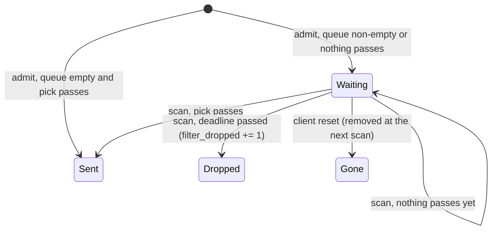

# Load Balancer — Design

`B` is the number of backends. All counters are atomic u64, incremented and decremented with relaxed ordering.
Each backend's `ewma_latency_ns` is an atomic u64 holding the bits of an IEEE-754 binary64 value
([EwmaLatency](#ewmalatency)), and so are its `ewma_exec_ns` ([EwmaExecTime](#ewmaexectime)) and its
`ewma_anti_exec_ns` ([EwmaAntiServiceTime](#ewmaantiservicetime)). `stats_snapshot` runs after every forward has ended or been abandoned, so its loads
are final. `monotonic_now_ns()` is the Ingress's monotonic clock ([../design.md#time-base](../design.md#time-base)).

## LoadBalancer

```
lb = { policy, filter: lb_filter, beta: ewma_beta, filter_margin: lb_filter_margin, monitor: HeartbeatMonitor or none,   # BackendLiveness
       filter_dropped: atomic u64 = 0,                                     # DeadlineFilter drops
       stats: array[B] of BackendStats (counters 0, ewma_latency_ns = EWMA_INITIAL_LATENCY_NS,
                                        ewma_exec_ns = bits of EXEC_NO_SAMPLE,
                                        ewma_anti_exec_ns = bits of EXEC_NO_SAMPLE,
                                        worker_count = 0),                 # WorkerCount; 0: not known yet
       rr: atomic u64 = 0,
       seq: atomic u64 = 0,                                                # TicketSeq source
       rng: rng_new(derive_seed(seed, STREAM_INGRESS_LB, 0)), rng_lock: mutex,
       log: list of ForwardRecord (empty), log_lock: mutex,                     # ForwardLog
       picks: list of PickRecord (empty),                                       # PickLog, also under log_lock
       peak: array[B] (PeakEwmaRtt), pending: array[B] (PendingStarts),         # lb_policy = peak_ewma only
       last_sent: array[B] of u64 = 0, probe_tau_ms: lb_probe_tau_ms,          # FilterProbe
       bucket: array[B] of TokenBucket,                                         # TokenBucketFilter (lb_filter = token_bucket)
       bbr: array[B] of BbrState,                                               # BbrFilter (lb_filter = bbr)
       last_fold_ns: u64 per Ingress worker = 0 }

function pick(lb, remaining_ns, attempt, record = true, exclude = none, avoid = {}):   # remaining_ns: i64 or none (the request's time to its deadline);
                                                     # attempt: LbRetries before this one (0 for the first);
                                                     # record: false for a FilterWaitQueue re-check
                                                     # exclude: a backend this pick must not choose (RetryElsewhere), or none
                                                     # avoid: backends to leave out unless that leaves none (HedgedForwarding)
    if record: record_pick(lb)                       # PickLog: what the choice below is about to see
    s = choose(lb, remaining_ns, exclude, avoid)     # LbPolicy over the DeadlineFilter's set
    if s is Dropped:
        return Dropped                               # no counter changes; no finish follows (callers count)
    n = lb.stats[s].outstanding.fetch_add(1)         # the value before this pick's increment
    lb.stats[s].forwarded.fetch_add(1)
    q = lb.seq.fetch_add(1)                          # TicketSeq: 0, 1, 2, ... in pick order
    return ForwardTicket(server_id = s, start_ns = monotonic_now_ns(), attempt = attempt,
                         seq = q, queue_at_send = max(n, 0),
                         estimate_ns = estimated_finish(lb, s, max(n, 0)))      # EstimatedFinish

function finish(lb, ticket, outcome, exec_ns, worker_count):   # exec_ns, worker_count: from the answer, or none
                                                                # -> sampled: boolean
    s = ticket.server_id
    if outcome in {ok, rejected} and worker_count is not none:
        lb.stats[s].worker_count.store(worker_count)  # the backend's latest WorkerCount
    lb.stats[s].outstanding.fetch_sub(1)
    lb.stats[s][outcome].fetch_add(1)                # ok | rejected | bad_request | bad_gateway | reset
    end_ns = monotonic_now_ns()
    latency_ns = end_ns - ticket.start_ns
    if outcome == ok:
        e = ewma_update(lb, s, latency_ns)           # EwmaLatency after this sample
    else:
        e = binary64_from_bits(lb.stats[s].ewma_latency_ns.load())
    sampled = outcome in {ok, rejected} and exec_ns is not none
    if sampled:
        x = ewma_exec_update(lb, s, exec_ns)         # EwmaExecTime after this sample
        for b in 0 ..= B-1 except s:
            ewma_anti_update(lb, b, exec_ns)         # EwmaAntiServiceTime of every other backend
    else:
        x = exec_value(lb, s)                        # unchanged; none before the first sample
    with lb.log_lock:
        lb.log.append(ForwardRecord(end_ns, s, outcome, latency_ns, e,
                                    exec_ns if outcome in {ok, rejected} else none, x, ticket.attempt,
                                    ticket.estimate_ns))                   # ForwardLog
    return sampled                                   # true: both EWMAs above took this sample
```

`outstanding` is incremented in `pick`, not when the forward actually starts, so the next `pick` already sees the
load it is about to add. That narrows, but does not close, the race described below.

## ForwardTicket

- `start_ns` is read in `pick` after the counters are incremented, so the latency covers the upstream connection,
  the backend's work and the response, and excludes the choice itself.
- `attempt` is passed through untouched: `pick` stores it, the ForwardRecord copies it. Each LbRetry has its own
  ticket, so every attempt is picked, counted in `outstanding` and finished on its own.
- `finish` reads the clock once, after the counters. The latency is `now - start_ns` as unsigned 64-bit; the clock
  is monotonic, so it is never negative.
- The ticket is a plain value: the LoadBalancer keeps no per-forward state, and a lost ticket only loses a sample.
- **TicketSeq.** `seq` is unique per Ingress run and increases in pick order (u64, starting at 0; it cannot wrap in a
  run). It names one attempt, even when several ForwardTasks share a RequestId (client RequestCopies).
- **QueueAtSend.** `queue_at_send` is the chosen backend's `outstanding` just before this pick's increment, clamped
  at 0: the `n` of the DeadlineFilter's `(n + 1) × e`, read atomically with the increment, so two concurrent picks of
  the same backend get different values. The LoadBalancer itself does not use it; the `anxious` RetryPolicy does
  ([../retry_policy/design.md#retrypolicyregistry](../retry_policy/design.md#retrypolicyregistry)).

## EstimatedFinish

At each pick the LoadBalancer records, on the ForwardTicket, the time it expects the forward to take: the
**EstimatedFinish** `(queue_at_send + 1) × EwmaExecTime / k` of the chosen backend, where `k` is its WorkerCount
(read as 1 while unknown, i.e. 0): the `deadline_mean` DeadlineFilter's `(n + 1) × e`, divided by the number of
requests the backend serves in parallel (as `deadline_mean_per_worker`).

```
function estimated_finish(lb, s, q):                 # binary64 ns, or none
    e = exec_value(lb, s)                            # EwmaExecTime as read now; none before the first sample
    if e is none: return none
    k = lb.stats[s].worker_count.load(); if k == 0: k = 1    # WorkerCount; unknown before the first answer
    return (float(q + 1) * e) / float(k)             # binary64: the product rounded, then the quotient rounded
```

- **What it is compared with.** The ForwardRecord carries it to the ForwardLog (`estimate_ns` in `forwards.csv`),
  next to the forward's `latency_ns` (pick to answer). The **EstimateError** of a forward is
  `(latency_ns − estimate_ns) / latency_ns`: `0` is exact, positive means the forward took longer than estimated,
  negative shorter. The ResultPlotter draws its CDF
  ([../../benchmark_runner/result_plotter/design.md](../../benchmark_runner/result_plotter/design.md), EstimateErrorCdf).
- **Not used to choose.** Recording it changes no pick: `choose` already ran.
- **Races.** `exec_value` is read after the pick's increment; a concurrent `finish` may update EwmaExecTime in between,
  as for every LoadBalancer heuristic.

Worked example: backend with EwmaExecTime 400 ms (`400_000_000` ns).

| `queue_at_send` | WorkerCount `k` | `estimate_ns` | Check |
|---|---|---|---|
| 0 | 1 | 400_000_000 | `1 × 400 ms / 1` |
| 3 | 1 | 1_600_000_000 | `4 × 400 ms / 1` |
| 3 | 4 | 400_000_000 | `4 × 400 ms / 4` |
| 15 | 40 | 160_000_000 | `16 × 400 ms / 40` |
| 3 | 0 (unknown) | 1_600_000_000 | `k` read as 1 |
| any | any, no EwmaExecTime yet | none | empty in `forwards.csv` |

- **Why divide by `k`.** A backend with `k` workers serves `k` requests at once, so `q` requests ahead take about
  `q / k` service times. Without the division the estimate was about 19× the real latency on a 40-worker backend at
  40% load (median EstimateError −18), see the EstimateErrorCdf. It is still an approximation: with
  `q + 1 <= k` the request starts at once and takes about one `e`, which `(q + 1) × e / k` underestimates.

## EwmaLatency

```
function ewma_update(lb, s, sample_ns):              # sample_ns: u64
    x = float(sample_ns)                             # binary64, round to nearest
    loop:
        old_bits = lb.stats[s].ewma_latency_ns.load()
        old = binary64_from_bits(old_bits)
        new = old * lb.beta + x * (1 - lb.beta)      # binary64, evaluated left to right, round to nearest
        if lb.stats[s].ewma_latency_ns.compare_and_swap(old_bits, bits_of(new)): return new
```

- **Which samples.** Only forwards that end `ok` (a `202` relayed) are samples. `rejected`, `bad_request`,
  `bad_gateway` and `reset` leave the EwmaLatency unchanged: a fast `503` or a failed dial would make a busy or dead
  backend look fast, and a reset forward has no complete response time.
- **Every policy.** The update runs under every LbPolicy, so the summary's `ewma_latency_ns` is meaningful for all of
  them. Only `ewma` reads it to choose.
- **Start value.** `EWMA_INITIAL_LATENCY_NS = 1_000_000`, not 0, so that `ewma` compares `outstanding + 1` between
  backends without samples instead of seeing every score as 0.
- **Range.** `0 <= beta <= 1`. `beta = 0` keeps only the newest sample. `beta = 1` never changes the start value,
  which makes `ewma` compare `outstanding` alone on the power_of_two pair.
- **Concurrent updates.** The compare-and-swap loop applies each sample exactly once. When several finish at once,
  they apply in the order the compare-and-swaps succeed, which depends on timing. No lock is taken.
- **Returned value.** `ewma_update` returns the value it stored, which is the EwmaLatency right after this sample
  even if another sample lands a moment later. `finish` puts it in the ForwardRecord.

## EwmaExecTime

Per backend, the **EwmaExecTime** is an exponentially weighted moving average of the ExecutionTimes the backend
reported in its ExecReports ([../../protocol/design.md#execreport](../../protocol/design.md#execreport)). It uses
the same `beta` as the EwmaLatency. No LbPolicy reads it yet.

```
EXEC_NO_SAMPLE = the binary64 quiet NaN with bits 0x7FF8000000000000    # "no sample yet"

function ewma_exec_update(lb, s, sample_ns):         # sample_ns: u64
    x = float(sample_ns)                             # binary64, round to nearest
    loop:
        old_bits = lb.stats[s].ewma_exec_ns.load()
        if old_bits == bits_of(EXEC_NO_SAMPLE):
            new = x                                  # the first sample is the average
        else:
            old = binary64_from_bits(old_bits)
            new = old * lb.beta + x * (1 - lb.beta)  # binary64, evaluated left to right, round to nearest
        if lb.stats[s].ewma_exec_ns.compare_and_swap(old_bits, bits_of(new)): return new

function exec_value(lb, s):                          # binary64 or none
    bits = lb.stats[s].ewma_exec_ns.load()
    return none if bits == bits_of(EXEC_NO_SAMPLE) else binary64_from_bits(bits)
```

- **Which samples.** Forwards that end `ok` or `rejected` and whose relayed body carried a valid `exec_ns`. A `503`
  is a sample here, unlike for the EwmaLatency: its ExecutionTime is the work the backend really did before the
  cancel. `bad_request`, `bad_gateway` and `reset` have no ExecReport.
- **Start value.** None, not a guess: the first sample becomes the average. A stored binary64 is never NaN (samples
  are finite and `beta` is in `[0, 1]`), so the sentinel cannot collide with a value.
- **Concurrency** is as for the EwmaLatency: a lock-free compare-and-swap loop that applies each sample once.

## EwmaAntiServiceTime

Per backend `b`, the **EwmaAntiServiceTime** is an exponentially weighted moving average of the ExecutionTimes
reported by every backend **other than** `b`: the service time a request would expect if it were not served by `b`.
It takes exactly the samples the EwmaExecTime takes (same rule, same `beta`), each folded into every backend except
the one that served it.

```
function ewma_anti_update(lb, b, sample_ns):         # sample_ns: u64; b != the serving backend
    x = float(sample_ns)                             # binary64, round to nearest
    loop:
        old_bits = lb.stats[b].ewma_anti_exec_ns.load()
        if old_bits == bits_of(EXEC_NO_SAMPLE):
            new = x                                  # the first sample is the average
        else:
            old = binary64_from_bits(old_bits)
            new = old * lb.beta + x * (1 - lb.beta)  # binary64, evaluated left to right, round to nearest
        if lb.stats[b].ewma_anti_exec_ns.compare_and_swap(old_bits, bits_of(new)): return new

function anti_value(lb, b):                          # binary64 or none
    bits = lb.stats[b].ewma_anti_exec_ns.load()
    return none if bits == bits_of(EXEC_NO_SAMPLE) else binary64_from_bits(bits)
```

- **Order.** `finish` updates the serving backend's EwmaExecTime first, then the other backends' EwmaAntiServiceTime
  in increasing `b`. Each is its own compare-and-swap, so a reader may see one updated and not yet the other.
- **One backend.** With `B = 1` no backend is ever "other", so its EwmaAntiServiceTime stays none.
- **Who reads it.** No LbPolicy and no DeadlineStrategy. The `anxious` RetryPolicy does, through the BackendView
  ([../retry_policy/design.md#retrypolicyregistry](../retry_policy/design.md#retrypolicyregistry)), and the summary reports its final value.

Worked example, `beta = 0.5`, `B = 3`, all values none at first (ns):

| Finish | Sample | `anti[0]` | `anti[1]` | `anti[2]` | Check |
|---|---|---|---|---|---|
| backend 0 ok | 100 | none | 100 | 100 | first sample of 1 and 2 |
| backend 1 rejected | 300 | 300 | 100 | 200 | `anti[2] = 100·0.5 + 300·0.5 = 200`; `anti[0]` first sample |
| backend 2 reset | none | 300 | 100 | 200 | no sample: unchanged |
| backend 2 ok | 500 | 400 | 300 | 200 | `300·0.5 + 500·0.5 = 400`; `100·0.5 + 500·0.5 = 300`; `anti[2]` unchanged (its own sample) |

## EwmaScore

```
function ewma_score(lb, s):                          # binary64
    o = lb.stats[s].outstanding.load()
    e = binary64_from_bits(lb.stats[s].ewma_latency_ns.load())
    return float(o + 1) * e
```

`+ 1` counts the forward that is about to be added, so a backend with nothing in progress is still scored by its
latency. `o` and `e` are read separately and may change between the two loads; the score is a heuristic and the
race is accepted, as for the other counters.

## PeakEwmaRtt

The `peak_ewma` LbPolicy (an OptionalValue) does not use EwmaLatency. It averages each backend's **PeakEwmaRtt**: the
time from sending a forward's first request byte to receiving its first response byte, for every answer whatever its
status, averaged with a weight that depends on the time between samples, not on their count.

```
PEAK_EWMA_DECAY_MS       = 10_000      # tau: a sample this old has weight 1 - 1/e
PEAK_EWMA_AGGREGATION_MS = 100         # new samples are folded in at most this often
PEAK_EWMA_MAX_SAMPLES    = 1_000       # samples kept per backend between two folds

peak[s] = { rtt_ms: binary64 = 0,      # the average; 0: no sample folded yet
            last_ns: u64 = 0,          # monotonic time of the last folded sample
            samples: ring of PEAK_EWMA_MAX_SAMPLES (rtt_ms, t_ns), written = 0, folded = 0 }   # shared by all workers

procedure peak_ewma_sample(lb, s, first_byte_sent_ns, first_byte_received_ns):   # Frontend, at the response headers
    rtt_ms = floor((first_byte_received_ns - first_byte_sent_ns) / 1_000_000)     # whole ms, truncated
    k = peak[s].written.fetch_add(1)
    peak[s].samples[k mod PEAK_EWMA_MAX_SAMPLES] = (float(rtt_ms), monotonic_now_ns())

procedure maybe_fold(lb):              # at each pick of a worker; lb.last_fold_ns is per Ingress worker
    now = monotonic_now_ns()
    if now - lb.last_fold_ns < PEAK_EWMA_AGGREGATION_MS * 1_000_000: return
    lb.last_fold_ns = now
    for s in 0 ..= B-1: fold(lb, s)

procedure fold(lb, s):
    w = peak[s].written; f = peak[s].folded
    if w - f > PEAK_EWMA_MAX_SAMPLES: f = w - PEAK_EWMA_MAX_SAMPLES   # overwritten samples are lost
    e = peak[s].rtt_ms; t_prev = peak[s].last_ns
    for k in f ..= w-1, in order:
        (x, t) = peak[s].samples[k mod PEAK_EWMA_MAX_SAMPLES]
        if x <= 0 or t == 0: continue                 # an RTT under 1 ms (truncated to 0) is not a sample
        a = 1 if probe_answer(lb, s, t) else time_alpha(t, t_prev)   # ProbeSample: a probe's answer replaces the average
        e = x if e == 0 else a * x + (1 - a) * e      # each product rounded, then the sum (binary64)
        t_prev = t
    peak[s].rtt_ms = e; peak[s].last_ns = t_prev; peak[s].folded = w

function time_alpha(t_ns, t_prev_ns):                 # binary64 in [0, 1]
    dt = signed(t_ns - t_prev_ns)                     # i64
    if dt <= 0: return 0                              # a concurrent or out-of-order sample has no weight
    return min(1, max(0, 1 - exp(-(dt / 1e9) / (PEAK_EWMA_DECAY_MS / 1e3))))
```

- **What is measured.** First byte to first byte, so a backend's queueing and service count, but not the time to send
  or receive the bodies. Every answer is a sample, `202`, `503`, `400` alike; a forward that ends without an answer is
  not.
- **Shared.** The samples and the average belong to the backend and are shared by all Ingress workers; each worker
  folds on its own picks, at most every `PEAK_EWMA_AGGREGATION_MS`. Two workers may fold at the same moment; the race
  is accepted (a sample is then folded once more or lost).
- **First sample.** The first folded sample becomes the average; until then `rtt_ms = 0` means "no sample".
- **Stale average.** A backend that answers nothing gets no sample, so its average stays where it was, however long it
  has been silent. [ProvisionalCurrentRtt](#provisionalcurrentrtt) is the testbed's answer to that.

Worked example, `tau = 10 s`:

| Δt since the last sample | `time_alpha` | Average before | Sample | Average after | Check |
|---|---|---|---|---|---|
| 100 ms | 0.009950166250831893 | 400 | 420 | 400.19900332501663 | 0.00995… × 420 + 0.99004… × 400 |
| 10 s | 0.6321205588285577 | — | — | — | 1 − e^(−1) |
| 60 s | 0.9975212478233336 | — | — | — | 1 − e^(−6) |
| 0 or negative | 0 | 400 | 9000 | 400 | no weight |
| — | — | 0 (no sample) | 420 | 420 | the first sample is the average |

## PeakEwmaCost

```
PEAK_EWMA_DEFAULT_RTT_MS = 10.0
PEAK_EWMA_PENALTY        = 1_000_000.0

function peak_ewma_cost(lb, s):                       # binary64
    rtt = peak[s].rtt_ms
    a = float(lb.stats[s].outstanding.load())         # forwards in progress on s, every attempt of every request
    if rtt > 0: return rtt * (a + 1)                  # PeakEwmaCost: latency times load
    if a > 0:   return PEAK_EWMA_PENALTY + a          # in use but never answered: worst
    return PEAK_EWMA_DEFAULT_RTT_MS * (a + 1)         # unused and unmeasured: assume 10 ms
```

| `rtt_ms` | `outstanding` | **PeakEwmaCost** | Check |
|---|---|---|---|
| 400 | 3 | 1600 | 400 × 4 |
| 400 | 0 | 400 | 400 × 1 |
| 0 | 2 | 1000002 | penalty + 2 |
| 0 | 0 | 10 | 10 × 1 |

## LbPolicy

```
function choose(lb, remaining_ns, exclude = none, avoid = {}):
    L = [ s for s in 0 ..= B-1 if heartbeat_monitor.is_live(lb.monitor, s) ]     # LiveSet, in id order
    if L is empty: L = [0 ..= B-1]                   # every backend silent: use them all, as without a monitor
    if exclude is not none:
        L = [ s for s in L if s != exclude ]         # ExcludedBackend: after the fallback, so it never comes back
        if L is empty: return Dropped
    A = [ s for s in L if s not in avoid ]           # AvoidedBackends (HedgedForwarding): left out ...
    if A is not empty: L = A                         # ... unless that leaves none, then all of L again
    if lb.policy == peak_ewma: maybe_fold(lb)        # PeakEwmaRtt: fold new RTT samples at most every 100 ms
    if lb.filter == deadline_provisional_rtt:
        return peak_ewma_deadline_choose(lb, L, remaining_ns)   # PeakEwmaDeadline: its own filter and choice
    if lb.filter == token_bucket:
        return token_bucket_choose(lb, L, remaining_ns)         # TokenBucketFilter: tokens instead of a deadline test
    if lb.filter == bbr:
        return bbr_choose(lb, w, L, remaining_ns)               # BbrFilter: cwnd and pacing per backend (w: this worker)
    if lb.filter != none and remaining_ns is not none:
        L = deadline_filter(lb, L, remaining_ns)     # DeadlineFilter
        if L is empty: return Dropped
    n = len(L)
    if n == 1: return L[0]                           # every policy; no random draw, no counter change
    match lb.policy:
        round_robin:
            return L[lb.rr.fetch_add(1) mod n]       # u64 counter: cannot wrap in any realistic run
        least_outstanding:
            best = L[0]
            for s in L[1 ..= n-1]:
                if outstanding[s].load() < outstanding[best].load(): best = s      # strict <: ties go to lower id
            return best
        power_of_two:
            (a, b) = random_pair(lb, L)
            return b if outstanding[b].load() < outstanding[a].load() else a       # ties go to lower id
        ewma:
            (a, b) = random_pair(lb, L)
            return b if ewma_score(lb, b) < ewma_score(lb, a) else a               # EwmaScore; ties go to lower id
        peak_ewma:                                   # OptionalValue
            r = native_random_u64()                  # the implementation's own random source, one draw per pick
            i = r mod n
            j = (r >> 16) mod n
            if j == i: j = (j + 1) mod n             # two different positions of L
            ci = peak_ewma_cost(lb, L[i]); cj = peak_ewma_cost(lb, L[j])     # PeakEwmaCost
            if ci == cj: return L[i] if (r & 1) == 1 else L[j]               # tie: the draw's low bit decides
            return L[i] if ci < cj else L[j]

function random_pair(lb, L):                         # two different members of L (n >= 2), a < b
    n = len(L)
    with lb.rng_lock:
        i = uniform_int(lb.rng, 0, n-1)
        j = uniform_int(lb.rng, 0, n-2)
    if j >= i: j = j + 1                             # j is uniform over the n-1 positions other than i
    return (L[min(i, j)], L[max(i, j)])              # L is in id order, so a < b
```

- **LiveSet.** `L` holds the backends the Heartbeat Monitor reports live
  ([../heartbeat_monitor/design.md#backendliveness](../heartbeat_monitor/design.md#backendliveness)). Without a
  monitor every backend is live, so `L = [0 ..= B-1]` and every policy is exactly as before: same choices, same
  draws, same counter. A dead backend gets no new forwards; forwards already in progress on it are left alone and
  end as they would have. When no backend is live, `L` falls back to all of them, so requests still go somewhere.
  `L` is read once per pick; a backend that changes state during the pick is seen in either state.
- **AvoidedBackends.** Under HedgedForwarding an LbRetry decided `RetryElsewhere` passes `avoid` = every backend its
  request has already been sent to ([../frontend/design.md#hedgedforwarding](../frontend/design.md#hedgedforwarding)).
  They are left out of `L` unless that would leave nothing, in which case `L` is kept whole: unlike `exclude`, `avoid`
  never makes a pick `Dropped`. With `avoid = {}` nothing changes.
- **ExcludedBackend.** A pick with `exclude = e` (an LbRetry decided `RetryElsewhere`,
  [../retry_policy/api.md#retrydecision](../retry_policy/api.md#retrydecision)) removes `e` from `L` after the
  all-silent fallback, so the retry never goes back to `e`, even when `e` is the only live backend. If that leaves
  `L` empty, the pick is `Dropped` with no counter change, like a DeadlineFilter refusal. With `exclude = none`
  nothing changes.
- **Concurrent picks race.** Two picks at the same moment may read the same counters and choose the same backend.
  That is accepted: the policies are heuristics, and the counters correct themselves on the next pick. No lock is
  taken around the read and the increment.
- **Reproducibility.** `round_robin` and `least_outstanding` use no randomness. `peak_ewma` draws from the
  implementation's own random source, not from `seed`, so its pairs differ between runs. `power_of_two` and `ewma` draw two
  numbers per pick (when `B > 1`), in pick order; with concurrent clients the pick order, and so the
  draw-to-request assignment, depends on timing. `ewma` also depends on measured latencies, so its choices are not
  reproducible across runs even with one client.
- `least_outstanding` reads each counter once per comparison; the counters may change during the scan. The
  result is the minimum among the values seen.

## DeadlineFilter

With `lb_filter` other than `none`, each request is only sent to a backend expected to finish it before its
RequestDeadline. The Frontend passes the request's time left, `remaining_ns`
([../frontend/design.md#forwardtask](../frontend/design.md#forwardtask)); `choose` keeps from the LiveSet the
backends that pass the **DeadlineStrategy** named by `lb_filter`, and the LbPolicy then chooses among them exactly as
it would among `L`. Everything but the per-backend test is shared by the strategies.

| `lb_filter` (DeadlineStrategy) | Keep backend `s` if | Character |
|---|---|---|
| `deadline_mean` | `(n + 1) × e <= T` | mean wait as if the backend ran one request at a time: about `k` times too pessimistic |
| `deadline_mean_per_worker` | `(n + 1) × e / k <= T` | mean wait with `k` workers draining the queue |
| `deadline_mean_queue_plus_share` | `(n + 1/k) × e <= T` | each request ahead at a full service time, the request's own at `1/k` of one |
| `deadline_mmk` | `Pr(t > T \| N = n) <= DEADLINE_FILTER_MISS` | M/M/k on-time probability `>= 0.99` (see [Model](#model)) |
| `deadline_provisional_rtt` (OptionalValue; needs `lb_policy = peak_ewma`) | `γ ×` ProvisionalCurrentRtt `<= T` (`γ = lb_filter_margin`) | the backend's RTT average, as if its oldest pending forward answered now; its own choice and wait queues ([PeakEwmaDeadline](#peakewmadeadline)) |
| `token_bucket` (OptionalValue; needs `lb_policy = peak_ewma`) | its TokenBucket holds a whole token | not a deadline test: a per-backend rate limit adapted by AIMD; the PeakEwmaDeadline's choice and wait queues ([TokenBucketFilter](#tokenbucketfilter)) |
| `bbr` (OptionalValue; needs `lb_policy = peak_ewma`) | its BbrState has room in the Cwnd and its PacingRate allows a send now | not a deadline test: BBR congestion control per backend, in requests; the PeakEwmaDeadline's choice and wait queues ([BbrFilter](#bbrfilter), [BbrAdmit](#bbradmit)) |

`n`, `k`, `e` and `T` are as defined in the [Model](#model): `outstanding`, `max(WorkerCount, 1)`, EwmaExecTime and
`remaining_ns`.

### Model

Each backend is an M/M/k queue seen by the LoadBalancer, with:

| Symbol | Value | Source |
|---|---|---|
| `n` | `outstanding` of the backend at pick time: this Ingress's forwards in progress there (queued or running) | BackendStats |
| `k` | `max(worker_count, 1)`: requests the backend runs at once | WorkerCount ([../../protocol/design.md#workercount](../../protocol/design.md#workercount)) |
| `e` | EwmaExecTime, in ns: the mean service time, so `μ = 1/e` | [EwmaExecTime](#ewmaexectime) |
| `T` | `remaining_ns`: the request's time left | Frontend |

The quantity is the **conditional** probability `Pr(t <= T | N = n)` that the request's completion time `t` (its wait
plus its own service) is within `T`, given the `n` requests seen ahead of it. It is not the stationary M/M/k
response-time distribution, which averages over `N` and needs the arrival rate.

- **Given `N = n`.** Service is exponential, hence memoryless: every request in service has an `Exp(μ)` remainder,
  however long it has already run, so nothing else about the past matters. If `n < k` a worker is free and the wait
  `W` is 0. Otherwise all `k` workers are busy and the request starts after `m = n - k + 1` departures; while all
  are busy, departures form a Poisson process of rate `kμ`, so `W ~ Erlang(m, kμ)`. Later arrivals do not delay it
  (FIFO). Its own service `S ~ Exp(μ)` is independent, and `t = W + S`.
- **Late probability.** With `x = μT = T / e` and `Q(m, y) = Σ_{i=0}^{m-1} e^{-y} y^i / i!` (the probability that
  a Poisson(y) variable is `< m`, which equals `Pr(Erlang(m, rate) > y / rate)`):

| Case | `Pr(t > T \| N = n)` |
|---|---|
| `T <= 0` | 1 (already late) |
| `n < k` | `e^{-x}` (only the service) |
| `n >= k`, `k = 1` | `Q(m + 1, x)`: `W + S` is `Erlang(m + 1, μ)` |
| `n >= k`, `k >= 2` | `Q(m, kx) + e^{-x} (k / (k-1))^m (1 - Q(m, (k-1)x))` |

  The last row: `Pr(W + S > T) = Pr(W > T) + ∫_0^T f_W(w) e^{-μ(T-w)} dw`, with
  `f_W(w) = (kμ)^m w^{m-1} e^{-kμw} / (m-1)!`. The integral is
  `e^{-μT} (kμ)^m / (m-1)! ∫_0^T w^{m-1} e^{-(k-1)μw} dw = e^{-μT} (k/(k-1))^m Pr(Erlang(m, (k-1)μ) <= T)`.
  This derivation is argued here, not machine-checked; the worked example below was checked against direct numerical
  integration (agreeing to 50 digits) and a Monte Carlo of 10^6 samples per case.
- **Estimates, not truths.** `μ = 1/e` plugs the EwmaExecTime in as the true mean service time; its own uncertainty is
  not modeled, so 0.99 is a probability under the fitted model. `n` counts this Ingress's forwards, which include
  requests still in transit and superseded RequestCopies the server is still running, so it is the server's `N` only
  approximately. The order is FIFO; under the `edf` QueueDiscipline a request may overtake or be overtaken, and the
  law is an approximation.

### Filter

```
DEADLINE_FILTER_CONFIDENCE = 0.99
DEADLINE_FILTER_MISS       = 0.01            # 1 - DEADLINE_FILTER_CONFIDENCE, written as its own constant

function deadline_filter(lb, L, remaining_ns):      # L in id order -> sublist of L, in id order
    F = []
    for s in L:
        e = exec_value(lb, s)                        # EwmaExecTime, binary64 or none
        if e is none: F.append(s); continue          # no ExecutionTime sample yet: eligible
        n = lb.stats[s].outstanding.load()
        k = max(lb.stats[s].worker_count.load(), 1)  # WorkerCount; not known yet: 1
        T = float(remaining_ns)                      # i64 -> binary64, round to nearest
        match lb.filter:                             # DeadlineStrategy
            deadline_mean:            keep = float(n + 1) * e <= T
            deadline_mean_per_worker: keep = float(n + 1) * e / float(k) <= T    # left to right, each step rounded
            deadline_mean_queue_plus_share: keep = float(n) * e + e / float(k) <= T   # each product/quotient rounded, then the sum
            deadline_mmk:             keep = late_probability(n, k, e, T) <= DEADLINE_FILTER_MISS
        if keep: F.append(s)
    return F

function late_probability(n, k, e, T):               # binary64 throughout; -> Pr(t > T | N = n) in [0, 1]
    if T <= 0: return 1
    x = T / e
    if n < k: return exp(-x)
    m = n - k + 1
    if k == 1: return poisson_lower_sum(m + 1, x)
    a = poisson_lower_sum(m, k * x)
    log_b = -x + m * log1p(1 / (k - 1)) + log_poisson_upper(m, (k - 1) * x)   # ln of e^{-x} (k/(k-1))^m (1 - Q)
    return min(a + exp(log_b), 1)

function poisson_lower_sum(m, y):                    # Q(m, y), m >= 1, y > 0
    s = 0
    for i in 0 ..= m-1:                              # in increasing i
        s = s + exp(-y + i * ln(y) - lgamma(i + 1))  # each Poisson term computed in log space
    return min(s, 1)

function log_poisson_upper(m, y):                    # ln(1 - Q(m, y)), m >= 1, y > 0
    if y < m:                                        # lower regularized gamma series: no cancellation
        t = 1; s = 1; j = 1
        loop:
            t = t * y / (m + j); s = s + t; j = j + 1
            if t < 1e-17 * s: break
        return -y + m * ln(y) - lgamma(m + 1) + ln(s)
    q = poisson_lower_sum(m, y)
    return log1p(-q) if q < 1 else -infinity        # then exp(log_b) = 0
```

- **Numerics.** Every Poisson term and the `(k/(k-1))^m` factor are formed in log space, so no intermediate overflows
  or underflows even for `n` in the thousands. `1 - Q(m, y)` is never formed by subtraction when it is small (`y < m`);
  computing it as `1 - Q` there loses everything (e.g. `n = 1000`, `k = 2`, `e = 10 ms`, `T = 5 s` needs
  `1 - Q(999, 500) ≈ e^{-196}`, multiplied by `2^999`). Each product inside a sum is rounded on its own (no fused
  multiply-add). Implementations must agree with the worked example to a relative `1e-12`.
- **No backend passes.** When no backend of `L` passes, `pick` returns `Dropped`; no backend is contacted and no
  BackendStats counter, ForwardRecord or `finish` follows. For a first attempt the request then **waits** in the
  [FilterWaitQueue](#filterwaitqueue), which re-checks it every 10 ms and drops it only once its RequestDeadline has
  passed. A request whose deadline has already passed (`remaining_ns <= 0`) passes nowhere.
- **Off.** With `lb_filter = none`, or a request without a RequestDeadline (`remaining_ns` none), `L` is used as
  before: same choices and same random draws.
- **Races.** `outstanding`, WorkerCount and EwmaExecTime are read without a lock and may change during the scan, as
  for EwmaScore; the filter is a heuristic.

Worked example, `e = 200_000_000` ns (`μ = 5/s`), `T = 5_000_000_000` ns (`x = 25`); `Pr(late)` to 17 significant
digits:

| `k` | `n` | `m` | `Pr(t > T \| N = n)` | Eligible (`<= 0.01`) |
|---|---|---|---|---|
| 10 | 0 | — | 1.3887943864964040e-11 (`e^{-25}`) | yes |
| 10 | 9 | — | 1.3887943864964040e-11 | yes |
| 10 | 10 | 1 | 1.5431048738848933e-11 | yes |
| 10 | 50 | 41 | 1.0439869390746449e-9 | yes |
| 10 | 150 | 141 | 3.9304667021466753e-5 | yes |
| 10 | 200 | 191 | 0.0075996341805018727 | yes |
| 10 | 202 | 193 | 0.0093662549934202290 | yes: the largest admitted `n` |
| 10 | 203 | 194 | 0.010395504157208201 | no |
| 10 | 220 | 211 | 0.057518866812073766 | no |
| 1 | 0 | — | 1.3887943864964040e-11 | yes |
| 1 | 10 | 10 | 0.00058646162975308126 | yes |
| 1 | 13 | 13 | 0.0064674843658217432 | yes: the largest admitted `n` |
| 1 | 14 | 14 | 0.012402060718900588 | no |

Other cases: `T <= 0` gives 1 (dropped); a backend without an EwmaExecTime sample is eligible; WorkerCount 0
(unknown) is treated as `k = 1`; `lb_filter = none` or no RequestDeadline uses `L`.

Worked example of the three mean strategies, `B = 2`, both live, `e = 140_000_000` ns for both,
`outstanding = (10, 40)`, WorkerCount `(10, 10)`; the waits are `(n + 1) × e = (1_540_000_000, 5_740_000_000)`,
divided by `k` `(154_000_000, 574_000_000)`, and `n × e + e / k = (1_414_000_000, 5_614_000_000)`, all exact in
binary64:

| `remaining_ns` | `deadline_mean` keeps | `deadline_mean_per_worker` keeps | `deadline_mean_queue_plus_share` keeps |
|---|---|---|---|
| 6_000_000_000 | [0, 1] | [0, 1] | [0, 1] |
| 3_000_000_000 | [0] | [0, 1] | [0] |
| 1_540_000_000 | [0] (`<=`: exactly fits) | [0, 1] | [0] |
| 1_414_000_000 | [] | [0, 1] | [0] (`<=`: exactly fits) |
| 1_000_000_000 | [] (`Dropped`) | [0, 1] | [] |
| 500_000_000 | [] | [0] | [] |
| 154_000_000 | [] | [0] (`<=`) | [] |
| 100_000_000 | [] | [] | [] |

**Admit edges compared**, at `e = 200 ms`, `T = 5 s`: `deadline_mean` keeps `n <= 24` whatever `k` is;
`deadline_mean_queue_plus_share` keeps `n <= 24` at `k = 10` (`n <= T/e - 1/k = 24.9`) and at `k = 1`;
`deadline_mean_per_worker` keeps `n <= 249` at `k = 10` (`n <= 24` at `k = 1`); `deadline_mmk` keeps `n <= 202` at
`k = 10` and `n <= 13` at `k = 1`, stricter than the per-worker mean because it bounds the tail, not the mean.

## FilterWaitQueue

A first attempt that no backend passes under the DeadlineFilter waits here instead of being dropped. Every
`FILTER_QUEUE_TICK_MS` the queue re-checks its requests with the same `pick` (LiveSet, DeadlineFilter, LbPolicy) and
sends those that now fit; a request still waiting once its RequestDeadline has passed is dropped.

```
FILTER_QUEUE_TICK_MS = 10

wq = { waiting: FIFO of WaitEntry, lock: mutex,
       queued: u64, sent_from_queue: u64, dropped: u64, max_len: u64 }      # summary counters
WaitEntry = { deadline: u64 (Unix ns), state: waiting | sent(ticket) | dropped | gone, signal: one-shot }

function admit(lb, deadline):                        # attempt 0; deadline: RequestDeadline or none
    -> Sent(ticket) | Wait(entry)
    if lb.filter == none or deadline is none:
        return Sent(pick(lb, none, 0))               # never filtered, so never Dropped
    with wq.lock:
        if wq.waiting is empty:
            t = pick(lb, deadline - wall_clock_unix_ns(), 0)
            if t is not Dropped: return Sent(t)
        e = WaitEntry(deadline, state = waiting)     # FIFO: behind every request already waiting
        wq.waiting.push_back(e); wq.queued += 1
        return Wait(e)

procedure scan(lb):                                  # every FILTER_QUEUE_TICK_MS while lb.filter != none
    with wq.lock:
        wq.max_len = max(wq.max_len, len(wq.waiting))
        for e in wq.waiting, oldest first:
            if e.state == gone: remove e; continue                    # its client reset the stream
            remaining = e.deadline - wall_clock_unix_ns()             # exact signed, saturated to i64
            if remaining <= 0:                                        # past its SLO
                e.state = dropped; wq.dropped += 1; remove e; e.signal.set(); continue
            t = pick(lb, remaining, 0, record = false)                # a failed re-check writes no PickRecord
            if t is not Dropped:
                e.state = sent(t); wq.sent_from_queue += 1; remove e; e.signal.set()
            # else: stays in place; younger entries are still tried
```

- **FIFO admission.** A newcomer joins behind a non-empty queue even if a backend would pass it now, so it never
  overtakes a waiting request at admission. Inside a scan every entry is tried, oldest first; a younger entry (more
  time left) may be sent while an older one still does not fit.
- **Load is seen at once.** A request sent from the queue increments its backend's `outstanding` in `pick` before the
  next entry is tried, so later entries see it.
- **Waiting counts.** The time spent waiting is part of the client's latency and shrinks `remaining_ns`; the LbRetry
  `timeout` counts from the attempt's `pick`, after the wait.
- **Counters (summary).** `filter_queued`: requests that waited; `filter_sent_from_queue`: those later sent;
  `filter_dropped`: those dropped past their deadline; `filter_queue_max`: the longest queue a scan saw. `pick` itself
  counts nothing.
- **Off.** With `lb_filter = none`, or a request without a RequestDeadline, nothing waits and no scanner runs.
- **Concurrency.** `wq.lock` is held for one admission or one whole scan. `admit` holding it for its `pick` keeps
  newcomers from overtaking a scan in progress.



Worked example, `deadline_mean`, one backend, `e = 200 ms`, `outstanding = 24` throughout except as stated, so
`(n + 1) × e = 5 s`; times in ms, every request has a 5 s SLO:

| Time | Event | Queue after | Result |
|---|---|---|---|
| 0 | A arrives, 5000 left: `5000 <= 5000` passes | [] | A sent |
| 1 | B arrives (n = 25), 4999 left: `5200 > 4999` | [B] | B waits |
| 2 | C arrives with 5000 left; queue non-empty | [B, C] | C waits (FIFO), not tried |
| 10 | scan: n = 25, B (4990 left) and C (4992 left) fail | [B, C] | — |
| 300 | two forwards finish, n = 23; scan: B `4800 <= 4701`? no; C `4800 <= 4702`? no | [B, C] | both wait |
| 600 | n = 21; scan: B `4400 <= 4401` yes, sent (n = 22); C `4600 <= 4402` no | [C] | B sent; C still waits |
| 5002 | C still not sent; remaining 0 | [] | C dropped past its SLO, `503` |

## ProvisionalCurrentRtt

A backend that stops answering keeps its PeakEwmaRtt forever ([PeakEwmaRtt](#peakewmartt)). The
**ProvisionalCurrentRtt** folds in, provisionally, the forward that has waited longest on the backend, as if it
answered now. It is not stored: it is computed at each decision and then forgotten.

```
pending[s] = multiset of u64 (monotonic ns)   # PendingStarts: one per forward picked for s whose client request
                                              # has not ended yet; shared by all workers, under its own lock

procedure pending_add(lb, s, request):        # at each pick that returns s, under deadline_provisional_rtt, token_bucket or bbr
    t = monotonic_now_ns(); pending[s].insert(t); request.pending.append((s, t))
    last_sent[s] = t                            # LastSentTime (FilterProbe)

procedure pending_release(lb, request):       # when the client request ends (answered, dropped or reset)
    for (s, t) in request.pending: pending[s].remove_one(t)

function provisional_rtt(lb, s, now_ns):      # -> (binary64 ms, has_pending)
    e = peak[s].rtt_ms
    if pending[s] is empty: return (e, false)
    x = float(now_ns - min(pending[s])) / 1e6         # the oldest pending forward's age, ms
    a = time_alpha(now_ns, peak[s].last_ns)           # the weight it would have as a sample now
    return (x if e == 0 else a * x + (1 - a) * e, true)
```

- **Until the request ends.** A forward stays pending until its whole client request ends, not only its own attempt:
  under HedgedForwarding the losing attempts are released when the winner answers.
- **Healthy backend.** Its oldest pending forward is about as old as a normal answer, and the time since its last sample
  is short, so `a` is small and the value stays near the average.
- **Stalled backend.** Both the age and `a` grow; after a few `tau` the value is about the oldest forward's age.

Worked example, `tau = 10 s`, PeakEwmaRtt 400 ms whose last sample was at 50 s, oldest pending forward started at
59.9 s (the backend stalled at 60 s):

| now | age (ms) | Δt (s) | `a` | ProvisionalCurrentRtt (ms) | Check |
|---|---|---|---|---|---|
| 70 s | 10100 | 20 | 0.8646647167633873 | 8787.247752604857 | 0.86466… × 10100 + 0.13533… × 400 |
| 80 s | 20100 | 30 | 0.950212931632136 | 19119.194753153082 | 0.95021… × 20100 + 0.04978… × 400 |
| any, nothing pending | — | — | — | 400 | the average itself |

**FilterMargin.** `lb_filter_margin = γ >= 1` makes the test stricter: a backend is kept only if `γ ×` its
ProvisionalCurrentRtt fits in the time left, leaving `1 − 1/γ` of it as a margin for the queue the RTT average has not
seen yet. With `γ = 2` the backend above is already refused at 70 s (`2 × 8787 = 17574 > 17000`); with `γ = 1` it is
kept (`8787 <= 17000`).

With 17 s left, the backend is kept at 70 s (8787 <= 17000) and refused at 80 s (19119 > 17000).

## PeakEwmaDeadline

`lb_filter = deadline_provisional_rtt` (with `lb_policy = peak_ewma`) replaces the shared DeadlineFilter and
FilterWaitQueue with its own **PeakEwmaDeadline**: a filter over every backend, the lowest PeakEwmaCost among the kept
ones, and one wait queue per Ingress worker. The RequestDeadline comes from the RequestDeadlineHeader
([../../protocol/design.md#requestdeadlineheader](../../protocol/design.md#requestdeadlineheader)).

```
function peak_ewma_deadline_choose(lb, L, remaining_ns):   # L after LiveSet, exclude and avoid; -> s | Dropped
    now = monotonic_now_ns()
    best = +infinity; keep = {}; probe = {}
    for s in L:
        (p, has_pending) = provisional_rtt(lb, s, now)
        if remaining_ns is none:            ok = true                       # no RequestDeadline: never filtered
        else if remaining_ns <= 0:          ok = false                      # already late: no backend
        else if peak[s].rtt_ms <= 0 and not has_pending: ok = true          # unmeasured and idle: eligible
        else:                               ok = not (lb.filter_margin * p * 1e6 > float(remaining_ns))   # FilterMargin γ; products rounded left to right
        if ok: keep[s] = peak_ewma_cost(lb, s); best = min(best, keep[s])
        else if filter_probe(lb, s, now, remaining_ns, has_pending): probe[s] = peak_ewma_cost(lb, s)   # FilterProbe
    if probe is not empty:                                # a probe wins over the kept backends
        keep = probe; best = min(probe values)
    T = [ s for s in L if s in keep and keep[s] == best ]
    if T is empty: return Dropped
    if len(T) == 1: return T[0]
    return T[native_random_u64() mod len(T)]           # ties: the implementation's random source
```

Waiting, per Ingress worker `w` (a client connection is served by one worker for its whole life):

```
FILTER_QUEUE_TICK_MS = 10
wq[w]      = FIFO of WaitEntry          # first attempts that no backend took
retries[w] = list of WaitEntry          # LbRetries that no backend took; never dropped

function admit_peak(lb, w, request, deadline):        # attempt 0
    if deadline is none: s = choose(...); pending_add(lb, s, request); return Sent(s)
    if hopeless(lb, deadline - wall_clock_unix_ns()): answer 503 (dropped, filter_dropped += 1); return Dropped   # HopelessDrop (bbr only)
    if wq[w] is not empty: wq[w].push_back(entry); return Wait     # FIFO: never overtakes at admission
    s = choose(lb, deadline - wall_clock_unix_ns(), ...)
    if s is Dropped: wq[w].push_back(entry); return Wait
    pending_add(lb, s, request); return Sent(s)

function retry_peak(lb, w, request, deadline, exclude, avoid):     # an LbRetry
    s = choose(lb, deadline - wall_clock_unix_ns() if deadline is not none else none, exclude, avoid)
    if s is Dropped: retries[w].append(entry); return Wait         # re-tried at every scan, never dropped
    pending_add(lb, s, request); return Sent(s)

procedure scan_peak(lb, w):                            # every FILTER_QUEUE_TICK_MS while wq[w] or retries[w] is not empty
    for e in wq[w], oldest first:
        if e is gone: remove e; continue
        remaining = e.deadline - wall_clock_unix_ns()
        if remaining <= 0 or hopeless(lb, remaining): remove e; answer 503 (dropped, filter_dropped += 1); continue   # HopelessDrop
        s = choose(lb, remaining, ...)
        if s is not Dropped: remove e; pending_add(lb, s, e.request); send e to s; continue
    for e in retries[w], oldest first:
        if e is gone: remove e; continue
        s = choose(lb, e.deadline - wall_clock_unix_ns(), e.exclude, e.avoid)   # late: Dropped, so it stays
        if s is not Dropped: remove e; pending_add(lb, s, e.request); send e to s
        else: e.refused += 1                           # counted into lb_retry_refused when it leaves
```

- **Every backend, lowest cost.** Unlike the shared DeadlineFilter, which hands the kept set to the LbPolicy's random
  pair, every kept backend is compared, so the cheapest one always wins.
- **Per worker.** Each worker has its own queue, retry list and 10 ms timer; FIFO order holds within a worker only.
  Backend state (PeakEwmaRtt, `outstanding`, PendingStarts) is shared.
- **Retries never queue behind first attempts** and are never dropped: a refused LbRetry is re-tried every scan until
  a backend is kept or its request ends (its earlier attempt keeps running meanwhile), as the `relay` Frontend
  re-decides a refused retry on every tick.
- **Dropped answer.** A request dropped past its deadline is answered `503` with a short plain-text body chosen by the
  implementation, not the `{"id":"<dec>"}` body of the shared FilterWaitQueue; a client classifies it `rejected` all
  the same.
- **Counters.** `filter_queued`, `filter_sent_from_queue`, `filter_dropped` and `filter_queue_max` as for the
  FilterWaitQueue, summed over workers; refused retry re-checks go to `lb_retry_refused`.

Worked example, two backends, 17 s SLO, one decision at each time shown; backend 0 stalls at 60 s (average
400 ms, last sample at 50 s, oldest pending forward from 59.9 s, as in [ProvisionalCurrentRtt](#provisionalcurrentrtt));
backend 1 stays at an average of 420 ms with 30 forwards in progress:

| Time | Backend 0: ProvisionalCurrentRtt, `outstanding`, cost | Backend 1: cost | Kept | Choice | Check |
|---|---|---|---|---|---|
| 59 s | 400 ms, 30, 400 × 31 = 12400 | 420 × 31 = 13020 | both | 0 | 12400 < 13020 |
| 70 s | 8787 ms, 300, 400 × 301 = 120400 | 13020 | both (8787 <= 17000) | 1 | 13020 < 120400 |
| 80 s | 19119 ms, 500, — | 13020 | 1 only (19119 > 17000) | 1 | the filter |

## FilterProbe

A backend the PeakEwmaDeadline refuses gets no request, so no answer can lower its RTT average: a healthy backend whose
average rose once (a burst, a short queue) could be refused for good. The **FilterProbe** sends it a request now and
then anyway, more likely the longer it has received none, so it can prove it is healthy again. Parameter
`lb_probe_tau_ms` (τ, ms, `>= 0`, default `0` = off).

```
last_sent[s]: u64 monotonic ns = 0       # LastSentTime: set by every pick that returns s (pending_add), shared by workers
probe_sent[s]: u64 monotonic ns or none = none   # set when a probe is sent to s; cleared by its answer (ProbeSample)

function filter_probe(lb, s, now, remaining_ns, has_pending):   # s was refused by the test; -> boolean
    if lb.probe_tau_ms == 0 or remaining_ns is none or remaining_ns <= 0: return false
    if has_pending: return false                      # only a backend with nothing pending is probed
    dt = now - last_sent[s]                           # monotonic ns, unsigned; never sent: last_sent 0, dt huge
    p  = 1 - exp(-(float(dt) / 1e6) / lb.probe_tau_ms)    # binary64
    u  = float(native_random_u64() >> 11) / 2^53      # one draw per refused backend, in L order, before the tie draw
    return u < p
```

- **Every decision flips.** A coin is flipped for each refused backend at every decision: a first attempt's
  admission, each `FILTER_QUEUE_TICK_MS` re-check of a waiting request, an LbRetry pick and its re-checks.
- **ProbeSample.** When a probe is sent to `s`, `probe_sent[s] = now`. The first RTT sample of `s` taken at or after
  that time is the probe's answer (a probed backend had nothing pending, so nothing else of `s` can answer first), and
  [PeakEwmaRtt](#peakewmartt)'s fold gives it weight 1: the average becomes the probe's RTT, instead of moving by
  `1 − e^(−Δt/τ_ewma)` (about 4% for a 400 ms answer). A backend refused because its average rose can thus be readmitted
  by one quick answer.

```
function probe_answer(lb, s, t):          # in fold, for a sample of s at monotonic time t; -> boolean
    p = probe_sent[s]
    if p is none or t < p: return false
    probe_sent[s] = none                  # compare-and-swap: of two workers folding at once, exactly one sees true
    return true
```

- **Heads sends the request there.** Probed backends win over the backends that passed the test; among several, the
  lowest PeakEwmaCost (ties random). The probe is a normal pick: it sets `last_sent`, so `dt` starts again from 0.
- **No flip** for an already-late request, a request without a RequestDeadline (never filtered), an avoided
  backend (it is not in `L`), or a backend with something pending (PendingStarts non-empty). A stalled backend keeps
  the forwards it never answers pending, so it is not probed; a healthy one that was refused drains its forwards, has
  nothing pending, and is probed.
- **Many decisions.** With requests waiting, a refused backend is checked about every 10 ms per waiting request, so it
  is probed soon after `dt` grows past a few ms, then again after the next quiet stretch; probes come in bursts.

| τ | `dt` | `p = 1 - e^(-dt/τ)` | Check |
|---|---|---|---|
| 4 s | 0 | 0 | just sent: never probed |
| 4 s | 0.4 s | 0.09516258196404048 | 1 − e^(−0.1) |
| 4 s | 4 s | 0.6321205588285577 | 1 − e^(−1) |
| 4 s | 8 s | 0.8646647167633873 | 1 − e^(−2) |
| 0 (off) | any | — | no flip: refused stays refused |
| 4 s | 8 s, something pending | — | no flip: only a backend with nothing pending is probed |

ProbeSample, worked example: average 2604 ms (refused with 4 s left at `γ = 2`); the probe answers in 401 ms 0.40 s after
the last sample. With the time-based weight the average would become `0.0392 × 401 + 0.9608 × 2604 = 2517.6` ms (still
refused); as a ProbeSample it becomes 401 ms, and the backend passes again (`2 × 401 = 802 <= 4000`).

## TokenBucketFilter

`lb_filter = token_bucket` (OptionalValue, with `lb_policy = peak_ewma`) is the **TokenBucketFilter**. It limits how
fast each backend is sent attempts instead of testing a deadline. Each backend `s` has one **TokenBucket**, kept by
the Ingress and shared by all Ingress workers. Every attempt sent to `s` (a first attempt, one sent from the wait
queue, an LbRetry) takes one token. The bucket refills at the **TokenRate** `r` tokens/s, which adapts by AIMD from
the latencies of the attempts `s` answers.

Parameters (Ingress, [api.md](api.md#parameters)): `lb_tb_slo_ms` (`slo`, required), `lb_tb_init_rate` (`init_r`,
default 50), `lb_tb_max_tokens` (`max_tokens`, default 10), `lb_tb_mult_dec` (default 2), `lb_tb_add_inc_limit`
(default 2), `lb_tb_add_inc_frac` (default 0.1) and `lb_tb_min_rate_frac` (default 0.1). Derived:
`add_inc = lb_tb_add_inc_frac × init_r`, `r_min = lb_tb_min_rate_frac × init_r`, `slo_ns = round(slo × 1e6)`.

```
TokenBucket = { tokens: binary64 = 0,               # starts empty
                rate: binary64 = init_r,            # TokenRate, tokens/s
                last_refill_ns: u64 = Ingress start (monotonic ns),
                last_decrease_ns: u64 or none = none,
                last_increase_ns: u64 or none = none,
                lock: mutex }                       # every function below holds bucket[s].lock throughout

procedure refill(b, now_ns):                        # monotonic now_ns >= b.last_refill_ns
    b.tokens = min(max_tokens, b.tokens + b.rate * float(now_ns - b.last_refill_ns) / 1e9)
    b.last_refill_ns = now_ns

function has_token(lb, s, now_ns):                  # -> boolean
    refill(lb.bucket[s], now_ns); return lb.bucket[s].tokens >= 1

function take_token(lb, s, now_ns):                 # -> boolean
    refill(lb.bucket[s], now_ns)
    if lb.bucket[s].tokens < 1: return false
    lb.bucket[s].tokens = lb.bucket[s].tokens - 1; return true

procedure rate_decrease(b, now):                    # a slow signal: at most one halving per SLO window
    if b.last_decrease_ns is none or now - b.last_decrease_ns >= slo_ns:
        b.rate = max(r_min, b.rate / lb_tb_mult_dec); b.last_decrease_ns = now

procedure token_rate_sample(lb, s, latency_ns):     # TokenRate: an attempt at s answered (response headers)
    b = lb.bucket[s]; now = monotonic_now_ns()
    refill(b, now)                                  # the old rate holds up to now
    if latency_ns > slo_ns:                                                       # slow
        rate_decrease(b, now)
    else if float(latency_ns) < float(slo_ns) / lb_tb_add_inc_limit:              # fast
        if b.last_increase_ns is none or now - b.last_increase_ns >= slo_ns:      # at most once per SLO window
            b.rate = b.rate + add_inc; b.last_increase_ns = now
    # otherwise (slo / add_inc_limit <= latency <= slo): no change

procedure stuck_attempt(lb, s, now):                # StuckAttempt: at every token_bucket_choose, for each s in L
    if pending[s] is not empty and now - min(pending[s]) > slo_ns:   # the oldest PendingStart at s is past the SLO
        refill(lb.bucket[s], now); rate_decrease(lb.bucket[s], now)

function token_bucket_choose(lb, L, remaining_ns):  # L after LiveSet, exclude and avoid; -> s | Dropped
    now = monotonic_now_ns()
    for s in L: stuck_attempt(lb, s, now)                                        # before any token test
    if remaining_ns is not none and remaining_ns <= 0: return Dropped            # already late: no backend
    if remaining_ns is none: K = L                                               # no RequestDeadline: never filtered
    else: K = [ s for s in L if has_token(lb, s, now) ]
    if K is empty: return Dropped
    best = min(peak_ewma_cost(lb, s) for s in K)
    T = [ s for s in K if peak_ewma_cost(lb, s) == best ]
    s = T[0] if len(T) == 1 else T[native_random_u64() mod len(T)]               # ties: the implementation's random source
    if not take_token(lb, s, now):
        if remaining_ns is none: return s           # never filtered: sent without a token
        return Dropped                              # another worker took it first: re-checked at the next scan
    return s
```

- **Latency of an attempt.** `token_rate_sample` is called by the Frontend when an attempt's response headers arrive,
  whatever the status. `latency_ns` runs from the attempt's request being sent to its response headers (monotonic
  ns). An attempt that ends without response headers (cancelled because another attempt answered first, reset, a
  connection error) gives no sample.
- **StuckAttempt.** A backend that stops answering gives no answers and so no slow samples. An attempt still pending
  at `s` longer than `slo` therefore counts as a slow signal, read from the [PendingStarts](#provisionalcurrentrtt) at
  each decision. The once-per-window rule applies, so a stalled backend's rate halves every `slo` down to `r_min`.
- **Increase at most once per SLO.** At about 100 answers/s, adding `add_inc` per fast answer raised the rate by
  hundreds of tokens/s every second, far past what a backend serves, and a once-per-window halving could not bring it
  back. Fast answers therefore add at most once per `slo` (their own window, kept apart from the decrease's).
- **Decrease at most once per SLO.** One stall makes every pending attempt at `s` slow at once. Halving on each of them
  would drive `r` to the floor within milliseconds, so a slow answer halves `r` only if `slo` has passed since the last
  halving. Others in that window change nothing.
- **Floor.** `r` never drops below `r_min > 0`, so a backend keeps receiving some attempts. With no attempts there
  would be no answers and no increase, and a recovered backend would stay shut out.
- **Waiting.** `admit_peak`, `retry_peak` and `scan_peak` of the [PeakEwmaDeadline](#peakewmadeadline) are used
  unchanged with `choose = token_bucket_choose`:
  - a first attempt that finds no token waits in its worker's FIFO and is answered `503` once its RequestDeadline
    passes;
  - a refused LbRetry is re-tried at every 10 ms scan;
  - `pending_add` and `pending_release` run as there.
- **Race.** Two workers may both see a token at `s` and only one can take it. `has_token` and `take_token` are
  separate locked steps, so the second take fails and that decision is `Dropped`. Its request waits, as if no backend
  had a token, and is re-checked at the next scan. It never takes a token from another backend in the same decision.
- **Ordering.** The tie-break draw happens only when `T` has more than one backend, after every `has_token`.
  `token_bucket_choose` makes no other random draw.
- **Not used:** FilterMargin and FilterProbe. `lb_filter_margin` and `lb_probe_tau_ms` are validated but ignored.

Worked example, refill (`max_tokens = 10`):

| Before | `r` | Elapsed | After | Check |
|---|---|---|---|---|
| 0 | 50 | 30 ms | 1.5 | 0 + 50 × 0.030 = 1.5: one take leaves 0.5 |
| 0.5 | 50 | 0 ms | 0.5 | no token: Dropped (waits) |
| 0.5 | 50 | 10 ms | 1.0 | 0.5 + 0.5 = 1.0 >= 1: a token |
| 0 | 50 | 300 ms | 10 | min(10, 15) = 10: the cap |

In the TokenRate example, "Last halving" is the time before the row's update. Increases have their own window (the
fast rows at 13 s and 17 s).

Worked example, TokenRate (`init_r = 50`, `slo = 4000 ms`, `mult_dec = 2`, `add_inc_limit = 2`, so fast is
`< 2000 ms`; `add_inc = 0.1 × 50 = 5`, `r_min = 0.1 × 50 = 5`):

| Answer at | Latency | Last halving | `r` before → after | Check |
|---|---|---|---|---|
| 0 s | 4500 ms | none | 50 → 25 | slow, no earlier halving |
| 1 s | 4500 ms | 0 s | 25 → 25 | slow, 1 s < 4 s since the last halving |
| 4 s | 4500 ms | 0 s | 25 → 12.5 | slow, 4 s >= 4 s |
| 8 s | 4500 ms | 4 s | 12.5 → 6.25 | 12.5 / 2 |
| 12 s | 4500 ms | 8 s | 6.25 → 5 | max(5, 3.125) = 5: the floor |
| 13 s | 1500 ms | 12 s | 5 → 10 | fast: 1500 < 2000, no earlier increase |
| 14 s | 1500 ms | 12 s | 10 → 10 | fast, 1 s < 4 s since the last increase |
| 15 s | 2000 ms | 12 s | 10 → 10 | not < 2000: no change |
| 16 s | 4000 ms | 12 s | 10 → 10 | not > 4000: no change |
| 17 s | 1500 ms | 12 s | 10 → 15 | fast, 17 − 13 = 4 s >= 4 s |
| 18 s | StuckAttempt: oldest pending sent at 13.5 s | 12 s | 15 → 7.5 | 18 − 13.5 = 4.5 s > 4 s; 18 − 12 = 6 s >= 4 s |
| 19 s | StuckAttempt, same attempt | 18 s | 7.5 → 7.5 | 1 s < 4 s since the last halving |

## BbrFilter

`lb_filter = bbr` (OptionalValue, with `lb_policy = peak_ewma`) is the **BbrFilter**: BBR congestion control
(Cardwell, Cheng, Gunn, Hassas Yeganeh, Jacobson, "BBR: Congestion-Based Congestion Control", ACM Queue 14(5), 2016)
run by the Ingress once per backend, as Linux runs it once per TCP connection (`net/ipv4/tcp_bbr.c` and
`net/ipv4/tcp_rate.c`, BBR v1). One attempt sent to a backend plays the part of one packet: its answer (response
headers) is the packet's ACK, and an attempt that ends without an answer is a lost packet ([AttemptLoss](#attemptloss)).
Rates are in requests/s where Linux has bytes/s.

Each backend `s` has one **BbrState**, kept by the Ingress and shared by all Ingress workers under one lock per
backend. It estimates:
- **BtlBw**, the backend's bottleneck rate: the largest [DeliveryRateSample](#deliveryratesample) over the last
  `BW_WINDOW_ROUNDS` rounds (req/s);
- **RTprop**, its round-trip time without queueing: the smallest attempt latency over the last `MIN_RTT_WINDOW_S`.

From them it sets a **PacingRate** (how fast attempts may be sent to `s`) and a **Cwnd** (how many may be in flight
at `s`), and runs the **BbrMode** state machine: STARTUP, DRAIN, PROBE_BW, PROBE_RTT ([BbrModel](#bbrmodel)).
[BbrAdmit](#bbradmit) keeps only the backends that both allow.

Parameter (Ingress, [api.md](api.md#parameters)): `lb_bbr_init_cwnd` (`init_cwnd`, u32 `>= 4`, default 10, Linux
`TCP_INIT_CWND`). Every other number is a constant copied from Linux:

| Constant | Value | Linux | Meaning |
|---|---|---|---|
| `HIGH_GAIN` | 2.885 | `bbr_high_gain` (2/ln 2) | STARTUP pacing and cwnd gain |
| `DRAIN_GAIN` | 1 / 2.885 | `bbr_drain_gain` | DRAIN pacing gain |
| `CWND_GAIN` | 2 | `bbr_cwnd_gain` | PROBE_BW cwnd gain |
| `PACING_GAIN` | [1.25, 0.75, 1, 1, 1, 1, 1, 1] | `bbr_pacing_gain` | PROBE_BW gain cycle, `CYCLE_LEN = 8` phases |
| `CYCLE_RAND` | 7 | `bbr_cycle_rand` | random start phase of the cycle |
| `BW_WINDOW_ROUNDS` | 10 | `bbr_bw_rtts` | BtlBw window, rounds |
| `MIN_RTT_WINDOW_NS` | 10 s | `bbr_min_rtt_win_sec` | RTprop window |
| `PROBE_RTT_NS` | 200 ms | `bbr_probe_rtt_mode_ms` | time PROBE_RTT holds the cwnd at `MIN_CWND` |
| `MIN_CWND` | 4 | `bbr_cwnd_min_target` | cwnd floor, and PROBE_RTT's cwnd |
| `FULL_BW_THRESH` | 1.25 | `bbr_full_bw_thresh` | growth that counts as "still growing" in STARTUP |
| `FULL_BW_COUNT` | 3 | `bbr_full_bw_cnt` | rounds without that growth that end STARTUP |
| `PACING_MARGIN` | 0.01 | `bbr_pacing_margin_percent` | pace 1% below the target rate |
| `INIT_RTT_NS` | 1 ms | `USEC_PER_MSEC` in `bbr_init_pacing_rate_from_rtt` | RTT assumed before the first answer |
| `UNPACED_SENDS` | 10 | `data_segs_out >= 10` in `tcp_update_skb_after_send` | the first attempts are not paced |
| `RATE_MIN_RTT_WINDOW_NS` | 300 s | `tcp_min_rtt_wlen` | window of the RTT minimum that validates a rate sample |
| `LT_INTVL_MIN_ROUNDS` | 4 | `bbr_lt_intvl_min_rtts` | [LongTermBw](#longtermbw) interval, rounds |
| `LT_LOSS_THRESH` | 50 / 256 | `bbr_lt_loss_thresh` | loss fraction that marks a policed interval |
| `LT_BW_RATIO` | 1 / 8 | `bbr_lt_bw_ratio` | two intervals within this ratio agree |
| `LT_BW_DIFF` | 1/3 req/s | `bbr_lt_bw_diff` (4000 bit/s; at 1500-byte packets) | or within this difference |
| `LT_BW_MAX_ROUNDS` | 48 | `bbr_lt_bw_max_rtts` | rounds the long-term rate is used |

```
BbrState = {
    lock: mutex,                                   # every procedure of the BbrFilter holds bbr[s].lock throughout
    # delivery accounting (DeliveryRateSample)
    sent: u64 = 0, inflight: u32 = 0, delivered: u64 = 0, lost: u64 = 0,
    delivered_ns: u64 = 0, first_send_ns: u64 = 0, app_limited: u64 = 0,
    rate_min_rtt: windowed min (minmax) of ns over time, empty,          # TCP's own RTT minimum (tcp_min_rtt)
    # model (BbrModel)
    mode = STARTUP, bw: windowed max (minmax) of req/s over rounds, reset to (0, 0),
    min_rtt_ns: u64 or none = none, min_rtt_stamp_ns: u64 = creation time,
    round_count: u64 = 0, next_round_delivered: u64 = 0, round_start = false,
    full_bw: binary64 = 0, full_bw_count: u32 = 0, full_bw_reached = false,
    cycle_idx: u32 = 0, cycle_stamp_ns: u64 = 0,
    pacing_gain = HIGH_GAIN, cwnd_gain = HIGH_GAIN,
    has_seen_rtt = false, pacing_rate: binary64 req/s = HIGH_GAIN * init_cwnd / (INIT_RTT_NS / 1e9) * (1 - PACING_MARGIN),
    next_send_ns: u64 = 0,                                               # Linux tcp_wstamp_ns
    cwnd: u32 = init_cwnd, prior_cwnd: u32 = 0,
    idle_restart = false, probe_rtt_done_ns: u64 or none = none, probe_rtt_round_done = false,
    # loss (AttemptLoss)
    in_recovery = false, recovery_seq: u64 = 0, packet_conservation = false, unreported_losses: u32 = 0,
    # LongTermBw
    lt_is_sampling = false, lt_use_bw = false, lt_bw: binary64 = 0, lt_rtt_count: u32 = 0,
    lt_last_delivered: u64 = 0, lt_last_lost: u64 = 0, lt_last_stamp_ns: u64 = 0 }

SendTag = { seq: u64, delivered: u64, delivered_ns: u64, first_send_ns: u64, send_ns: u64, app_limited: boolean }
                                                   # kept by the attempt from bbr_on_send until its answer or loss

function bdp(b, bw, gain):                         # -> u32; Linux bbr_bdp (no quantization budget)
    if b.min_rtt_ns is none: return init_cwnd
    return ceil(bw * (float(b.min_rtt_ns) / 1e9) * gain)       # binary64, products left to right

function btl_bw(b):                                # Linux bbr_bw
    return b.lt_bw if b.lt_use_bw else b.bw.value()
```

- **Hooks.** The Frontend calls, for each attempt at `s`:
  - `bbr_on_send(lb, s, now)` when the attempt's request is sent, keeping the returned SendTag with the attempt;
  - `bbr_on_answer(lb, s, tag, now)` when its response headers arrive, whatever the status;
  - `bbr_on_cancel(lb, s, tag, now)` when it ends without response headers because another attempt of the same
    request answered first (a [HedgeCancel](#attemptloss));
  - `bbr_on_loss(lb, s, tag, now)` when it ends without response headers for any other reason (cut at the
    RequestDeadline, the client request reset, the attempt reset, a connection error).
  Exactly one of the last three follows each `bbr_on_send`. All times are monotonic ns.
- **Windowed min and max.** `bw` and `rate_min_rtt` are Kathleen Nichols' windowed filters as in Linux
  `lib/minmax.c` (the block below); `bw` is indexed by `round_count` with a window of `BW_WINDOW_ROUNDS`,
  `rate_min_rtt` by time with a window of `RATE_MIN_RTT_WINDOW_NS`.
- **Left out of Linux:** the TSO quantization budget (`bbr_quantization_budget`), ACK aggregation (`extra_acked`),
  the TSO pacing floor, the `TCP_CA_Loss` (RTO) state, and the EDT in-network adjustment
  (`bbr_packets_in_net_at_edt`): requests have no segments, no ACK compression and no retransmission timer.
- **Not used:** FilterMargin, FilterProbe, the PendingStarts test and the `lb_tb_*` parameters (validated, ignored).

```
procedure minmax_reset(m, t, v): m.s[0] = m.s[1] = m.s[2] = (t, v)

function minmax_running_max(m, win, t, v):        # u64 t; for a min filter swap ">=" for "<=" (minmax_running_min)
    if v >= m.s[0].v or t - m.s[2].t > win: minmax_reset(m, t, v); return v
    if v >= m.s[1].v: m.s[2] = m.s[1] = (t, v)
    else if v >= m.s[2].v: m.s[2] = (t, v)
    dt = t - m.s[0].t                              # minmax_subwin_update
    if dt > win:
        m.s[0] = m.s[1]; m.s[1] = m.s[2]; m.s[2] = (t, v)
        if t - m.s[0].t > win: m.s[0] = m.s[1]; m.s[1] = m.s[2]; m.s[2] = (t, v)
    else if m.s[1].t == m.s[0].t and dt > win / 4: m.s[2] = m.s[1] = (t, v)   # integer division
    else if m.s[2].t == m.s[1].t and dt > win / 2: m.s[2] = (t, v)
    return m.s[0].v                                # value(): m.s[0].v
```

An empty `rate_min_rtt` takes its first sample as a reset.

## DeliveryRateSample

A **DeliveryRateSample** is Linux `tcp_rate.c` per attempt: how many attempts `s` answered between this attempt's
send and its answer, over that interval.

```
function bbr_on_send(lb, s, now):                  # -> SendTag; Linux tcp_rate_skb_sent + tcp_event_data_sent
    b = lb.bbr[s]
    if b.inflight == 0:
        b.first_send_ns = now; b.delivered_ns = now
        if b.app_limited != 0: idle_restart(b, now)        # Linux CA_EVENT_TX_START
    tag = SendTag(seq = b.sent, delivered = b.delivered, delivered_ns = b.delivered_ns,
                  first_send_ns = b.first_send_ns, send_ns = now, app_limited = b.app_limited != 0)
    b.sent = b.sent + 1; b.inflight = b.inflight + 1
    return tag

procedure idle_restart(b, now):                    # Linux bbr_cwnd_event
    b.idle_restart = true
    if b.mode == PROBE_BW: set_pacing_rate(b, btl_bw(b), 1)
    else if b.mode == PROBE_RTT: check_probe_rtt_done(b, now)

procedure bbr_on_answer(lb, s, tag, now):          # Linux tcp_ack -> tcp_rate_skb_delivered, tcp_rate_gen, bbr_main
    b = lb.bbr[s]
    prior_inflight = b.inflight; b.inflight = b.inflight - 1
    b.delivered = b.delivered + 1
    rtt = now - tag.send_ns
    minmax_running_min(b.rate_min_rtt, RATE_MIN_RTT_WINDOW_NS, now, rtt)
    send_elapsed = tag.send_ns - tag.first_send_ns
    b.first_send_ns = tag.send_ns
    if b.app_limited != 0 and b.delivered > b.app_limited: b.app_limited = 0
    b.delivered_ns = now
    rs = RateSample(delivered = b.delivered - tag.delivered,
                    interval_ns = max(send_elapsed, now - tag.delivered_ns),
                    rtt_ns = rtt, is_app_limited = tag.app_limited, prior_delivered = tag.delivered,
                    prior_inflight = prior_inflight, acked = 1, losses = b.unreported_losses)
    b.unreported_losses = 0
    if rs.interval_ns < b.rate_min_rtt.value(): rs.interval_ns = none            # not a valid sample
    if b.in_recovery and tag.seq >= b.recovery_seq: end_recovery(b)              # AttemptLoss
    bbr_main(b, rs, now)

function rate(rs):                                 # req/s; only for a valid sample
    return float(rs.delivered) * 1e9 / float(rs.interval_ns)

procedure mark_app_limited(b):                      # Linux tcp_rate_check_app_limited; called by BbrAdmit
    b.app_limited = (b.delivered + b.inflight) if b.delivered + b.inflight > 0 else 1
```

- **Interval.** The sample is taken over the longer of the send interval (from the attempt sent just before the
  earliest one still counted to this one) and the answer interval (from the answer this attempt saw last at its send
  to its own), as in Linux, so neither a burst of sends nor a burst of answers inflates the rate.
- **Invalid.** An interval shorter than the RTT minimum seen over `RATE_MIN_RTT_WINDOW_NS` (including this answer's
  RTT) gives no rate sample. The answer still counts for the RTT, the inflight and the cwnd.
- **App-limited.** A sample of an attempt sent while the Ingress had nothing waiting for `s` ([BbrAdmit](#bbradmit))
  is marked, and may raise BtlBw but never lower it: a backend that was offered less than it can serve shows a low
  rate that says nothing about its capacity. The mark covers every attempt sent until `delivered` passes the value
  stored by `mark_app_limited`.
- **Losses are reported with the next answer.** A lost attempt is counted at once ([AttemptLoss](#attemptloss)), and
  the count also rides on the next answer's sample (`rs.losses`), as TCP learns of a loss from the ACK after it.

Worked example (`min_rtt` none at first, every attempt answered in about 400 ms):

| Event at | `inflight` before | Tag (`delivered`, `delivered_ns`, `first_send_ns`) | Sample | Check |
|---|---|---|---|---|
| A sent 0 ms | 0 | (0, 0, 0) | — | first_send = delivered_ns = 0 |
| B sent 10 ms | 1 | (0, 0, 0) | — | |
| A answered 400 ms | 2 | | 1 over 400 ms = 2.5 req/s | send 0 − 0 = 0; answer 400 − 0 = 400 |
| B answered 410 ms | 1 | | 2 over 410 ms = 4.878 req/s | `delivered` 2 − 0; send 10 − 0 = 10; answer 410 − 0 = 410 |
| C sent 420 ms | 0 | (2, 420, 420) | — | idle: first_send = delivered_ns = 420 |
| C answered 820 ms | 1 | | 1 over 400 ms = 2.5 req/s | 3 − 2; answer 820 − 420 |

## BbrModel

**BbrModel** is Linux `bbr_main`, run on every answer (`bbr_on_answer`), in this order:

```
procedure bbr_main(b, rs, now):
    update_bw(b, rs, now); update_cycle_phase(b, rs); check_full_bw_reached(b, rs); check_drain(b, rs)
    update_min_rtt(b, rs, now); update_gains(b)
    set_pacing_rate(b, btl_bw(b), b.pacing_gain)
    set_cwnd(b, rs, btl_bw(b), b.cwnd_gain)

procedure update_bw(b, rs, now):
    b.round_start = false
    if rs.interval_ns is none: return              # not a valid observation
    if rs.prior_delivered >= b.next_round_delivered:                       # a round has passed
        b.next_round_delivered = b.delivered; b.round_count = b.round_count + 1
        b.round_start = true; b.packet_conservation = false
    lt_bw_sampling(b, rs)                          # LongTermBw
    bw = rate(rs)
    if not rs.is_app_limited or bw >= b.bw.value():
        minmax_running_max(b.bw, BW_WINDOW_ROUNDS, b.round_count, bw)

procedure update_cycle_phase(b, rs):               # ProbeBwCycle
    if b.mode == PROBE_BW and is_next_cycle_phase(b, rs): advance_cycle_phase(b)

function is_next_cycle_phase(b, rs):
    full_length = b.delivered_ns - b.cycle_stamp_ns > b.min_rtt_ns       # min_rtt_ns is set in PROBE_BW
    if b.pacing_gain == 1: return full_length
    if b.pacing_gain > 1:                          # probing: until a loss or the extra in flight is there
        return full_length and (rs.losses > 0 or rs.prior_inflight >= bdp(b, btl_bw(b), b.pacing_gain))
    return full_length or rs.prior_inflight <= bdp(b, btl_bw(b), 1)       # draining: until the queue is gone

procedure advance_cycle_phase(b):
    b.cycle_idx = (b.cycle_idx + 1) mod CYCLE_LEN; b.cycle_stamp_ns = b.delivered_ns

procedure reset_probe_bw_mode(b):
    b.mode = PROBE_BW
    b.cycle_idx = CYCLE_LEN - 1 - (native_random_u64() mod CYCLE_RAND)   # 1 ..= 7
    advance_cycle_phase(b)                         # so the cycle never starts in the 0.75 phase

procedure reset_mode(b):
    if not b.full_bw_reached: b.mode = STARTUP else: reset_probe_bw_mode(b)

procedure check_full_bw_reached(b, rs):
    if b.full_bw_reached or not b.round_start or rs.is_app_limited: return
    if btl_bw(b) >= b.full_bw * FULL_BW_THRESH:
        b.full_bw = btl_bw(b); b.full_bw_count = 0; return
    b.full_bw_count = b.full_bw_count + 1
    b.full_bw_reached = b.full_bw_count >= FULL_BW_COUNT

procedure check_drain(b, rs):
    if b.mode == STARTUP and b.full_bw_reached: b.mode = DRAIN
    if b.mode == DRAIN and rs.prior_inflight <= bdp(b, btl_bw(b), 1): reset_probe_bw_mode(b)

procedure update_min_rtt(b, rs, now):              # RTprop and PROBE_RTT
    expired = now > b.min_rtt_stamp_ns + MIN_RTT_WINDOW_NS
    if b.min_rtt_ns is none or rs.rtt_ns < b.min_rtt_ns or expired:
        b.min_rtt_ns = rs.rtt_ns; b.min_rtt_stamp_ns = now
    if expired and not b.idle_restart and b.mode != PROBE_RTT:
        b.mode = PROBE_RTT; save_cwnd(b); b.probe_rtt_done_ns = none
    if b.mode == PROBE_RTT:
        mark_app_limited(b)                        # samples taken while holding back are not capacity
        if b.probe_rtt_done_ns is none and b.inflight <= MIN_CWND:
            b.probe_rtt_done_ns = now + PROBE_RTT_NS
            b.probe_rtt_round_done = false; b.next_round_delivered = b.delivered
        else if b.probe_rtt_done_ns is not none:
            if b.round_start: b.probe_rtt_round_done = true
            if b.probe_rtt_round_done: check_probe_rtt_done(b, now)
    if rs.delivered > 0: b.idle_restart = false

procedure check_probe_rtt_done(b, now):
    if b.probe_rtt_done_ns is none or not now > b.probe_rtt_done_ns: return
    b.min_rtt_stamp_ns = now
    b.cwnd = max(b.cwnd, b.prior_cwnd)
    reset_mode(b)

procedure update_gains(b):
    STARTUP:   b.pacing_gain = HIGH_GAIN;  b.cwnd_gain = HIGH_GAIN
    DRAIN:     b.pacing_gain = DRAIN_GAIN; b.cwnd_gain = HIGH_GAIN
    PROBE_BW:  b.pacing_gain = 1 if b.lt_use_bw else PACING_GAIN[b.cycle_idx]; b.cwnd_gain = CWND_GAIN
    PROBE_RTT: b.pacing_gain = 1;          b.cwnd_gain = 1

procedure set_pacing_rate(b, bw, gain):
    r = bw * gain * (1 - PACING_MARGIN)
    if not b.has_seen_rtt and b.min_rtt_ns is not none:         # Linux bbr_init_pacing_rate_from_rtt with srtt
        b.has_seen_rtt = true
        b.pacing_rate = HIGH_GAIN * float(b.cwnd) / (float(b.min_rtt_ns) / 1e9) * (1 - PACING_MARGIN)
    if b.full_bw_reached or r > b.pacing_rate: b.pacing_rate = r      # STARTUP only raises it

procedure save_cwnd(b):
    if not b.in_recovery and b.mode != PROBE_RTT: b.prior_cwnd = b.cwnd
    else: b.prior_cwnd = max(b.prior_cwnd, b.cwnd)

procedure set_cwnd(b, rs, bw, gain):
    if rs.acked > 0 and not recovery_cwnd(b, rs.acked):          # AttemptLoss: packet conservation decides alone
        target = bdp(b, bw, gain)
        if b.full_bw_reached: b.cwnd = min(b.cwnd + rs.acked, target)
        else if b.cwnd < target or b.delivered < init_cwnd: b.cwnd = b.cwnd + rs.acked
        b.cwnd = max(b.cwnd, MIN_CWND)
    if b.mode == PROBE_RTT: b.cwnd = min(b.cwnd, MIN_CWND)
```

- **Rounds.** A round ends when an attempt sent after the previous round's end is answered, counted by `delivered`
  as in Linux. Rounds advance only on valid samples, so a backend that answers nothing ages nothing: its BtlBw window
  stands still.
- **STARTUP** doubles the delivery rate each round (gain 2/ln 2) until three rounds in a row (not app-limited) grow
  BtlBw by less than 25%. **DRAIN** then paces at the inverse gain until what is in flight fits one BDP.
  **PROBE_BW** cycles the pacing gain through 1.25, 0.75 and six phases of 1, each at least one RTprop long.
  **PROBE_RTT** comes every 10 s that RTprop has not been renewed: the cwnd drops to `MIN_CWND` for
  `PROBE_RTT_NS` and one round, so the queue drains and a fresh RTprop can be measured.
- **Ordering.** `reset_probe_bw_mode` makes one `native_random_u64()` draw (the implementation's random source), at
  each entry into PROBE_BW, under the backend's lock. No other procedure of the BbrFilter draws.
- **Startup pacing.** Before any answer the PacingRate assumes `INIT_RTT_NS`, which for `init_cwnd = 10` is about
  28,600 req/s: unpaced in practice, the cwnd alone limits. The first answer replaces it with
  `HIGH_GAIN × cwnd / RTprop`.

Worked example, BDP and rates (`BtlBw = 100` req/s, `RTprop = 400 ms`):

| Quantity | Value | Check |
|---|---|---|
| `bdp(b, 100, 1)` | 40 | ceil(100 × 0.4 × 1) |
| PROBE_BW cwnd target, `bdp(b, 100, CWND_GAIN)` | 80 | ceil(100 × 0.4 × 2) |
| STARTUP cwnd target, `bdp(b, 100, HIGH_GAIN)` | 116 | ceil(115.4) |
| PacingRate in the 1.25 phase | 123.75 req/s | 100 × 1.25 × 0.99 |
| PacingRate in a 1 phase | 99 req/s | 100 × 1 × 0.99 |
| Initial PacingRate, `init_cwnd = 10` | 28561.5 req/s | 2.885 × 10 / 0.001 × 0.99 |
| PacingRate after the first answer, RTT 400 ms, cwnd 10 | 71.40375 req/s | 2.885 × 10 / 0.4 × 0.99 (the cwnd grows after) |

Worked example, end of STARTUP (one valid, not app-limited sample at each round start):

| Round | BtlBw | `full_bw` before | Threshold | `full_bw_count` | Check |
|---|---|---|---|---|---|
| 1 | 50 | 0 | 0 | 0 | 50 >= 0: `full_bw` = 50 |
| 2 | 100 | 50 | 62.5 | 0 | 100 >= 62.5: `full_bw` = 100 |
| 3 | 110 | 100 | 125 | 1 | 110 < 125 |
| 4 | 115 | 100 | 125 | 2 | |
| 5 | 118 | 100 | 125 | 3 | reached: DRAIN |

Worked example, PROBE_BW start: a draw of 0 gives `cycle_idx = 8 − 1 − 0 = 7`, advanced to 0 (gain 1.25); a draw of
6 gives 1, advanced to 2 (gain 1). No draw gives phase 1 (0.75).

Worked example, PROBE_RTT (RTprop 400 ms stamped at 0 s, cwnd 80, `full_bw_reached`):

| At | Event | Result | Check |
|---|---|---|---|
| 10.001 s | answer, RTT 450 ms | RTprop 450 ms stamped 10.001 s; PROBE_RTT; `prior_cwnd` 80; cwnd 4 | 10.001 > 0 + 10: expired |
| 10.5 s | answer, `inflight` 4 | `probe_rtt_done_ns` = 10.7 s; a new round starts at this `delivered` | 4 <= 4 |
| 10.8 s | first answer of an attempt sent after 10.5 s | round done; 10.8 > 10.7: cwnd = max(4, 80) = 80, PROBE_BW | |

## AttemptLoss

An attempt at `s` that ends without an answer, other than a HedgeCancel, is an **AttemptLoss**, Linux's lost
packet: it leaves the inflight, counts in `lost`, and puts the backend in recovery with packet conservation (Linux
`TCP_CA_Recovery` and `bbr_set_cwnd_to_recover_or_restore`).

An attempt that ends without an answer because another attempt of the same request answered first is a
**HedgeCancel**: it only leaves the inflight. It is neither delivered nor lost, so it changes no sample, no cwnd and
no recovery state.

```
procedure bbr_on_cancel(lb, s, tag, now):          # HedgeCancel
    b = lb.bbr[s]
    b.inflight = b.inflight - 1
```

```
procedure bbr_on_loss(lb, s, tag, now):
    b = lb.bbr[s]
    b.inflight = b.inflight - 1; b.lost = b.lost + 1
    b.unreported_losses = b.unreported_losses + 1            # reported in the next answer's sample
    b.cwnd = max(b.cwnd - 1, 1)                              # rs.losses = 1
    if not b.in_recovery:                                    # enter recovery (Linux tcp_enter_recovery)
        save_cwnd(b)                                         # Linux bbr_ssthresh
        b.in_recovery = true; b.recovery_seq = b.sent        # Linux high_seq = snd_nxt
        b.packet_conservation = true
        b.next_round_delivered = b.delivered                 # a round starts now
        b.cwnd = b.inflight                                  # in flight + acked (0)
    if b.packet_conservation: b.cwnd = max(b.cwnd, b.inflight)
    if b.mode == PROBE_RTT: b.cwnd = min(b.cwnd, MIN_CWND)

function recovery_cwnd(b, acked):                  # in set_cwnd, on an answer; -> true if it decided the cwnd
    if b.packet_conservation:
        b.cwnd = max(b.cwnd, b.inflight + acked); return true
    return false

procedure end_recovery(b):                         # the first answer of an attempt sent after recovery began
    b.in_recovery = false; b.packet_conservation = false
    b.cwnd = max(b.cwnd, b.prior_cwnd)
```

- **When the cut happens.** In TCP a loss is found by an ACK and cut in that ACK's `bbr_main`. Here a loss arrives on
  its own, so `bbr_on_loss` applies Linux's loss cut itself (`cwnd − losses`, then packet conservation) and does not
  run `bbr_main`; the loss is also carried by the next answer's `rs.losses`, where it ends a probing phase
  ([BbrModel](#bbrmodel)) and feeds [LongTermBw](#longtermbw), but is not cut a second time.
- **Packet conservation** holds the cwnd at what is in flight plus what was just answered until the next round
  starts (`update_bw`): one answer lets one new attempt go.
- **End of recovery.** TCP leaves recovery when everything sent before it began is acknowledged. Lost attempts are
  not re-sent to the same backend, so here recovery ends at the first answer to an attempt sent after it began
  (`tag.seq >= recovery_seq`), which then restores the cwnd saved at entry. A backend that answers nothing stays in
  recovery, and each of its lost attempts lowers its cwnd, down to 1.
- **Cases.** An attempt cut at the RequestDeadline, the client request reset, an attempt reset and a connection
  error are losses. The loser of a HedgedForwarding race (another attempt of its request answered first) is a
  HedgeCancel, not a loss: that the other backend answered first says nothing about congestion at `s`, and counting
  it kept a backend that mostly received hedges in recovery for good. An attempt picked but never sent (its request
  ended first) has no SendTag and is neither answered nor lost.
- **Which one.** An attempt ending without an answer is a HedgeCancel if and only if, when it ends, another attempt
  of the same request has already received its response headers. Whichever is observed first wins: an attempt
  that ends before the other's answer is observed is a loss.
- **A stalled backend** no longer loses its hedged-away attempts: each HedgeCancel frees one slot of its cwnd. Its
  BtlBw window does not age (no answers, no rounds), so it keeps receiving up to a cwnd of attempts each time its
  stuck attempts are hedged away; only losses (deadline cuts, resets) shrink its cwnd.

Worked example, PROBE_BW, cwnd 80, `inflight` 80, `prior_cwnd` 0:

| Event | `inflight` after | cwnd | Check |
|---|---|---|---|
| loss | 79 | 79 | `prior_cwnd` = 80; max(80 − 1, 1) = 79; enter: cwnd = 79; max(79, 79) |
| loss | 78 | 78 | max(79 − 1, 1) = 78; max(78, 78) |
| answer of an attempt sent before the first loss, no round start | 77 | 78 | conservation: max(78, 77 + 1) |
| one attempt sent (room: 77 < 78), then answered | 77 | 80 | sent after the first loss: recovery ends, max(78, 80); then min(80 + 1, 80) |
| the backend stalls: its 77 attempts are lost (cut at their RequestDeadline), none answered | 0 | 1 | first loss: `prior_cwnd` 80, enter: cwnd = 76; each next: max(cwnd − 1, 1), then max(cwnd, inflight) |

## LongTermBw

**LongTermBw** is Linux's policer detection (`bbr_lt_bw_sampling`): when two consecutive intervals of 4 to 16 rounds
both lose at least `LT_LOSS_THRESH` of their attempts at nearly the same delivery rate, the backend is taken to be
rate-limited at that rate, and BtlBw becomes that rate, at gain 1, for `LT_BW_MAX_ROUNDS` rounds.

```
procedure reset_lt_interval(b):
    b.lt_last_stamp_ns = b.delivered_ns; b.lt_last_delivered = b.delivered; b.lt_last_lost = b.lost
    b.lt_rtt_count = 0

procedure reset_lt(b):
    b.lt_bw = 0; b.lt_use_bw = false; b.lt_is_sampling = false; reset_lt_interval(b)

procedure lt_bw_sampling(b, rs):                   # from update_bw, after the round check
    if b.lt_use_bw:
        if b.mode == PROBE_BW and b.round_start:
            b.lt_rtt_count = b.lt_rtt_count + 1
            if b.lt_rtt_count >= LT_BW_MAX_ROUNDS: reset_lt(b); reset_probe_bw_mode(b)
        return
    if not b.lt_is_sampling:
        if rs.losses == 0: return
        reset_lt_interval(b); b.lt_is_sampling = true
    if rs.is_app_limited: reset_lt(b); return
    if b.round_start: b.lt_rtt_count = b.lt_rtt_count + 1
    if b.lt_rtt_count < LT_INTVL_MIN_ROUNDS: return
    if b.lt_rtt_count > 4 * LT_INTVL_MIN_ROUNDS: reset_lt(b); return
    if rs.losses == 0: return
    lost = b.lost - b.lt_last_lost; delivered = b.delivered - b.lt_last_delivered
    if delivered == 0 or lost * 256 < 50 * delivered: return                 # LT_LOSS_THRESH, exact in integers
    t = floor(b.delivered_ns / 1e6) - floor(b.lt_last_stamp_ns / 1e6)       # whole ms, as Linux
    if t < 1: return
    lt_interval_done(b, float(delivered) * 1000 / float(t))

procedure lt_interval_done(b, bw):
    if b.lt_bw > 0:
        diff = abs(bw - b.lt_bw)
        if diff <= LT_BW_RATIO * b.lt_bw or diff <= LT_BW_DIFF:          # the two intervals agree
            b.lt_bw = (bw + b.lt_bw) / 2; b.lt_use_bw = true
            b.pacing_gain = 1; b.lt_rtt_count = 0
            return
    b.lt_bw = bw
    reset_lt_interval(b)
```

`reset_lt` also runs once when a BbrState is created (Linux `bbr_init`).

Worked example:

| Interval | `delivered` | `lost` | `t` | Rate | Check |
|---|---|---|---|---|---|
| 1 | 100 | 30 | 1000 ms | 100 req/s | 30 × 256 = 7680 >= 50 × 100 = 5000; `lt_bw` was 0: `lt_bw` = 100, new interval |
| 2 | 90 | 25 | 1000 ms | 90 req/s | 6400 >= 4500; diff 10 <= 100 / 8 = 12.5: `lt_bw` = 95, in use |
| 2' | 90 | 10 | 1000 ms | — | 2560 < 4500: not policed, the interval goes on |

## BbrAdmit

**BbrAdmit** is the BbrFilter's choice, in place of the PeakEwmaDeadline's test: a backend is kept while its Cwnd
has room and its PacingRate allows a send now (Linux `tcp_cwnd_test` and the EDT pacing check).

```
function bbr_allows(b, now):                       # under b.lock
    return b.inflight < b.cwnd and b.next_send_ns <= now

procedure pace(b, now):                            # Linux tcp_update_skb_after_send; under b.lock
    prior = b.next_send_ns
    b.next_send_ns = max(b.next_send_ns, now)
    if b.sent >= UNPACED_SENDS:
        len_ns = floor(1e9 / b.pacing_rate)                          # u64 ns
        len_ns = len_ns - min(floor(len_ns / 2), b.next_send_ns - prior)   # credit for an idle gap, at most half
        b.next_send_ns = b.next_send_ns + len_ns

function bbr_choose(lb, w, L, remaining_ns):       # L after LiveSet, exclude and avoid; -> s | Dropped
    now = monotonic_now_ns()
    if remaining_ns is not none and remaining_ns <= 0: return Dropped           # already late: no backend
    if remaining_ns is none: K = L                                              # no RequestDeadline: never filtered
    else: K = [ s for s in L if bbr_allows(lb.bbr[s], now) ]
    if K is empty: return Dropped
    best = min(peak_ewma_cost(lb, s) for s in K)
    T = [ s for s in K if peak_ewma_cost(lb, s) == best ]
    s = T[0] if len(T) == 1 else T[native_random_u64() mod len(T)]              # ties: the implementation's random source
    b = lb.bbr[s]
    if remaining_ns is not none and not bbr_allows(b, now): return Dropped       # another worker took the room first
    if wq[w] is empty and retries[w] is empty and b.inflight < b.cwnd: mark_app_limited(b)
    pace(b, now)
    return s
```

- **HopelessDrop.** With `lb_filter = bbr`, a first attempt whose time left is below the RTprop of every backend
  is answered `503` at once, at admission or at the next scan, instead of waiting until its RequestDeadline: no
  backend could answer it in time even if it were sent now.

```
function hopeless(lb, remaining_ns):             # false unless lb.filter == bbr
    if lb.filter != bbr: return false
    L = the LiveSet (as in choose, without exclude or avoid)
    if some s in L has lb.bbr[s].min_rtt_ns none: return false    # an unmeasured backend might be fast
    return remaining_ns < min(lb.bbr[s].min_rtt_ns for s in L)    # i64 against u64 ns; RTprop read under each lock
```

- **Waiting.** `admit_peak`, `retry_peak` and `scan_peak` of the [PeakEwmaDeadline](#peakewmadeadline) are used
  with `choose = bbr_choose` and the HopelessDrop above. Refused LbRetries are never dropped (their request's
  earlier attempt is still running), so `hopeless` applies to first attempts only. A first attempt that no backend allows waits in its worker's FIFO and is
  answered `503` once its RequestDeadline passes; a refused LbRetry is re-tried at every 10 ms scan, so a paced
  backend is re-checked at most every `FILTER_QUEUE_TICK_MS`.
- **Inflight is counted at the send.** `bbr_allows` is checked at the pick, but `inflight` grows only in
  `bbr_on_send`, when the attempt's request is sent. Two workers may pick `s` with one slot left before either sends,
  so `inflight` may pass the cwnd by at most one less than the number of Ingress workers. The pacing slot, in
  contrast, is taken at the pick (`pace`), so two picks never share it.
- **App-limited.** The pick that finds its worker's FilterWaitQueue and refused LbRetries empty and room in the cwnd
  marks `s` app-limited: the Ingress sends what it has, and the samples that follow show the offered load, not the
  capacity ([DeliveryRateSample](#deliveryratesample)).
- **Without a RequestDeadline** a request is never refused: it is sent even if the cwnd is full or the pacing time
  has not come, and still counts in the inflight and the pacing.
- **Ordering.** The tie-break draw happens only when `T` has more than one backend, after every `bbr_allows`.
- **pending_add** runs at each pick as under the PeakEwmaDeadline (PeakEwmaCost reads `outstanding`).

Worked example, HopelessDrop (two backends):

| RTprop 0, RTprop 1 | Time left | Dropped | Check |
|---|---|---|---|
| 400 ms, 450 ms | 399 ms | yes | 399 < min(400, 450) |
| 400 ms, 450 ms | 400 ms | no | 400 < 400 is false: waits (it can still be sent) |
| none, 450 ms | 10 ms | no | backend 0 unmeasured |
| 400 ms, 450 ms | 3 s | no | waits as before |

Worked example, pacing at 99 req/s after 10 sends (`len_ns = floor(1e9 / 99) = 10101010`):

| `now` | `next_send_ns` before | Allowed | `next_send_ns` after | Check |
|---|---|---|---|---|
| 1000 ms | 1000 ms | yes | 1010.10101 ms | no gap: credit 0 |
| 1005 ms | 1010.10101 ms | no | — | 1010.1 > 1005: waits for the next scan |
| 1020 ms | 1010.10101 ms | yes | 1025.050505 ms | credit 9.89899 ms; 10.10101 − 5.050505 (at most half) |
| 1020 ms, cwnd 80, `inflight` 80 | 1000 ms | no | — | 80 < 80 is false |

## PickLog

The **PickLog** records, at every `pick` (forwarded or dropped), what the LoadBalancer sees of every backend, so the
DeadlineFilter's inputs can be plotted over time. It is an optional output: an implementation may leave it empty
(the file then has only its header).

```
function record_pick(lb):
    t = monotonic_now_ns()
    rows = [ PickRecord(t, s, lb.stats[s].outstanding.load(), exec_value(lb, s), lb.stats[s].worker_count.load())
             for s in 0 ..= B-1 ]                     # every backend, live or not, in id order
    with lb.log_lock:
        lb.picks.extend(rows)

function pick_log(lb):                               # -> list of PickRecord, in append order
    with lb.log_lock:
        return copy of lb.picks
```

- **When.** Before `choose`, so `outstanding` excludes the request being placed: `(outstanding + 1) × EwmaExecTime`
  is the mean-based expected time to completion this request would face on that backend, and `outstanding`,
  WorkerCount and EwmaExecTime are the DeadlineFilter's `n`, `k` and `e`. Every policy and every `lb_filter` value
  records, so the log is comparable across runs.
- **Reads.** The loads are separate from those of `choose`, a few nanoseconds earlier; another pick may change a
  counter in between. The log describes the state, it does not replay the decision exactly.
- **Memory and lock.** `B` records per `/ping`, kept until shutdown (a 120 s run at 70 req/s with 2 backends is
  about 17_000 records). `log_lock` is held for one append of `B` records, as for the ForwardLog, and never nests.

Worked example, `B = 2`, backend 1 without an ExecutionTime sample yet, a pick at `t = 1_000`:

| `t_ns` | `server_id` | `outstanding` | `ewma_exec_ns` | `worker_count` | `(outstanding + 1) × ewma_exec_ns` |
|---|---|---|---|---|---|
| 1_000 | 0 | 12 | 140_000_000 | 10 | 1_820_000_000 |
| 1_000 | 1 | 0 | none | 0 | — (no sample) |

## ForwardLog

```
function forward_log(lb):                            # -> list of ForwardRecord, in append order
    with lb.log_lock:
        return copy of lb.log
```

- **One record per `finish`**, for every outcome and every policy, appended in the order the appends take the
  lock. A forward abandoned at shutdown never calls `finish` and has no record.
- **Fields.** `end_ns` is the monotonic time `finish` read, `latency_ns = end_ns - start_ns`, and
  `ewma_latency_ns` is the backend's EwmaLatency after this finish: the value `ewma_update` stored for `ok`, or the
  value read for the other outcomes, which do not change it. `exec_ns` is the ExecutionTime the backend reported
  (none unless `ok` or `rejected`), and `ewma_exec_ns` is the backend's EwmaExecTime after this finish (none before
  its first sample).
- **Lock.** `log_lock` is held only for one append or one copy, and never nests with another lock. The Ingress's
  concurrency model allows it ([../design.md#concurrency-model](../design.md#concurrency-model)).
- **Memory.** The log grows by one record per forward for the whole run, and is kept in memory until shutdown. A
  30 s run at 4000 forwards/s is 120000 records.
- `forward_log` is called by the Ingress's shutdown after it waited for the forwards in progress. The copy makes
  it safe even if an abandoned forward finishes during the write.
- **Recorded from outside the balancer.** An implementation whose balancer cannot keep this log (it is reused, not
  written for the testbed) may build it at shutdown from a per-attempt access log instead. Then `latency_ns` runs from
  the client request's arrival at the Ingress to the end of the attempt's upstream answer, `ewma_latency_ns` is
  recomputed from those latencies by [EwmaLatency](#ewmalatency), and `exec_ns`, `ewma_exec_ns` and `estimate_ns`
  are empty (ForwardLogFromAccessLog). The rows, outcomes and `attempt` numbers are the same.

## Worked examples

`round_robin`, `B = 2`: picks return `0, 1, 0, 1, …` (rr = 0, 1, 2, 3, …).

`least_outstanding`, `B = 3`:

| `outstanding` before | Choice | Why |
|---|---|---|
| (0, 0, 0) | 0 | all tied: lowest id |
| (1, 0, 0) | 1 | 0 < 1; tie between 1 and 2 goes to 1 |
| (1, 1, 0) | 2 | strictly smallest |
| (2, 1, 1) | 1 | tie between 1 and 2 goes to 1 |

`power_of_two`, `B = 3`, `outstanding = (2, 0, 1)`:

| draws `(i, j)` | `j` after skip | Pair `(a, b)` | Choice | Why |
|---|---|---|---|---|
| (0, 0) | 1 | (0, 1) | 1 | 0 < 2 |
| (2, 1) | 1 | (1, 2) | 1 | 0 < 1 |
| (0, 1) | 2 | (0, 2) | 2 | 1 < 2 |
| (2, 0) | 0 | (0, 2) | 2 | 1 < 2 |

`ewma_update`, binary64 (`1 - 0.7` is `0.30000000000000004`; every result below is exact after rounding):

| `old` (ns) | `sample_ns` | `beta` | `new` (ns) | Check |
|---|---|---|---|---|
| 1_000_000 | 2_000_000 | 0.7 | 1_300_000 | 700_000 + 600_000 |
| 1_000_000 | 500_000 | 0.7 | 850_000 | 700_000 + 150_000 |
| 1_000_000 | 0 | 0.7 | 700_000 | 700_000 + 0 |
| 1_300_000 | 1_300_000 | 0.7 | 1_300_000 | a sample equal to the average leaves it unchanged |
| 1_000_000 | 3_000_000 | 0.5 | 2_000_000 | 500_000 + 1_500_000 |
| 1_000_000 | 3_000_000 | 0 | 3_000_000 | `beta = 0`: newest sample only |
| 1_000_000 | 3_000_000 | 1 | 1_000_000 | `beta = 1`: never changes |

`ewma`, `B = 3`, `outstanding = (2, 0, 1)`, `ewma_latency_ns = (1_000_000, 4_000_000, 1_500_000)`, so the
EwmaScores are `(3 × 1_000_000, 1 × 4_000_000, 2 × 1_500_000) = (3_000_000, 4_000_000, 3_000_000)`:

| draws `(i, j)` | `j` after skip | Pair `(a, b)` | Choice | Why |
|---|---|---|---|---|
| (0, 0) | 1 | (0, 1) | 0 | 3_000_000 < 4_000_000; `power_of_two` would choose 1 |
| (2, 1) | 1 | (1, 2) | 2 | 3_000_000 < 4_000_000 |
| (0, 1) | 2 | (0, 2) | 0 | 3_000_000 = 3_000_000: tie goes to lower id |
| (2, 0) | 0 | (0, 2) | 0 | same pair, same tie |

`ewma` at start, `B = 3`, `outstanding = (0, 0, 0)`, every `ewma_latency_ns = 1_000_000`: every score is
`1 × 1_000_000`, so every pair is a tie and the choice is its lower id. With `outstanding = (0, 1, 0)` and draws
`(0, 0)`: pair `(0, 1)`, scores `1_000_000 < 2_000_000`, choice 0.

ForwardLog, `ewma_beta = 0.7`, one backend starting at `1_000_000`, three forwards:

| `start_ns` | `end_ns` | outcome | `latency_ns` | `ewma_latency_ns` in the record | Check |
|---|---|---|---|---|---|
| 100 | 2_000_100 | `ok` | 2_000_000 | 1_300_000 | 1_000_000 × 0.7 + 2_000_000 × 0.3 |
| 200 | 300_200 | `rejected` | 300_000 | 1_300_000 | not a sample: unchanged |
| 300 | 500_300 | `ok` | 500_000 | 1_060_000 | 1_300_000 × 0.7 + 500_000 × 0.3 = 910_000 + 150_000 |

EwmaExecTime, `ewma_beta = 0.7`, one backend, in finish order:

| outcome | `exec_ns` given | `ewma_exec_ns` in the record | Check |
|---|---|---|---|
| `reset` | none | none | no sample yet |
| `ok` | 2_000_000 | 2_000_000 | first sample is the average |
| `rejected` | 1_000_000 | 1_700_000 | 2_000_000 × 0.7 + 1_000_000 × 0.3 = 1_400_000 + 300_000 |
| `bad_gateway` | none | 1_700_000 | not a sample: unchanged |
| `ok` | 500_000 | 1_340_000 | 1_700_000 × 0.7 + 500_000 × 0.3 = 1_190_000 + 150_000 |
| `ok` | none (old server, no ExecReport) | 1_340_000 | not a sample: unchanged |

`B = 1`: every policy returns 0 and draws nothing.

LiveSet, `B = 3`, backend 1 not live, so `L = [0, 2]` and `n = 2`:

| Policy | State | Draws `(i, j)` | Choice | Check |
|---|---|---|---|---|
| `round_robin` | rr = 0, 1, 2 | none | 0, 2, 0 | `L[0]`, `L[1]`, `L[2 mod 2]` |
| `least_outstanding` | `outstanding = (3, 0, 1)` | none | 2 | backend 1 is skipped although its 0 is smallest |
| `power_of_two` | `outstanding = (3, 0, 1)` | (0, 0) | 2 | `j` → 1; pair `(L[0], L[1]) = (0, 2)`; 1 < 3 |
| `ewma` | any | (1, 0) | — | pair `(L[0], L[1]) = (0, 2)`; the scores of 0 and 2 decide |
| any | only backend 2 live | none | 2 | `n = 1`: no draw |
| any | no backend live | as for `B = 3` | as without a monitor | `L = [0, 1, 2]` |

## Design specific to Envoy

Implementation: `implementation/envoy`: vendored Envoy (`envoy/`) and Nighthawk (`nighthawk/`) with the testbed's
changes, recorded in [VENDORED.md](../../../implementation/envoy/VENDORED.md) ([AGENTS.md](../../../AGENTS.md#vendored-code)),
built in Docker with Bazel by `implementation/envoy/build.sh` (C++ tests: `bazel test` on the targets VENDORED.md
names); Python 3 wrappers `bin/ingress.py`, `bin/loadgen.py` and `wrappers/convert.py` (tests: `cd
implementation/envoy/wrappers && python3 -B -m unittest test_convert`). Only code written or changed for the testbed
carries `Design:` tags; unchanged upstream code does not.

### Envoy choices

- LoadBalancer and LbPolicy: `lb_policy = peak_ewma` is Envoy's contrib `peak_ewma` policy (upstream
  `peak_ewma_lb.cc`); with `deadline_provisional_rtt` it is the testbed's `peak_ewma_deadline` policy
  (`deadline_lb.cc`, new), which reuses it. Our change to `peak_ewma_lb.cc` honors the retry host predicates
  (AvoidedBackends, with the fall-back to all hosts); the native random source is Envoy's `RandomGenerator`.
- PeakEwmaRtt: upstream records first-byte RTTs in its HTTP filter and folds them every 100 ms from a 1000-sample
  ring; our change gives a sample with Δt <= 0 the weight 0 (`calculateTimeBasedAlpha`; upstream gave it 1).
- ProvisionalCurrentRtt and PeakEwmaDeadline: `PendingRequests` host data (shared by the workers) and a
  `PendingRegistration` in the request's filter state, released when the downstream stream ends; `decide` filters
  every healthy host and takes the lowest cost; per-worker `queue_` and `retry_waiters_` with a 10 ms dispatcher
  timer; a request dropped past its deadline gets Envoy's local reply `503 no healthy upstream`.
- EwmaExecTime and EwmaAntiServiceTime: kept by the `testbed_anxious` upstream filter from each answer's ExecReport
  (only when `lb_retry_policy = anxious`), and recomputed for the summary by `convert.exec_ewmas`.
- ForwardLog and EwmaLatency: ForwardLogFromAccessLog, built by `convert.write_forwards` from the router's
  per-attempt upstream log; EwmaLatency is recomputed there with `ewma_beta`. FilterWaitQueue counters come from the
  balancer's queue trace (`convert.filter_counts`).
- ForwardTicket: the TicketSeq of an attempt is assigned by `testbed_anxious` when the attempt's headers go upstream.

- FilterMargin: the `peak_ewma_deadline` proto field `filter_margin` (unset or below 1 means 1), set from `--lb_filter_margin` by `bin/ingress.py`; `decide` compares `filter_margin_ * provisional * 1e6` with the time left (test `MarginScalesTheProvisionalRtt`).

- FilterProbe: the proto field `probe_tau` (unset: off), set from `--lb_probe_tau_ms`; the last-sent time is an atomic in the `PendingRequests` host data, stored in `registerPending` for every handed-out host; `decide` flips one `random_.random()` coin per refused host with nothing pending (53-bit uniform) and prefers the probed hosts; probe decisions are traced with kind `probe`.
- ProbeSample: `decide` stores the probe's monotonic time in an atomic of the probed host's `PendingRequests` (0: none). Upstream `processHostSamples` calls a virtual `fullWeightSample(host, t)` (default false) before the time-based alpha; the deadline balancer overrides it to consume the mark with a compare-and-swap when `t >= mark`, and the sample is then folded with alpha = 1 (the existing `updateEwmaWithSample`, which returns the sample).
- TokenBucketFilter: the proto message `TokenBucket` (field `token_bucket`; `slo` a Duration, the other parameters `DoubleValue`s, unset meaning the spec default) switches `decide` from the RTT test to the token test; `lb_filter = token_bucket` maps to the `peak_ewma_deadline` policy. Each host's bucket (`token_bucket.h`: one mutex per bucket, binary64 tokens and rate) lives in its `PendingRequests` and is initialized once, by the first balancer to see the host, at that balancer's start. A refill with a clock reading older than the bucket's last refill (another worker refilled later) adds nothing. `decide` checks `hasToken` per host and then `take`s on the chosen one, so a take lost to another worker returns none, as the spec's race. `token_rate_sample` is the upstream filter `envoy.filters.http.testbed_token_bucket`, one instance per attempt: request headers to response headers on the monotonic clock; an attempt destroyed without response headers reports nothing. StuckAttempt runs at the top of `decide` for every host not excluded, from the oldest entry of the host's `PendingRequests`; the increase window is a second timestamp in the bucket. Diagnostic trace `<prefix>.tokens.0.csv`: take, race and untaken at a pick, stuck at a decision that halved the rate, slow, slow_held, fast, fast_held and mid at a sample.
- BbrFilter: the proto message `Bbr` (field `bbr`, `init_cwnd` a `UInt32Value`, unset meaning 10) switches `decide` from the RTT test to BbrAdmit; `lb_filter = bbr` maps to the `peak_ewma_deadline` policy. Each host's `BbrState` (`bbr.h`: one mutex per host, binary64 rates and gains, u32 counts, the random draw passed in as a function) lives in its `PendingRequests` and is initialized once, by the first balancer to see the host, at that balancer's start. `decide` checks `allows` per host, then `admit`s the chosen one (re-check, app-limited mark when the worker's `queue_` and `retry_waiters_` are empty, pacing slot), so a slot lost to another worker returns none, as the spec's race. `bbr_on_send`, `bbr_on_answer` and `bbr_on_loss` are the upstream filter `envoy.filters.http.testbed_bbr`, one instance per attempt: `decodeHeaders` (the attempt's request headers going upstream) is the send, `encodeHeaders` the answer, `onDestroy` without response headers a HedgeCancel if the request's filter state holds the mark `envoy.testbed.bbr.answered` (set by the first attempt whose response headers pass the filter, before the router resets the other attempts) and a loss otherwise; it keeps the SendTag and draws from the server's `RandomGenerator`. Diagnostic trace `<prefix>.bbr.0.csv`: admit and race at a pick, send, answer, cancel and loss of an attempt, each with the host's state after it.

### Not traced

| Design subsection | Reason |
|---|---|
| [EstimatedFinish](#estimatedfinish) | not realized on Envoy: `estimate_ns` is empty in a ForwardLog built from an access log ([ForwardLog](#forwardlog)) |
| [EwmaScore](#ewmascore) | not realized on Envoy: `lb_policy ewma is not supported by this implementation` |
| [PeakEwmaCost](#peakewmacost) | unchanged upstream code: `envoy/contrib/peak_ewma/load_balancing_policies/source/cost.cc` |
| [PickLog](#picklog) | optional output: Envoy writes `picks.csv` with its header only |

### Traceability

Generated from the `Design:` tags in the testbed's code under `implementation/envoy` by `implementation/spec_tools/tracegen.py` (see `AGENTS.md`). Each link points at the first code line after the tag.
Regenerate from the repository root with `python3 implementation/spec_tools/tracegen.py --lang Envoy --impl implementation/envoy --ext .cc --ext .h --comment // --ext .py:# --write`.

<!-- trace:begin -->
| Design subsection | Implementation (file:line) |
|---|---|
| [LoadBalancer](#loadbalancer) | [deadline_lb.cc:402](../../../implementation/envoy/envoy/contrib/peak_ewma/load_balancing_policies/source/deadline_lb.cc#L402) |
| [ForwardTicket](#forwardticket) | [filter.cc:164](../../../implementation/envoy/envoy/contrib/peak_ewma/anxious/source/filter.cc#L164) |
| [EstimatedFinish](#estimatedfinish) | not traced |
| [EwmaLatency](#ewmalatency) | [convert.py:136](../../../implementation/envoy/wrappers/convert.py#L136) |
| [EwmaExecTime](#ewmaexectime) | [anxious_tracker.cc:18](../../../implementation/envoy/envoy/contrib/peak_ewma/anxious/source/anxious_tracker.cc#L18), [anxious_tracker.cc:59](../../../implementation/envoy/envoy/contrib/peak_ewma/anxious/source/anxious_tracker.cc#L59), [filter.cc:203](../../../implementation/envoy/envoy/contrib/peak_ewma/anxious/source/filter.cc#L203), [convert.py:299](../../../implementation/envoy/wrappers/convert.py#L299) |
| [EwmaAntiServiceTime](#ewmaantiservicetime) | [anxious_tracker.cc:59](../../../implementation/envoy/envoy/contrib/peak_ewma/anxious/source/anxious_tracker.cc#L59), [filter.cc:102](../../../implementation/envoy/envoy/contrib/peak_ewma/anxious/source/filter.cc#L102), [anxious_tracker_test.cc:151](../../../implementation/envoy/envoy/contrib/peak_ewma/anxious/test/anxious_tracker_test.cc#L151), [convert.py:299](../../../implementation/envoy/wrappers/convert.py#L299) |
| [EwmaScore](#ewmascore) | not traced |
| [PeakEwmaRtt](#peakewmartt) | [ingress.py:304](../../../implementation/envoy/bin/ingress.py#L304), [peak_ewma_lb.cc:386](../../../implementation/envoy/envoy/contrib/peak_ewma/load_balancing_policies/source/peak_ewma_lb.cc#L386), [peak_ewma_lb_host_lifecycle_test.cc:367](../../../implementation/envoy/envoy/contrib/peak_ewma/load_balancing_policies/test/peak_ewma_lb_host_lifecycle_test.cc#L367) |
| [PeakEwmaCost](#peakewmacost) | not traced |
| [LbPolicy](#lbpolicy) | [ingress.py:173](../../../implementation/envoy/bin/ingress.py#L173), [deadline_lb.cc:250](../../../implementation/envoy/envoy/contrib/peak_ewma/load_balancing_policies/source/deadline_lb.cc#L250), [peak_ewma_lb.cc:307](../../../implementation/envoy/envoy/contrib/peak_ewma/load_balancing_policies/source/peak_ewma_lb.cc#L307), [deadline_lb_test.cc:680](../../../implementation/envoy/envoy/contrib/peak_ewma/load_balancing_policies/test/deadline_lb_test.cc#L680), [deadline_lb_test.cc:690](../../../implementation/envoy/envoy/contrib/peak_ewma/load_balancing_policies/test/deadline_lb_test.cc#L690), [peak_ewma_lb_comprehensive_test.cc:120](../../../implementation/envoy/envoy/contrib/peak_ewma/load_balancing_policies/test/peak_ewma_lb_comprehensive_test.cc#L120) |
| [DeadlineFilter](#deadlinefilter) | [deadline_lb.cc:230](../../../implementation/envoy/envoy/contrib/peak_ewma/load_balancing_policies/source/deadline_lb.cc#L230) |
| [FilterWaitQueue](#filterwaitqueue) | [convert.py:322](../../../implementation/envoy/wrappers/convert.py#L322) |
| [ProvisionalCurrentRtt](#provisionalcurrentrtt) | [deadline_lb.cc:25](../../../implementation/envoy/envoy/contrib/peak_ewma/load_balancing_policies/source/deadline_lb.cc#L25), [deadline_lb.cc:56](../../../implementation/envoy/envoy/contrib/peak_ewma/load_balancing_policies/source/deadline_lb.cc#L56), [deadline_lb.cc:151](../../../implementation/envoy/envoy/contrib/peak_ewma/load_balancing_policies/source/deadline_lb.cc#L151), [deadline_lb.cc:179](../../../implementation/envoy/envoy/contrib/peak_ewma/load_balancing_policies/source/deadline_lb.cc#L179), [deadline_lb_test.cc:637](../../../implementation/envoy/envoy/contrib/peak_ewma/load_balancing_policies/test/deadline_lb_test.cc#L637), [deadline_lb_test.cc:652](../../../implementation/envoy/envoy/contrib/peak_ewma/load_balancing_policies/test/deadline_lb_test.cc#L652), [deadline_lb_test.cc:665](../../../implementation/envoy/envoy/contrib/peak_ewma/load_balancing_policies/test/deadline_lb_test.cc#L665) |
| [PeakEwmaDeadline](#peakewmadeadline) | [deadline_lb.cc:230](../../../implementation/envoy/envoy/contrib/peak_ewma/load_balancing_policies/source/deadline_lb.cc#L230), [deadline_lb.cc:402](../../../implementation/envoy/envoy/contrib/peak_ewma/load_balancing_policies/source/deadline_lb.cc#L402), [deadline_lb.cc:447](../../../implementation/envoy/envoy/contrib/peak_ewma/load_balancing_policies/source/deadline_lb.cc#L447), [deadline_lb.cc:460](../../../implementation/envoy/envoy/contrib/peak_ewma/load_balancing_policies/source/deadline_lb.cc#L460), [deadline_lb.cc:477](../../../implementation/envoy/envoy/contrib/peak_ewma/load_balancing_policies/source/deadline_lb.cc#L477), [deadline_lb_test.cc:134](../../../implementation/envoy/envoy/contrib/peak_ewma/load_balancing_policies/test/deadline_lb_test.cc#L134), [deadline_lb_test.cc:438](../../../implementation/envoy/envoy/contrib/peak_ewma/load_balancing_policies/test/deadline_lb_test.cc#L438), [deadline_lb_test.cc:449](../../../implementation/envoy/envoy/contrib/peak_ewma/load_balancing_policies/test/deadline_lb_test.cc#L449), [deadline_lb_test.cc:465](../../../implementation/envoy/envoy/contrib/peak_ewma/load_balancing_policies/test/deadline_lb_test.cc#L465), [deadline_lb_test.cc:473](../../../implementation/envoy/envoy/contrib/peak_ewma/load_balancing_policies/test/deadline_lb_test.cc#L473), [deadline_lb_test.cc:481](../../../implementation/envoy/envoy/contrib/peak_ewma/load_balancing_policies/test/deadline_lb_test.cc#L481), [deadline_lb_test.cc:491](../../../implementation/envoy/envoy/contrib/peak_ewma/load_balancing_policies/test/deadline_lb_test.cc#L491), [deadline_lb_test.cc:534](../../../implementation/envoy/envoy/contrib/peak_ewma/load_balancing_policies/test/deadline_lb_test.cc#L534), [deadline_lb_test.cc:547](../../../implementation/envoy/envoy/contrib/peak_ewma/load_balancing_policies/test/deadline_lb_test.cc#L547), [deadline_lb_test.cc:563](../../../implementation/envoy/envoy/contrib/peak_ewma/load_balancing_policies/test/deadline_lb_test.cc#L563), [deadline_lb_test.cc:578](../../../implementation/envoy/envoy/contrib/peak_ewma/load_balancing_policies/test/deadline_lb_test.cc#L578), [deadline_lb_test.cc:603](../../../implementation/envoy/envoy/contrib/peak_ewma/load_balancing_policies/test/deadline_lb_test.cc#L603), [deadline_lb_test.cc:618](../../../implementation/envoy/envoy/contrib/peak_ewma/load_balancing_policies/test/deadline_lb_test.cc#L618), [convert.py:311](../../../implementation/envoy/wrappers/convert.py#L311), [convert.py:322](../../../implementation/envoy/wrappers/convert.py#L322), [test_convert.py:100](../../../implementation/envoy/wrappers/test_convert.py#L100) |
| [FilterProbe](#filterprobe) | [ingress.py:264](../../../implementation/envoy/bin/ingress.py#L264), [deadline_lb.cc:47](../../../implementation/envoy/envoy/contrib/peak_ewma/load_balancing_policies/source/deadline_lb.cc#L47), [deadline_lb.cc:159](../../../implementation/envoy/envoy/contrib/peak_ewma/load_balancing_policies/source/deadline_lb.cc#L159), [deadline_lb.cc:303](../../../implementation/envoy/envoy/contrib/peak_ewma/load_balancing_policies/source/deadline_lb.cc#L303), [deadline_lb.cc:341](../../../implementation/envoy/envoy/contrib/peak_ewma/load_balancing_policies/source/deadline_lb.cc#L341), [deadline_lb.cc:393](../../../implementation/envoy/envoy/contrib/peak_ewma/load_balancing_policies/source/deadline_lb.cc#L393), [peak_ewma_lb.cc:450](../../../implementation/envoy/envoy/contrib/peak_ewma/load_balancing_policies/source/peak_ewma_lb.cc#L450), [deadline_lb_test.cc:156](../../../implementation/envoy/envoy/contrib/peak_ewma/load_balancing_policies/test/deadline_lb_test.cc#L156), [deadline_lb_test.cc:165](../../../implementation/envoy/envoy/contrib/peak_ewma/load_balancing_policies/test/deadline_lb_test.cc#L165), [deadline_lb_test.cc:176](../../../implementation/envoy/envoy/contrib/peak_ewma/load_balancing_policies/test/deadline_lb_test.cc#L176), [deadline_lb_test.cc:201](../../../implementation/envoy/envoy/contrib/peak_ewma/load_balancing_policies/test/deadline_lb_test.cc#L201), [deadline_lb_test.cc:215](../../../implementation/envoy/envoy/contrib/peak_ewma/load_balancing_policies/test/deadline_lb_test.cc#L215), [deadline_lb_test.cc:241](../../../implementation/envoy/envoy/contrib/peak_ewma/load_balancing_policies/test/deadline_lb_test.cc#L241) |
| [TokenBucketFilter](#tokenbucketfilter) | [ingress.py:186](../../../implementation/envoy/bin/ingress.py#L186), [ingress.py:209](../../../implementation/envoy/bin/ingress.py#L209), [deadline_lb.cc:80](../../../implementation/envoy/envoy/contrib/peak_ewma/load_balancing_policies/source/deadline_lb.cc#L80), [deadline_lb.cc:260](../../../implementation/envoy/envoy/contrib/peak_ewma/load_balancing_policies/source/deadline_lb.cc#L260), [deadline_lb.cc:291](../../../implementation/envoy/envoy/contrib/peak_ewma/load_balancing_policies/source/deadline_lb.cc#L291), [deadline_lb.cc:349](../../../implementation/envoy/envoy/contrib/peak_ewma/load_balancing_policies/source/deadline_lb.cc#L349), [token_bucket.cc:14](../../../implementation/envoy/envoy/contrib/peak_ewma/load_balancing_policies/source/token_bucket.cc#L14), [token_bucket.cc:34](../../../implementation/envoy/envoy/contrib/peak_ewma/load_balancing_policies/source/token_bucket.cc#L34), [token_bucket.cc:66](../../../implementation/envoy/envoy/contrib/peak_ewma/load_balancing_policies/source/token_bucket.cc#L66), [token_bucket.cc:90](../../../implementation/envoy/envoy/contrib/peak_ewma/load_balancing_policies/source/token_bucket.cc#L90), [token_bucket.cc:100](../../../implementation/envoy/envoy/contrib/peak_ewma/load_balancing_policies/source/token_bucket.cc#L100), [deadline_lb_test.cc:340](../../../implementation/envoy/envoy/contrib/peak_ewma/load_balancing_policies/test/deadline_lb_test.cc#L340), [deadline_lb_test.cc:350](../../../implementation/envoy/envoy/contrib/peak_ewma/load_balancing_policies/test/deadline_lb_test.cc#L350), [deadline_lb_test.cc:366](../../../implementation/envoy/envoy/contrib/peak_ewma/load_balancing_policies/test/deadline_lb_test.cc#L366), [deadline_lb_test.cc:375](../../../implementation/envoy/envoy/contrib/peak_ewma/load_balancing_policies/test/deadline_lb_test.cc#L375), [deadline_lb_test.cc:391](../../../implementation/envoy/envoy/contrib/peak_ewma/load_balancing_policies/test/deadline_lb_test.cc#L391), [deadline_lb_test.cc:404](../../../implementation/envoy/envoy/contrib/peak_ewma/load_balancing_policies/test/deadline_lb_test.cc#L404), [deadline_lb_test.cc:427](../../../implementation/envoy/envoy/contrib/peak_ewma/load_balancing_policies/test/deadline_lb_test.cc#L427), [token_bucket_test.cc:32](../../../implementation/envoy/envoy/contrib/peak_ewma/load_balancing_policies/test/token_bucket_test.cc#L32), [token_bucket_test.cc:47](../../../implementation/envoy/envoy/contrib/peak_ewma/load_balancing_policies/test/token_bucket_test.cc#L47), [token_bucket_test.cc:58](../../../implementation/envoy/envoy/contrib/peak_ewma/load_balancing_policies/test/token_bucket_test.cc#L58), [token_bucket_test.cc:90](../../../implementation/envoy/envoy/contrib/peak_ewma/load_balancing_policies/test/token_bucket_test.cc#L90), [token_bucket_test.cc:109](../../../implementation/envoy/envoy/contrib/peak_ewma/load_balancing_policies/test/token_bucket_test.cc#L109), [filter.cc:21](../../../implementation/envoy/envoy/contrib/peak_ewma/token_bucket/source/filter.cc#L21), [filter.cc:31](../../../implementation/envoy/envoy/contrib/peak_ewma/token_bucket/source/filter.cc#L31), [test_convert.py:214](../../../implementation/envoy/wrappers/test_convert.py#L214), [test_ingress.py:47](../../../implementation/envoy/wrappers/test_ingress.py#L47) |
| [BbrFilter](#bbrfilter) | [ingress.py:220](../../../implementation/envoy/bin/ingress.py#L220), [bbr.cc:33](../../../implementation/envoy/envoy/contrib/peak_ewma/load_balancing_policies/source/bbr.cc#L33), [bbr.cc:83](../../../implementation/envoy/envoy/contrib/peak_ewma/load_balancing_policies/source/bbr.cc#L83), [bbr.cc:109](../../../implementation/envoy/envoy/contrib/peak_ewma/load_balancing_policies/source/bbr.cc#L109), [deadline_lb.cc:84](../../../implementation/envoy/envoy/contrib/peak_ewma/load_balancing_policies/source/deadline_lb.cc#L84), [bbr_test.cc:61](../../../implementation/envoy/envoy/contrib/peak_ewma/load_balancing_policies/test/bbr_test.cc#L61), [bbr_test.cc:77](../../../implementation/envoy/envoy/contrib/peak_ewma/load_balancing_policies/test/bbr_test.cc#L77), [test_convert.py:230](../../../implementation/envoy/wrappers/test_convert.py#L230), [test_ingress.py:81](../../../implementation/envoy/wrappers/test_ingress.py#L81) |
| [DeliveryRateSample](#deliveryratesample) | [ingress.py:191](../../../implementation/envoy/bin/ingress.py#L191), [filter.cc:26](../../../implementation/envoy/envoy/contrib/peak_ewma/bbr/source/filter.cc#L26), [filter.cc:43](../../../implementation/envoy/envoy/contrib/peak_ewma/bbr/source/filter.cc#L43), [bbr.cc:151](../../../implementation/envoy/envoy/contrib/peak_ewma/load_balancing_policies/source/bbr.cc#L151), [bbr.cc:156](../../../implementation/envoy/envoy/contrib/peak_ewma/load_balancing_policies/source/bbr.cc#L156), [bbr.cc:182](../../../implementation/envoy/envoy/contrib/peak_ewma/load_balancing_policies/source/bbr.cc#L182), [bbr_test.cc:89](../../../implementation/envoy/envoy/contrib/peak_ewma/load_balancing_policies/test/bbr_test.cc#L89) |
| [BbrModel](#bbrmodel) | [bbr.cc:172](../../../implementation/envoy/envoy/contrib/peak_ewma/load_balancing_policies/source/bbr.cc#L172), [bbr.cc:224](../../../implementation/envoy/envoy/contrib/peak_ewma/load_balancing_policies/source/bbr.cc#L224), [bbr.cc:238](../../../implementation/envoy/envoy/contrib/peak_ewma/load_balancing_policies/source/bbr.cc#L238), [bbr.cc:257](../../../implementation/envoy/envoy/contrib/peak_ewma/load_balancing_policies/source/bbr.cc#L257), [bbr.cc:274](../../../implementation/envoy/envoy/contrib/peak_ewma/load_balancing_policies/source/bbr.cc#L274), [bbr.cc:289](../../../implementation/envoy/envoy/contrib/peak_ewma/load_balancing_policies/source/bbr.cc#L289), [bbr.cc:312](../../../implementation/envoy/envoy/contrib/peak_ewma/load_balancing_policies/source/bbr.cc#L312), [bbr.cc:353](../../../implementation/envoy/envoy/contrib/peak_ewma/load_balancing_policies/source/bbr.cc#L353), [bbr.cc:375](../../../implementation/envoy/envoy/contrib/peak_ewma/load_balancing_policies/source/bbr.cc#L375), [bbr.cc:396](../../../implementation/envoy/envoy/contrib/peak_ewma/load_balancing_policies/source/bbr.cc#L396), [bbr_test.cc:112](../../../implementation/envoy/envoy/contrib/peak_ewma/load_balancing_policies/test/bbr_test.cc#L112), [bbr_test.cc:134](../../../implementation/envoy/envoy/contrib/peak_ewma/load_balancing_policies/test/bbr_test.cc#L134), [bbr_test.cc:246](../../../implementation/envoy/envoy/contrib/peak_ewma/load_balancing_policies/test/bbr_test.cc#L246) |
| [AttemptLoss](#attemptloss) | [filter.cc:64](../../../implementation/envoy/envoy/contrib/peak_ewma/bbr/source/filter.cc#L64), [bbr.cc:217](../../../implementation/envoy/envoy/contrib/peak_ewma/load_balancing_policies/source/bbr.cc#L217), [bbr.cc:412](../../../implementation/envoy/envoy/contrib/peak_ewma/load_balancing_policies/source/bbr.cc#L412), [bbr.cc:438](../../../implementation/envoy/envoy/contrib/peak_ewma/load_balancing_policies/source/bbr.cc#L438), [bbr.cc:447](../../../implementation/envoy/envoy/contrib/peak_ewma/load_balancing_policies/source/bbr.cc#L447), [bbr_test.cc:179](../../../implementation/envoy/envoy/contrib/peak_ewma/load_balancing_policies/test/bbr_test.cc#L179), [bbr_test.cc:212](../../../implementation/envoy/envoy/contrib/peak_ewma/load_balancing_policies/test/bbr_test.cc#L212), [bbr_test.cc:231](../../../implementation/envoy/envoy/contrib/peak_ewma/load_balancing_policies/test/bbr_test.cc#L231), [deadline_lb_test.cc:314](../../../implementation/envoy/envoy/contrib/peak_ewma/load_balancing_policies/test/deadline_lb_test.cc#L314) |
| [LongTermBw](#longtermbw) | [bbr.cc:462](../../../implementation/envoy/envoy/contrib/peak_ewma/load_balancing_policies/source/bbr.cc#L462), [bbr.cc:477](../../../implementation/envoy/envoy/contrib/peak_ewma/load_balancing_policies/source/bbr.cc#L477), [bbr_test.cc:266](../../../implementation/envoy/envoy/contrib/peak_ewma/load_balancing_policies/test/bbr_test.cc#L266) |
| [BbrAdmit](#bbradmit) | [bbr.cc:118](../../../implementation/envoy/envoy/contrib/peak_ewma/load_balancing_policies/source/bbr.cc#L118), [bbr.cc:124](../../../implementation/envoy/envoy/contrib/peak_ewma/load_balancing_policies/source/bbr.cc#L124), [bbr.cc:140](../../../implementation/envoy/envoy/contrib/peak_ewma/load_balancing_policies/source/bbr.cc#L140), [deadline_lb.cc:295](../../../implementation/envoy/envoy/contrib/peak_ewma/load_balancing_policies/source/deadline_lb.cc#L295), [deadline_lb.cc:363](../../../implementation/envoy/envoy/contrib/peak_ewma/load_balancing_policies/source/deadline_lb.cc#L363), [bbr_test.cc:151](../../../implementation/envoy/envoy/contrib/peak_ewma/load_balancing_policies/test/bbr_test.cc#L151), [bbr_test.cc:166](../../../implementation/envoy/envoy/contrib/peak_ewma/load_balancing_policies/test/bbr_test.cc#L166), [deadline_lb_test.cc:266](../../../implementation/envoy/envoy/contrib/peak_ewma/load_balancing_policies/test/deadline_lb_test.cc#L266), [deadline_lb_test.cc:283](../../../implementation/envoy/envoy/contrib/peak_ewma/load_balancing_policies/test/deadline_lb_test.cc#L283), [deadline_lb_test.cc:291](../../../implementation/envoy/envoy/contrib/peak_ewma/load_balancing_policies/test/deadline_lb_test.cc#L291), [deadline_lb_test.cc:304](../../../implementation/envoy/envoy/contrib/peak_ewma/load_balancing_policies/test/deadline_lb_test.cc#L304) |
| [PickLog](#picklog) | not traced |
| [ForwardLog](#forwardlog) | [ingress.py:271](../../../implementation/envoy/bin/ingress.py#L271), [convert.py:50](../../../implementation/envoy/wrappers/convert.py#L50), [convert.py:136](../../../implementation/envoy/wrappers/convert.py#L136), [test_convert.py:17](../../../implementation/envoy/wrappers/test_convert.py#L17), [test_convert.py:26](../../../implementation/envoy/wrappers/test_convert.py#L26) |
| [Worked examples](#worked-examples) | [deadline_lb_test.cc:637](../../../implementation/envoy/envoy/contrib/peak_ewma/load_balancing_policies/test/deadline_lb_test.cc#L637) |
<!-- trace:end -->
