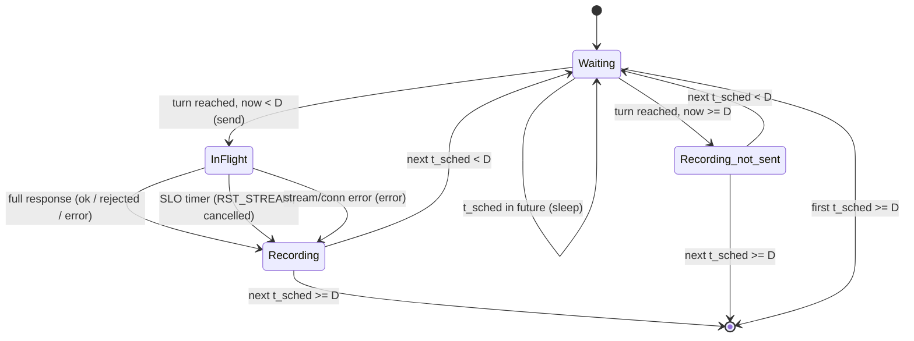

# Client — Design

`now()` means `monotonic_now_ns() - run_start`. `D = config.duration_ns`, `SLO = config.slo_ns`,
`λ = config.per_client_rate`.

## ClosedLoopPoissonClient

```
function run_client(client_id, conn, config, rng, run_start):
    records = []
    seq = 0
    t_sched = sampling.exponential_ns(rng, λ)          # first arrival: one gap after 0
    while t_sched < D:
        sleep_until(t_sched)                           # no-op if t_sched is already past (GatedArrival)
        if now() >= D:
            records.append(not_sent_record(client_id, seq, t_sched))
        else:
            records.append(send_one(client_id, seq, t_sched, conn, config))   # blocks until resolved
        seq = seq + 1
        t_sched = t_sched + sampling.exponential_ns(rng, λ)
    return records
```

- **Schedule.** Arrivals are at the running sums of Exp(λ) gaps. The `j`-th gap is always the `j`-th
  sample of this client's `Rng`, so the arrival schedule depends only on `seed`, `client_id` and λ,
  and not on how the server behaves.
- **seq** is the index of the scheduled arrival (starting at 0), and every scheduled arrival uses one.
  If `seq` would go past `2^32 - 1`, the client stops scheduling (the loop ends).
- **No arrival at or after `D`.** An arrival at `t_sched < D` whose turn comes at `now() >= D` is
  `not_sent`.

## GatedArrival

The loop runs one `send_one` at a time, and `send_one` returns only once the request has
resolved. So an arrival whose time is already past when its turn comes is sent right away, and its
end-to-end latency includes the wait (`send_ns - scheduled_ns`). The schedule does **not**
move: if several arrivals pass during one slow request, they are sent back-to-back afterwards.

## send_one

```
function send_one(client_id, seq, t_sched, conn, config):
    id   = protocol.make_request_id(seq, client_id)
    body = protocol.build_body(id, config.request_bytes)
    t_send = now()
    stream = conn.open_stream(headers = protocol request headers, body = body, end_stream = true)
    result = wait_first_of(
                 stream.full_response(),               # HEADERS + all DATA up to END_STREAM
                 timer_at(t_send + SLO))
    match result:
        Response(status, resp_body):
            t_end = now()
            outcome = classify(status, resp_body, id)  # see Outcome classification
        TimerFired:
            stream.reset(RST_CODE_CANCEL)
            t_end = now()
            outcome = cancelled; status = none
        StreamError or ConnectionError:
            t_end = now()
            outcome = error; status = none
    return RequestRecord(id, client_id, seq, outcome, status, t_sched, t_send, t_end)
```

## SLOCancellation

- The SLO timer starts at `t_send`, which is taken just before the stream is opened.
- "Answered" means the **full** response (END_STREAM) has arrived. Headers alone do not count.
- If the response completes and the timer fires at about the same moment, whichever
  `wait_first_of` reports first wins. Once a winner is chosen, the other event is ignored.
- After `reset`, the client never reads that stream again. Frames that arrive later are discarded by
  the HTTP/2 layer.
- A connection error makes the current request `error`. Later arrivals on a broken connection
  each fail at once as `error` (the client does not reconnect).

## Outcome classification

```
function classify(status, resp_body, id):
    parsed = protocol.parse_body(resp_body)
    if parsed is ParseError or parsed != id: return error
    if status == 202: return ok
    if status == 503: return rejected
    return error
```

## State machine



## Design specific to Go

Implementation: `implementation/go` (module `testbed`, Go 1.21, `golang.org/x/net v0.17.0`).
Build and test with `CGO_ENABLED=0 go build ./...` / `CGO_ENABLED=0 go test ./...`. On recent macOS the dynamic
loader rejects cgo-linked Go 1.21 binaries (missing `LC_UUID`), so cgo is disabled.

### Go choices

- File `internal/loadgen/client.go`.
- Each client owns an `*h2client.Conn` that wraps one `http2.ClientConn` (one TCP connection, never pooled).
- `wait_first_of` is a `select` between a 1-buffered result channel and a `time.Timer` set to `t_send + SLO`. The goroutine runs `RoundTrip` and reads the body to EOF (END_STREAM).
- The `reset(RST_CODE_CANCEL)` call is a cancelled request context. x/net/http2 then sends `RST_STREAM(CANCEL)` for the open stream, and the abandoned goroutine ends by itself.
- Schedule times saturate at `math.MaxInt64` (`addGap`) instead of overflowing.

### Traceability

Generated from the `// Design:` tags in the code by `implementation/spec_tools/tracegen.py` (see `AGENTS.md`). Each link points at the first code line after the tag.
Regenerate from the repository root with `python3 implementation/spec_tools/tracegen.py --lang Go --ext .go --comment // --write`.

<!-- trace:begin -->
| Design subsection | Implementation (file:line) |
|---|---|
| [ClosedLoopPoissonClient](#closedlooppoissonclient) | [client.go:35](../../../implementation/go/internal/loadgen/client.go#L35) |
| [GatedArrival](#gatedarrival) | [client.go:45](../../../implementation/go/internal/loadgen/client.go#L45) |
| [send_one](#send_one) | [client.go:69](../../../implementation/go/internal/loadgen/client.go#L69) |
| [SLOCancellation](#slocancellation) | [client.go:95](../../../implementation/go/internal/loadgen/client.go#L95) |
| [Outcome classification](#outcome-classification) | [client.go:118](../../../implementation/go/internal/loadgen/client.go#L118), [metrics_test.go:40](../../../implementation/go/internal/loadgen/metrics_test.go#L40) |
| [State machine](#state-machine) | [client.go:35](../../../implementation/go/internal/loadgen/client.go#L35) |
<!-- trace:end -->
