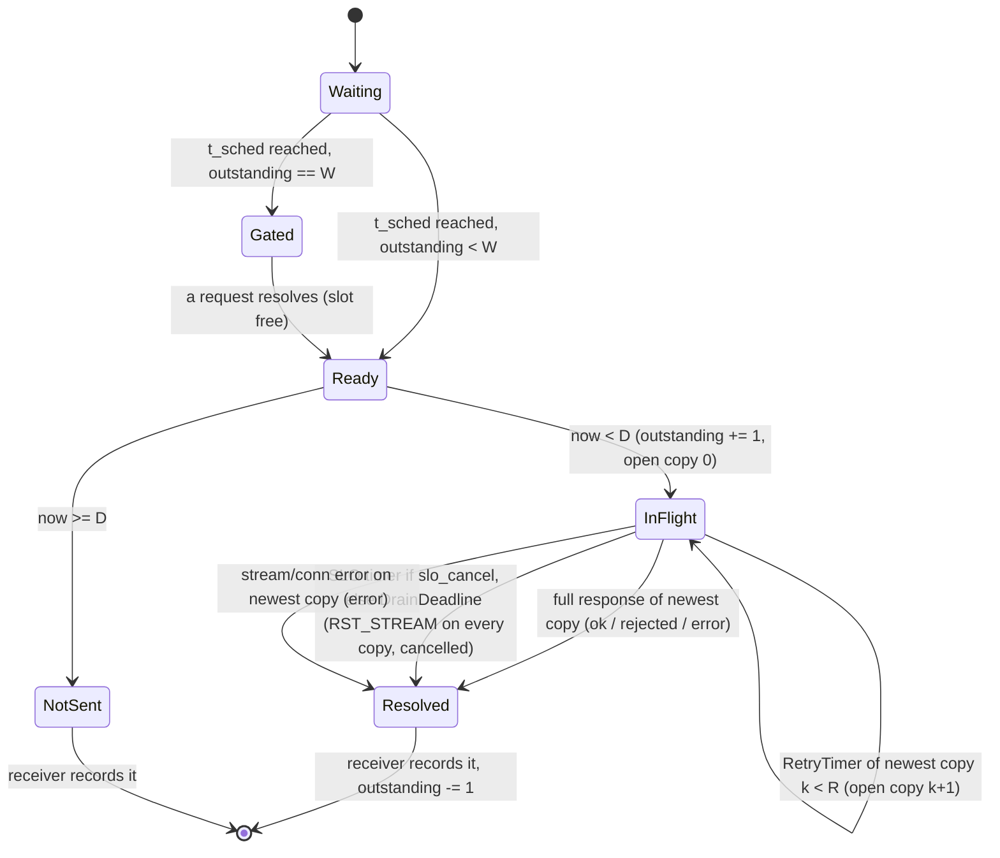

# Client — Design

`now()` means `monotonic_now_ns() - run_start`. `D = config.duration_ns`, `SLO = config.slo_ns`,
`λ = config.per_client_rate`, `W = config.n_waiting_requests`, `RETRY = config.retry_timeout_ns`,
`R = config.max_retries`, `STALL = config.initial_stall_ns`, `DRAIN = config.drain_timeout_ns`.

## SemiOpenLoopClient

`W = config.n_waiting_requests`. A client has two activities that share one record `C`:

```
C = { lock, slot_free: condition variable, outstanding: integer = 0,       # requests sent, not yet resolved
      events: FIFO of Event (unbounded, multi-producer, single consumer),  # to the receiver
      records: list of RequestRecord }                                     # written by the receiver only

function run_client(client_id, conn, config, rng, run_start, run_start_unix_ns):
    spawn receiver(C, client_id)
    sender(C, client_id, conn, config, rng)          # runs on the calling activity
    wait until the receiver has returned
    sort C.records by seq
    return C.records

procedure sender(C, client_id, conn, config, rng):
    seq = 0
    t_sched = sampling.exponential_ns(rng, λ)        # first arrival: one gap after 0
    while t_sched < D:
        sleep_until(t_sched)                         # no-op if t_sched is already past
        with C.lock:
            while C.outstanding == W: C.slot_free.wait()     # GatedArrival
            sendable = now() < D
            if sendable: C.outstanding = C.outstanding + 1
        if sendable:
            start_request(C, client_id, seq, t_sched, conn, config, run_start_unix_ns)   # never waits
        else:
            C.events.push(NotSent(seq, t_sched))
        if seq == 2^32 - 1: break
        seq = seq + 1
        t_sched = t_sched + sampling.exponential_ns(rng, λ)
    C.events.push(SenderDone)

procedure receiver(C, client_id):
    sender_done = false
    loop:
        ev = C.events.pop_blocking()
        match ev:
            NotSent(seq, t_sched):
                C.records.append(not_sent_record(client_id, seq, t_sched))
            Resolved(record):
                C.records.append(record)
                with C.lock:
                    C.outstanding = C.outstanding - 1
                    C.slot_free.notify_one()
            SenderDone:
                sender_done = true
        if sender_done:
            with C.lock: if C.outstanding == 0: return
```

- **Schedule.** Arrivals are at the running sums of Exp(λ) gaps. The `j`-th gap is always the `j`-th sample of
  this client's ArrivalRng ([ArrivalRng](#arrivalrng)), so the arrival schedule depends only on `seed`, `client_id`,
  λ and `arrival_rng`, not on how the server behaves or on `W`.
- **seq** is the index of the scheduled arrival (starting at 0), and every scheduled arrival uses one. After
  `seq = 2^32 - 1` the client stops scheduling.
- **No arrival at or after `D`.** An arrival at `t_sched < D` that becomes sendable only at `now() >= D` is
  `not_sent`.
- **Up to `W` outstanding.** The sender alone increments `outstanding`, and only while it is below `W`; the
  receiver alone decrements it. So `0 <= outstanding <= W` at all times.
- **`W = 1` is the old closed loop.** The next arrival is sent only after the previous request resolved, exactly
  the behavior before this parameter existed.
- **Up to `W` outstanding** counts logical requests, not RequestCopies: a request holds one slot from its first
  send until it resolves, however many copies it sent.
- **Ends** when the sender is done and every sent request has resolved. With `slo_cancel = true` each one resolves
  within `SLO` of its first send, so the client returns by about `D + SLO`; with `slo_cancel = false` the
  [DrainDeadline](#draindeadline) resolves the last ones by `D + DRAIN` (`DRAIN = drain_timeout_ns`).

## GatedArrival

An arrival whose time has come while `W` requests are outstanding waits until one of them resolves, then is
sent at once. Its end-to-end latency includes that wait (`send_ns - scheduled_ns`). The schedule does **not**
move: if several arrivals pass during the wait, they are sent back-to-back as slots free up. With `W` large
enough that the cap is never reached, the client is open loop.

Worked example, `W = 2`, arrivals at 0, 1, 2 and 3 ms, time at the server 5, 1.5, 1 and 1 ms (no SLO hit):

| ms | Event | `outstanding` after | Record (`seq`: scheduled → sent → resolved) |
|---|---|---|---|
| 0 | send 0 | 1 | |
| 1 | send 1 | 2 | |
| 2 | arrival 2 due, `outstanding == W` | 2 | gated |
| 2.5 | 1 resolves; send 2 | 2 | 1: 1 → 1 → 2.5 |
| 3 | arrival 3 due, `outstanding == W` | 2 | gated |
| 3.5 | 2 resolves; send 3 | 2 | 2: 2 → 2.5 → 3.5 (waited 0.5) |
| 4.5 | 3 resolves | 1 | 3: 3 → 3.5 → 4.5 (waited 0.5) |
| 5 | 0 resolves | 0 | 0: 0 → 0 → 5 |

With `W = 1` the same arrivals give sends at 0, 5, 6.5 and 7.5 ms.

## ArrivalRng

The **ArrivalRng** of a client is the generator its Exp(λ) gaps come from. The load-generator parameter
`arrival_rng` chooses it; `native` is an OptionalValue ([../../api.md#load-generator-parameters](../../api.md#load-generator-parameters)).

| `arrival_rng` | Generator of client `client_id` | Gap | Reproducible |
|---|---|---|---|
| `sampling` (default) | `sampling.rng_new(sampling.derive_seed(seed, STREAM_CLIENT_ARRIVALS, client_id))` | `sampling.exponential_ns(rng, λ)` | across implementations: the same `seed` gives the same schedule everywhere |
| `native` | the implementation's own 64-bit generator, seeded with `seed + i`, where `i` in `0 ..= N - 1` is a per-client index the implementation assigns (unsigned 64-bit, wrapping) | an Exp(λ) draw in seconds by the implementation's own algorithm, converted to ns and truncated | only within one implementation and build; the gaps are Exp(λ) everywhere |

- Either way one gap is drawn per scheduled arrival, in arrival order, from the client's own generator, so the
  schedule never depends on the server, on `W` or on the other clients.
- `native` exists for an implementation that reuses a load generator with its own random generator. Results of two
  implementations under `native` agree in distribution, not sample by sample.

## start_request

`start_request` sends copy 0 of a request and returns; the request's first deciding event becomes one `Resolved`
event for the receiver.

```
procedure start_request(C, client_id, seq, t_sched, conn, config, run_start_unix_ns):
    id   = protocol.make_request_id(seq, client_id)
    t_send = now()                                    # first send: SLO and record clocks start here
    deadline_unix_ns = run_start_unix_ns + t_send + SLO      # RequestDeadline, fixed for the request
    body = protocol.build_request_body(id, deadline_unix_ns, config.request_bytes)   # every copy reuses it
    req = { id, seq, t_sched, t_send, client_id, deadline_unix_ns,
            in_stall_window: boolean = (t_send < STALL),   # StallWindowRequest: never retries
            lock,                                     # guards current, streams, reset_all
            current: integer = 0,                     # index of the newest RequestCopy
            streams: list of stream = [],             # every copy opened so far
            reset_all: boolean = false,               # set once SLOCancellation has reset the streams
            settled: atomic boolean = false }
    t_expire = t_send + SLO if config.slo_cancel else D + DRAIN   # SLOCancellation or DrainDeadline
    at timer t_expire:
        if settle(C, req, TimerFired):
            with req.lock:
                req.reset_all = true
                open_streams = copy of req.streams
            for s in open_streams: s.reset(RST_CODE_CANCEL)
    send_copy(C, req, 0, conn, config, body)

function settle(C, req, result):                      # first event wins
    if not req.settled.compare_and_swap(false, true): return false
    t_end = now()
    with req.lock: copies = req.current + 1
    exec_ns = none; start_slack_ns = none                       # ExecReport, from the deciding response only
    match result:
        Response(status, resp_body):
            outcome = classify(status, resp_body, req.id)       # see Outcome classification
            if outcome in {ok, rejected}:
                (exec_ns, start_slack_ns) = protocol.parse_exec_report(resp_body)
        TimerFired:                  outcome = cancelled; status = none
        StreamError or ConnectionError: outcome = error; status = none
    C.events.push(Resolved(RequestRecord(req.id, req.client_id, req.seq, outcome, status,
                                         req.t_sched, req.t_send, t_end, copies,
                                         req.in_stall_window, exec_ns, start_slack_ns)))
    return true
```

The callbacks may run on any activity (the HTTP/2 layer's reader, a timer). They never block: they hold
`req.lock` only for a few field reads and writes, and `settle` does one compare-and-swap, one short locked read
and one push. Opening and resetting streams happen outside `req.lock`.

## RequestDeadline

Every request carries a **RequestDeadline** in its PingRequestBody
([../../protocol/design.md#pingrequestbody](../../protocol/design.md#pingrequestbody)), and again in the
RequestDeadlineHeader of every copy ([../../protocol/design.md#requestdeadlineheader](../../protocol/design.md#requestdeadlineheader)):
the Unix wall-clock time by which its SLO ends, that is the wall-clock time of the request's first send plus the SLO:

```
deadline_unix_ns = run_start_unix_ns + t_send + SLO        # unsigned 64-bit integer ns
```

An implementation may instead read the wall clock once at the first send and add the SLO. Both give the same instant;
they differ only by how far the wall clock is stepped or slewed during the run, and the formula above is immune to
that.

- `run_start_unix_ns` is the Run Controller's wall-clock reading of `run_start`
  ([../design.md#time-base](../design.md#time-base)); `t_send` is the first copy's send on the monotonic time base.
  So the deadline equals the moment the SLO timer fires, expressed in Unix time, and all clients of one load
  generator use one origin.
- It is computed once, in `start_request`, and the body is built once. Every RequestCopy sends that same body
  ([RetryTimer](#retrytimer)), so **a retry has the same deadline as the original request**.
- A StallWindowRequest carries a deadline like any other request.

Worked example, `run_start_unix_ns = 1_794_533_185_000_000_000`, `SLO = 300 ms`, `RETRY = 150 ms`, `R = 1`:

| Copy | Sent at `t_send` (ms) | `deadline_unix_ns` | Check |
|---|---|---|---|
| 0 | 2.5 | 1_794_533_185_302_500_000 | 1_794_533_185_000_000_000 + 2_500_000 + 300_000_000 |
| 1 (retry at 152.5 ms) | — | 1_794_533_185_302_500_000 | same body as copy 0, so the same deadline |

## RetryTimer

Every **RequestCopy** of a request is the same RequestId and the same body, sent on a new stream of the client's
connection. Each copy `k < R` has its own **RetryTimer**, `RETRY` after that copy's send; the last copy (`k = R`)
has none and waits for its answer or the SLO. Only the newest copy
(`k == req.current`) can decide the request; the responses and errors of earlier copies are ignored, and their
streams are left open (no reset) until the server answers them or SLOCancellation resets them.

```
procedure send_copy(C, req, k, conn, config, body):   # req.current == k already; called without req.lock
    t_copy = now()
    headers = protocol request headers + [(REQUEST_DEADLINE_HEADER, decimal(req.deadline_unix_ns))]   # RequestDeadlineHeader
    stream = conn.open_stream(headers = headers, body = body, end_stream = true)
    if open_stream failed: settle(C, req, ConnectionError); return
    with req.lock:
        req.streams.append(stream)
        late = req.reset_all
    if late: stream.reset(RST_CODE_CANCEL); return    # SLOCancellation already ran
    on stream.full_response(status, resp_body):       # HEADERS + DATA to END_STREAM
        with req.lock: newest = (k == req.current)
        if newest: settle(C, req, Response(status, resp_body))
    on stream.error():
        with req.lock: newest = (k == req.current)
        if newest: settle(C, req, StreamError)
    if req.in_stall_window: return                    # StallWindow: no RetryTimer
    if k == config.max_retries: return                # last copy: no RetryTimer, it waits for the SLO
    at timer t_copy + RETRY:                          # RetryTimer of copy k < R
        with req.lock:
            if req.settled or k != req.current: return
            req.current = k + 1
        send_copy(C, req, k + 1, conn, config, body)
```

- **Copies.** A request sends at most `1 + R` copies. `copies` in its RequestRecord is `req.current + 1` when it
  settles: every copy the client started, including one whose `open_stream` failed.
- **Which answer counts.** Once copy `k+1` is started, the client waits only for copy `k+1`. A response of copy
  `k` that arrives later is ignored even if it is `ok`.
- **The last copy waits for the SLO.** Copy `R` has no RetryTimer. It is decided by its full response, its stream
  or connection error, or SLOCancellation, which resets every copy. So a request never ends `dropped`; that outcome
  is reserved ([api.md#outcome](api.md#outcome)).
- **`R = 0`** gives one copy with no RetryTimer: the behavior before retries existed. `RETRY` is then unused.
- **Races.** Every event checks `req.current` and `req.settled`, and `settle` decides by compare-and-swap, so
  whichever deciding event is observed first wins and the others are ignored. A RetryTimer and a response of the
  same copy at about the same moment: if the timer takes `req.lock` first, the copy is superseded and its response
  is ignored.
- **Open streams.** At most `W × (1 + R)` streams belong to unresolved requests at any time. Validation keeps this
  within `MAX_WAITING_REQUESTS`, which every server and Ingress advertises as `SETTINGS_MAX_CONCURRENT_STREAMS`
  ([../../api.md](../../api.md#load-generator-parameters)). Ignored copies of resolved requests may add to it
  until the server answers them; the HTTP/2 layer then holds back new streams.

Worked examples, `RETRY = 150 ms`, `SLO = 300 ms`, `R = 1`, a request first sent at 0 ms (times in ms):

| Case | Events | Record (`outcome`, `copies`, `end_ns - send_ns`) |
|---|---|---|
| Fast answer | copy 0 answers at 100 | `ok`, 1, 100 |
| Retry answered | RetryTimer of copy 0 at 150 sends copy 1; copy 1 answers at 250 | `ok`, 2, 250 |
| Late original | copy 1 sent at 150; copy 0 answers at 200 (ignored); copy 1 answers at 260 | `ok`, 2, 260 |
| No answer | copy 1 sent at 150; SLO timer at 300 settles first and resets copies 0 and 1; copy 1's RetryTimer (due at 300 or later) then does nothing | `cancelled`, 2, 300 |
| Last copy answered late | `RETRY = 100`: copy 1 sent at 100; it has no RetryTimer and answers at 280 | `ok`, 2, 280 |
| `R = 0`, slow answer | copy 0 has no RetryTimer and answers at 200 | `ok`, 1, 200 |
| `R = 0`, no answer | SLO timer at 300 resets copy 0 | `cancelled`, 1, 300 |

## StallWindow

The **StallWindow** is `[0, STALL)` of the client's time base, `STALL = initial_stall_ns`. It mirrors the servers'
StallGate ([../../server/worker_pool/design.md](../../server/worker_pool/design.md#stallgate)), during which no
`/ping` runs, so every request sent then is slow by construction. A request whose first send `t_send` is in the
window (`t_send < STALL`) is a **StallWindowRequest**:

- It sends only copy 0. `send_copy` returns before starting a RetryTimer, so it never retries; `copies` is always 1.
- SLOCancellation still applies: it ends `ok`, `rejected`, `cancelled` or `error` as before retries existed.
- It holds a GatedArrival slot like any other request.
- Its RequestRecord has `in_stall_window = true`. Metrics leaves it out of every count, rate and latency statistic
  ([../metrics/design.md#collection](../metrics/design.md#collection)), and Availability skips it.

The window is approximate. A server's stall starts at its first *admitted* `/ping`, a little after `run_start`
(network and Ingress delay), and its backlog drains only after the stall. So requests sent just after `STALL` can
still be slow; they are counted normally. `STALL = 0` disables the window: no request is a StallWindowRequest.

Worked examples, `STALL = 1000 ms`, `RETRY = 150 ms`, `SLO = 300 ms`, `R = 1`:

| First send | `t_send < STALL` | Behavior |
|---|---|---|
| 0 ms | yes | copy 0 only; SLO at 300 ms → `cancelled` if unanswered; excluded from metrics |
| 999 ms | yes | copy 0 only, although its SLO runs to 1299 ms |
| 1000 ms | no | normal request: RetryTimer at 1150 ms, SLO at 1300 ms |
| any, with `STALL = 0` | no | normal request |

## SLOCancellation

With `slo_cancel = true` (the default). With `slo_cancel = false` there is no SLO timer and the
[DrainDeadline](#draindeadline) takes its place.

- The SLO timer starts at `t_send`, the first copy's send, taken just before copy 0's stream is opened. RetryTimers
  never restart it.
- "Answered" means the **full** response (END_STREAM) of the newest copy has arrived. Headers alone do not count.
- If the response completes and the timer fires at about the same moment, whichever calls `settle` first wins
  (the compare-and-swap). The other event is ignored.
- When it wins, the client resets **every** copy it opened, including ignored earlier copies. A copy whose stream
  opens after that is reset at once (`reset_all`).
- After `reset`, the client never reads that stream again. Frames that arrive later are discarded by
  the HTTP/2 layer.
- A connection error makes **every** outstanding request of the client `error` (its newest copy's stream fails).
  Later arrivals and RequestCopies on a broken connection each fail at once as `error` (the client does not
  reconnect).
- Each request has its own timers. Several requests of one client can retry, time out, and be reset,
  independently.

## DrainDeadline

With `slo_cancel = false` there is no SLO timer: a request waits for its newest copy's full response or an error,
however late. A late `ok` is still an `ok`; the SLO only decides its Availability and the summary's `ok_late`
([../metrics/design.md](../metrics/design.md#collection)). To keep the run bounded, every request instead gets a
**DrainDeadline** timer at the same absolute time for all requests, `D + DRAIN` (`D = duration_ns`,
`DRAIN = drain_timeout_ns`, on the run clock). It acts exactly like the SLO timer: it calls `settle` with
`TimerFired` (outcome `cancelled`, `end_ns` = when it fired) and, if it wins, resets every copy and sets
`reset_all`.

- **Only stuck requests reach it.** The sender stops at `D`, so a request answered within `DRAIN` of the end of the
  active phase never sees it. A request on a server that never answers (a frozen server) is cancelled at `D + DRAIN`.
- **Retries are unchanged.** RetryTimers of copies `k < R` still fire `RETRY` after each copy's send. The last copy
  waits for its answer or the DrainDeadline. Ignored earlier copies are not reset until the request settles, so
  their streams stay open while the server works on them.
- **Races** are resolved by `settle` as for the SLO timer: whichever of the response, an error and the DrainDeadline
  calls it first wins.
- **Slots.** A request holds its slot until it settles, so with `slo_cancel = false` a client whose server is slow
  or stuck reaches `W` outstanding sooner and gates later arrivals ([GatedArrival](#gatedarrival)).

Worked examples, `slo_cancel = false`, `SLO = 5000 ms`, `RETRY = 2000 ms`, `R = 1`, `D = 120 s`,
`DRAIN = 60 s` (times in s from the run start):

| Case | Events | Record (`outcome`, `copies`, `end_ns - send_ns`) |
|---|---|---|
| Late answer | sent at 10; copy 1 at 12; copy 1 answers at 17 | `ok`, 2, 7 s (late: counts in `ok_late`, not available) |
| Late answer, no retry | `R = 0`; sent at 10, answered at 18.5 | `ok`, 1, 8.5 s |
| Stuck | sent at 100 to a frozen server; copy 1 at 102 also stuck | `cancelled` at 180, 2, 80 s |
| Answered during the drain | sent at 119, answered at 150 | `ok`, 1 or 2, 31 s |
| Same with `slo_cancel = true` | the SLO timer at 15 resets both copies | `cancelled`, 2, 5 s |

## Outcome classification

```
function classify(status, resp_body, id):
    parsed = protocol.parse_body(resp_body)
    if parsed is ParseError or parsed != id: return error
    if status == 202: return ok
    if status == 503: return rejected
    return error
```

The ExecReport ([../../protocol/design.md#execreport](../../protocol/design.md#execreport)) is read only from the
response that settled the request, which is always the newest copy's, and only when it is classified `ok` or
`rejected`. `parse_exec_report` never fails: a missing or malformed field just leaves that RequestRecord field empty.
Answers of older copies are never read, so their ExecReports are lost.

## State machine

Per scheduled arrival:



Events of copies older than the newest one never change the state. A StallWindowRequest never takes the RetryTimer
transition, and copy `R` has no RetryTimer, so nothing resolves a request as `dropped`.

## Design specific to Envoy

Implementation: `implementation/envoy`: vendored Envoy (`envoy/`) and Nighthawk (`nighthawk/`) with the testbed's
changes, recorded in [VENDORED.md](../../../implementation/envoy/VENDORED.md) ([AGENTS.md](../../../AGENTS.md#vendored-code)),
built in Docker with Bazel by `implementation/envoy/build.sh` (C++ tests: `bazel test` on the targets VENDORED.md
names); Python 3 wrappers `bin/ingress.py`, `bin/loadgen.py` and `wrappers/convert.py` (tests: `cd
implementation/envoy/wrappers && python3 -B -m unittest test_convert`). Only code written or changed for the testbed
carries `Design:` tags; unchanged upstream code does not.

### Envoy choices

- SemiOpenLoopClient and ArrivalRng: each Nighthawk worker is one client; our `PoissonRateLimiter`
  (`rate_limiter_impl.cc`) releases at Exp(λ) gaps, `λ = global_rate / num_clients`, from a `std::mt19937_64` seeded
  `seed + k` (`k` the worker's creation index) and `std::exponential_distribution` (`arrival_rng = native`; `sampling`
  is rejected).
- GatedArrival: Nighthawk's `--max-active-requests` and `--max-pending-requests` are both `n_waiting_requests`: at
  most `n_waiting_requests` requests are on the wire per client; further arrivals wait, first in the connection
  pool's pending queue (up to `n_waiting_requests` more), then at the rate limiter, which keeps their releases
  (`tryAcquireOne` catches up).
- start_request and RequestDeadline: the `ping` RequestSource builds each request when it starts, with the deadline
  `wall clock + slo_ms` (the spec's equivalent reading of the wall clock at the first send).
- StallWindow: Nighthawk sends no copies, so a StallWindowRequest needs no special case; `convert.requests_records`
  flags `in_stall_window` from the send time.
- DrainDeadline: `slo_cancel = false` only; Nighthawk's `--timeout` (whole seconds, rounded up from
  `drain_timeout_ms`) resets what is still outstanding, which the per-request log records as `reset` and
  `convert.request_outcome` classifies `cancelled`.

### Not traced

| Design subsection | Reason |
|---|---|
| [RetryTimer](#retrytimer) | not realized on Envoy: `max_retries <value> is not supported by this implementation` for any value but 0 |
| [SLOCancellation](#slocancellation) | not realized on Envoy: `slo_cancel true is not supported by this implementation` |
| [State machine](#state-machine) | unchanged upstream code: Nighthawk's StreamDecoder and BenchmarkClient (`nighthawk/source/client/`) |

### Traceability

Generated from the `Design:` tags in the testbed's code under `implementation/envoy` by `implementation/spec_tools/tracegen.py` (see `AGENTS.md`). Each link points at the first code line after the tag.
Regenerate from the repository root with `python3 implementation/spec_tools/tracegen.py --lang Envoy --impl implementation/envoy --ext .cc --ext .h --comment // --ext .py:# --write`.

<!-- trace:begin -->
| Design subsection | Implementation (file:line) |
|---|---|
| [SemiOpenLoopClient](#semiopenloopclient) | [loadgen.py:100](../../../implementation/envoy/bin/loadgen.py#L100), [rate_limiter_impl.cc:125](../../../implementation/envoy/nighthawk/source/common/rate_limiter_impl.cc#L125) |
| [GatedArrival](#gatedarrival) | [loadgen.py:105](../../../implementation/envoy/bin/loadgen.py#L105), [rate_limiter_impl.cc:138](../../../implementation/envoy/nighthawk/source/common/rate_limiter_impl.cc#L138) |
| [ArrivalRng](#arrivalrng) | [loadgen.py:116](../../../implementation/envoy/bin/loadgen.py#L116), [factories_impl.cc:111](../../../implementation/envoy/nighthawk/source/client/factories_impl.cc#L111), [rate_limiter_impl.cc:125](../../../implementation/envoy/nighthawk/source/common/rate_limiter_impl.cc#L125), [rate_limiter_impl.h:77](../../../implementation/envoy/nighthawk/source/common/rate_limiter_impl.h#L77), [rate_limiter_test.cc:43](../../../implementation/envoy/nighthawk/test/rate_limiter_test.cc#L43) |
| [start_request](#start_request) | [ping_request_source_plugin_impl.cc:43](../../../implementation/envoy/nighthawk/source/request_source/ping_request_source_plugin_impl.cc#L43) |
| [RequestDeadline](#requestdeadline) | [ping_request_source_plugin_impl.cc:52](../../../implementation/envoy/nighthawk/source/request_source/ping_request_source_plugin_impl.cc#L52), [ping_request_source_plugin_test.cc:34](../../../implementation/envoy/nighthawk/test/request_source/ping_request_source_plugin_test.cc#L34) |
| [RetryTimer](#retrytimer) | not traced |
| [StallWindow](#stallwindow) | [convert.py:368](../../../implementation/envoy/wrappers/convert.py#L368), [test_convert.py:275](../../../implementation/envoy/wrappers/test_convert.py#L275) |
| [SLOCancellation](#slocancellation) | not traced |
| [DrainDeadline](#draindeadline) | [loadgen.py:109](../../../implementation/envoy/bin/loadgen.py#L109), [stream_decoder.cc:99](../../../implementation/envoy/nighthawk/source/client/stream_decoder.cc#L99) |
| [Outcome classification](#outcome-classification) | [convert.py:344](../../../implementation/envoy/wrappers/convert.py#L344) |
| [State machine](#state-machine) | not traced |
<!-- trace:end -->
