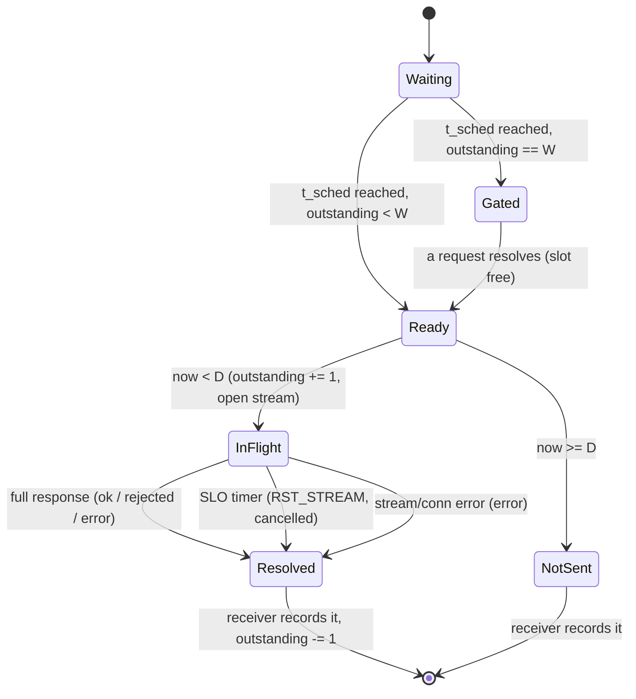

# Client — Design

`now()` means `monotonic_now_ns() - run_start`. `D = config.duration_ns`, `SLO = config.slo_ns`,
`λ = config.per_client_rate`, `W = config.n_waiting_requests`.

## SemiOpenLoopClient

`W = config.n_waiting_requests`. A client has two activities that share one record `C`:

```
C = { lock, slot_free: condition variable, outstanding: integer = 0,       # requests sent, not yet resolved
      events: FIFO of Event (unbounded, multi-producer, single consumer),  # to the receiver
      records: list of RequestRecord }                                     # written by the receiver only

function run_client(client_id, conn, config, rng, run_start):
    spawn receiver(C, client_id)
    sender(C, client_id, conn, config, rng)          # runs on the calling activity
    wait until the receiver has returned
    sort C.records by seq
    return C.records

procedure sender(C, client_id, conn, config, rng):
    seq = 0
    t_sched = sampling.exponential_ns(rng, λ)        # first arrival: one gap after 0
    while t_sched < D:
        sleep_until(t_sched)                         # no-op if t_sched is already past
        with C.lock:
            while C.outstanding == W: C.slot_free.wait()     # GatedArrival
            sendable = now() < D
            if sendable: C.outstanding = C.outstanding + 1
        if sendable:
            start_request(C, client_id, seq, t_sched, conn, config)   # never waits for the response
        else:
            C.events.push(NotSent(seq, t_sched))
        if seq == 2^32 - 1: break
        seq = seq + 1
        t_sched = t_sched + sampling.exponential_ns(rng, λ)
    C.events.push(SenderDone)

procedure receiver(C, client_id):
    sender_done = false
    loop:
        ev = C.events.pop_blocking()
        match ev:
            NotSent(seq, t_sched):
                C.records.append(not_sent_record(client_id, seq, t_sched))
            Resolved(record):
                C.records.append(record)
                with C.lock:
                    C.outstanding = C.outstanding - 1
                    C.slot_free.notify_one()
            SenderDone:
                sender_done = true
        if sender_done:
            with C.lock: if C.outstanding == 0: return
```

- **Schedule.** Arrivals are at the running sums of Exp(λ) gaps. The `j`-th gap is always the `j`-th sample of
  this client's `Rng`, so the arrival schedule depends only on `seed`, `client_id` and λ, not on how the server
  behaves or on `W`.
- **seq** is the index of the scheduled arrival (starting at 0), and every scheduled arrival uses one. After
  `seq = 2^32 - 1` the client stops scheduling.
- **No arrival at or after `D`.** An arrival at `t_sched < D` that becomes sendable only at `now() >= D` is
  `not_sent`.
- **Up to `W` outstanding.** The sender alone increments `outstanding`, and only while it is below `W`; the
  receiver alone decrements it. So `0 <= outstanding <= W` at all times.
- **`W = 1` is the old closed loop.** The next arrival is sent only after the previous request resolved, exactly
  the behavior before this parameter existed.
- **Ends** when the sender is done and every sent request has resolved. Each one resolves within `SLO` of its
  send, so the client returns by about `D + SLO`.

## GatedArrival

An arrival whose time has come while `W` requests are outstanding waits until one of them resolves, then is
sent at once. Its end-to-end latency includes that wait (`send_ns - scheduled_ns`). The schedule does **not**
move: if several arrivals pass during the wait, they are sent back-to-back as slots free up. With `W` large
enough that the cap is never reached, the client is open loop.

Worked example, `W = 2`, arrivals at 0, 1, 2 and 3 ms, time at the server 5, 1.5, 1 and 1 ms (no SLO hit):

| ms | Event | `outstanding` after | Record (`seq`: scheduled → sent → resolved) |
|---|---|---|---|
| 0 | send 0 | 1 | |
| 1 | send 1 | 2 | |
| 2 | arrival 2 due, `outstanding == W` | 2 | gated |
| 2.5 | 1 resolves; send 2 | 2 | 1: 1 → 1 → 2.5 |
| 3 | arrival 3 due, `outstanding == W` | 2 | gated |
| 3.5 | 2 resolves; send 3 | 2 | 2: 2 → 2.5 → 3.5 (waited 0.5) |
| 4.5 | 3 resolves | 1 | 3: 3 → 3.5 → 4.5 (waited 0.5) |
| 5 | 0 resolves | 0 | 0: 0 → 0 → 5 |

With `W = 1` the same arrivals give sends at 0, 5, 6.5 and 7.5 ms.

## start_request

`send_one` of the closed-loop design is split: `start_request` opens the stream and returns, and the stream's
first event becomes one `Resolved` event for the receiver.

```
procedure start_request(C, client_id, seq, t_sched, conn, config):
    id   = protocol.make_request_id(seq, client_id)
    body = protocol.build_body(id, config.request_bytes)
    t_send = now()
    req = { id, seq, t_sched, t_send, settled: atomic boolean = false }
    stream = conn.open_stream(headers = protocol request headers, body = body, end_stream = true)
    if open_stream failed: settle(C, req, ConnectionError); return
    on stream.full_response(status, resp_body):  settle(C, req, Response(status, resp_body))  # HEADERS + DATA to END_STREAM
    on stream.error():                           settle(C, req, StreamError)
    at timer t_send + SLO:
        if settle(C, req, TimerFired): stream.reset(RST_CODE_CANCEL)

function settle(C, req, result):                 # first event wins
    if not req.settled.compare_and_swap(false, true): return false
    t_end = now()
    match result:
        Response(status, resp_body): outcome = classify(status, resp_body, req.id)  # see Outcome classification
        TimerFired:                  outcome = cancelled; status = none
        StreamError or ConnectionError: outcome = error; status = none
    C.events.push(Resolved(RequestRecord(req.id, client_id, req.seq, outcome, status,
                                         req.t_sched, req.t_send, t_end)))
    return true
```

The three callbacks may run on any activity (the HTTP/2 layer's reader, a timer). They never block: `settle` does
one compare-and-swap and one push.


## SLOCancellation

- The SLO timer starts at `t_send`, which is taken just before the stream is opened.
- "Answered" means the **full** response (END_STREAM) has arrived. Headers alone do not count.
- If the response completes and the timer fires at about the same moment, whichever calls `settle` first wins
  (the compare-and-swap). The other event is ignored.
- After `reset`, the client never reads that stream again. Frames that arrive later are discarded by
  the HTTP/2 layer.
- A connection error makes **every** outstanding request of the client `error`. Later arrivals on a broken
  connection each fail at once as `error` (the client does not reconnect).
- Each request has its own timer. Several requests of one client can time out, and be reset, independently.

## Outcome classification

```
function classify(status, resp_body, id):
    parsed = protocol.parse_body(resp_body)
    if parsed is ParseError or parsed != id: return error
    if status == 202: return ok
    if status == 503: return rejected
    return error
```

## State machine

Per scheduled arrival:



## Design specific to Go

Implementation: `implementation/go` (module `testbed`, Go 1.21, `golang.org/x/net v0.17.0`).
Build and test with `CGO_ENABLED=0 go build ./...` / `CGO_ENABLED=0 go test ./...`. On recent macOS the dynamic
loader rejects cgo-linked Go 1.21 binaries (missing `LC_UUID`), so cgo is disabled.

### Go choices

- File `internal/loadgen/client.go`.
- Each client owns an `*h2client.Conn` that wraps one `http2.ClientConn` (one TCP connection, never pooled). Up to `n_waiting_requests` concurrent `RoundTrip`s share it. If the peer advertised fewer concurrent streams, x/net/http2 waits for a free stream (`awaitOpenSlotForStreamLocked`) rather than failing. Every peer here advertises at least 1000.
- The sender is the goroutine that calls `RunClient`; the receiver is a goroutine started by it. `outstanding` is the fill level of `slots`, a buffered channel of size `n_waiting_requests` used as a counting semaphore. Sending into it is the GatedArrival wait, and the receiver takes from it once per resolved request. The sender only increments and the receiver only decrements, as in the design.
- `C.events` is a buffered channel of size `n_waiting_requests + 1`. It cannot be unbounded in Go, but the receiver always drains it, so a send waits at most until the receiver's next iteration. Records are appended by the receiver only and sorted by `seq` with `sort.Slice` at the end.
- `start_request` builds the request, starts a `time.AfterFunc` for the SLO, and runs `RoundTrip` plus reading the body to EOF (END_STREAM) in its own goroutine. `settle` is a closure with an `atomic.Bool` `CompareAndSwap`, which is the first-event-wins rule. A winning SLO timer cancels the request context, and x/net/http2 then sends `RST_STREAM(CANCEL)` for the stream. A winning response stops the timer.
- Schedule times saturate at `math.MaxInt64` (`addGap`) instead of overflowing.
- Tests: `client_test.go` runs a client against a one-worker server with a 200 ms StallGate. With a cap of 10, at least 2 and at most 10 requests are outstanding at once and records come back in `seq` order. With a cap of 1, each send waits for the previous request (closed loop).

### Traceability

Generated from the `// Design:` tags in the code by `implementation/spec_tools/tracegen.py` (see `AGENTS.md`). Each link points at the first code line after the tag.
Regenerate from the repository root with `python3 implementation/spec_tools/tracegen.py --lang Go --ext .go --comment // --write`.

<!-- trace:begin -->
| Design subsection | Implementation (file:line) |
|---|---|
| [SemiOpenLoopClient](#semiopenloopclient) | [client.go:49](../../../implementation/go/internal/loadgen/client.go#L49), [client_test.go:39](../../../implementation/go/internal/loadgen/client_test.go#L39) |
| [GatedArrival](#gatedarrival) | [client.go:79](../../../implementation/go/internal/loadgen/client.go#L79), [client_test.go:71](../../../implementation/go/internal/loadgen/client_test.go#L71) |
| [start_request](#start_request) | [client.go:104](../../../implementation/go/internal/loadgen/client.go#L104) |
| [SLOCancellation](#slocancellation) | [client.go:128](../../../implementation/go/internal/loadgen/client.go#L128) |
| [Outcome classification](#outcome-classification) | [client.go:156](../../../implementation/go/internal/loadgen/client.go#L156), [metrics_test.go:43](../../../implementation/go/internal/loadgen/metrics_test.go#L43) |
| [State machine](#state-machine) | [client.go:49](../../../implementation/go/internal/loadgen/client.go#L49) |
<!-- trace:end -->
