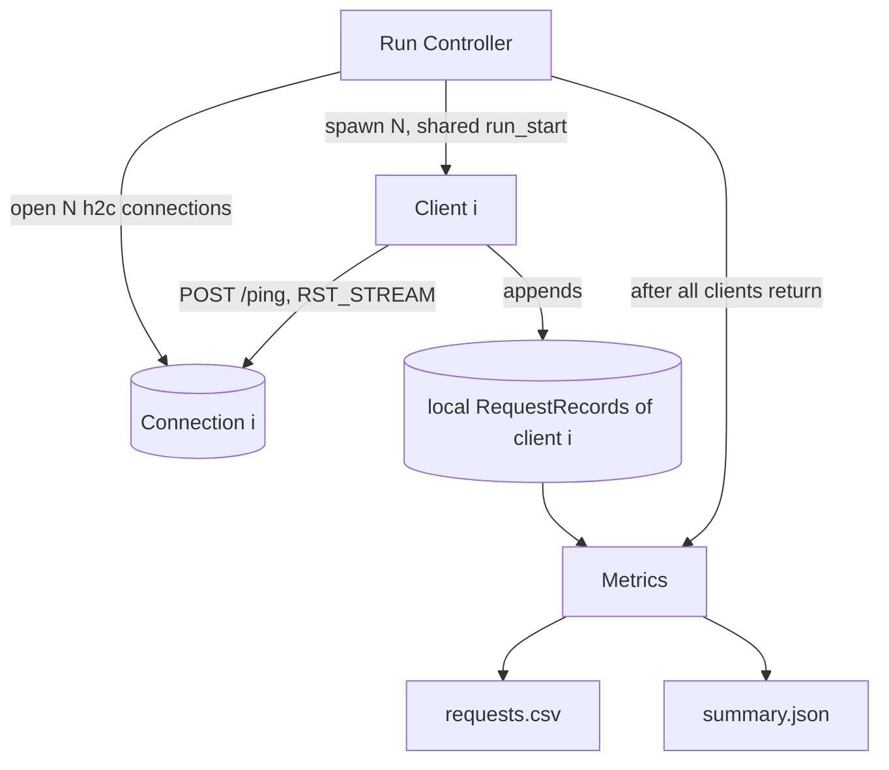

# Load Generator — Design

## Structure

| Subcomponent | Responsibility | Spec |
|---|---|---|
| Run Controller | Validate config, open connections, start clients, wait through DrainPhase, close, write outputs | [run_controller/description.md](run_controller/description.md) |
| Client | SemiOpenLoopClient: schedule, sender and receiver, GatedArrival, RetryTimer, SLOCancellation, record | [client/description.md](client/description.md) |
| Metrics | RequestRecord schema, aggregation, CSV and summary output | [metrics/description.md](metrics/description.md) |

## Time base

Every timestamp is in **integer nanoseconds since `run_start`**, a single monotonic-clock reading
taken by the Run Controller after all connections are open and just before the clients start. All
clients share this origin. Its wall-clock time, `run_start_unix_ns`, is read at the same moment and only reported
in the summary, so the run's times can be compared with other machines' wall-clock times (their clock offset then
adds to the comparison).

## Concurrency

Each client runs as its own concurrent activities (a sender and a receiver, coroutines or threads). Clients share
no mutable state: each one owns its connection, its `Rng`, and its own list of records. Within a client, the
sender and the receiver share only the client's outstanding count and event queue
([client/design.md#semiopenloopclient](client/design.md#semiopenloopclient)). The lists are
merged only after every client has returned. Timers and sleeps must use the same monotonic clock.

## Phases

1. **Setup:** validate, open N connections. Any failure aborts with a non-zero exit.
2. **Active phase** `[0, duration_ns)`: clients send requests.
3. **DrainPhase:** clients send no new arrivals (a RetryTimer may still send a RequestCopy of an outstanding
   request). Their outstanding requests (up to `n_waiting_requests` each) resolve within `slo_ns` of their first send.
4. **Teardown:** close connections, aggregate, write files.

Details: [run_controller/design.md](run_controller/design.md).

## Design specific to Go

Implementation: `implementation/go` (module `testbed`, Go 1.21, `golang.org/x/net v0.17.0`).
Build and test with `CGO_ENABLED=0 go build ./...` / `CGO_ENABLED=0 go test ./...`. On recent macOS the dynamic
loader rejects cgo-linked Go 1.21 binaries (missing `LC_UUID`), so cgo is disabled.

### Go choices

- One Go package `internal/loadgen`: `config.go` (`LoadGenConfig`, time base), `client.go`, `metrics.go`, `runcontroller.go`. Flags are parsed in `cmd/loadgen/main.go`. The package is synced in one commit because its files share types.
- `run_start_unix_ns` is `runStart.UnixNano()`: the Run Controller's one `time.Now()` holds the monotonic reading (every `*_ns`) and the wall clock (reported only). `Aggregate` takes it and copies it into `SummaryReport.RunStartUnixNs`; `TestAggregate` checks the pass-through.
- Shared h2c dialing is in `internal/h2client` (also used by the Ingress).
- Each client is a sender goroutine plus a receiver goroutine, plus one short-lived goroutine per outstanding request. Timestamps are `int64` nanoseconds from `time.Since(runStart)`, which is monotonic.
- The summary's `config` echoes `n_waiting_requests`, `retry_timeout_ms` and `max_retries` after `seed`. The `loadgen` command has the flags `-retry_timeout_ms` (default `150`) and `-max_retries` (default `1`).

### Traceability

Generated from the `// Design:` tags in the code by `implementation/spec_tools/tracegen.py` (see `AGENTS.md`). Each link points at the first code line after the tag.
Regenerate from the repository root with `python3 implementation/spec_tools/tracegen.py --lang Go --ext .go --comment // --write`.

<!-- trace:begin -->
| Design subsection | Implementation (file:line) |
|---|---|
| [Structure](#structure) | [runcontroller.go:96](../../implementation/go/internal/loadgen/runcontroller.go#L96) |
| [Time base](#time-base) | [config.go:57](../../implementation/go/internal/loadgen/config.go#L57), [config.go:64](../../implementation/go/internal/loadgen/config.go#L64) |
| [Concurrency](#concurrency) | [runcontroller.go:110](../../implementation/go/internal/loadgen/runcontroller.go#L110) |
| [Phases](#phases) | [runcontroller.go:96](../../implementation/go/internal/loadgen/runcontroller.go#L96) |
<!-- trace:end -->
