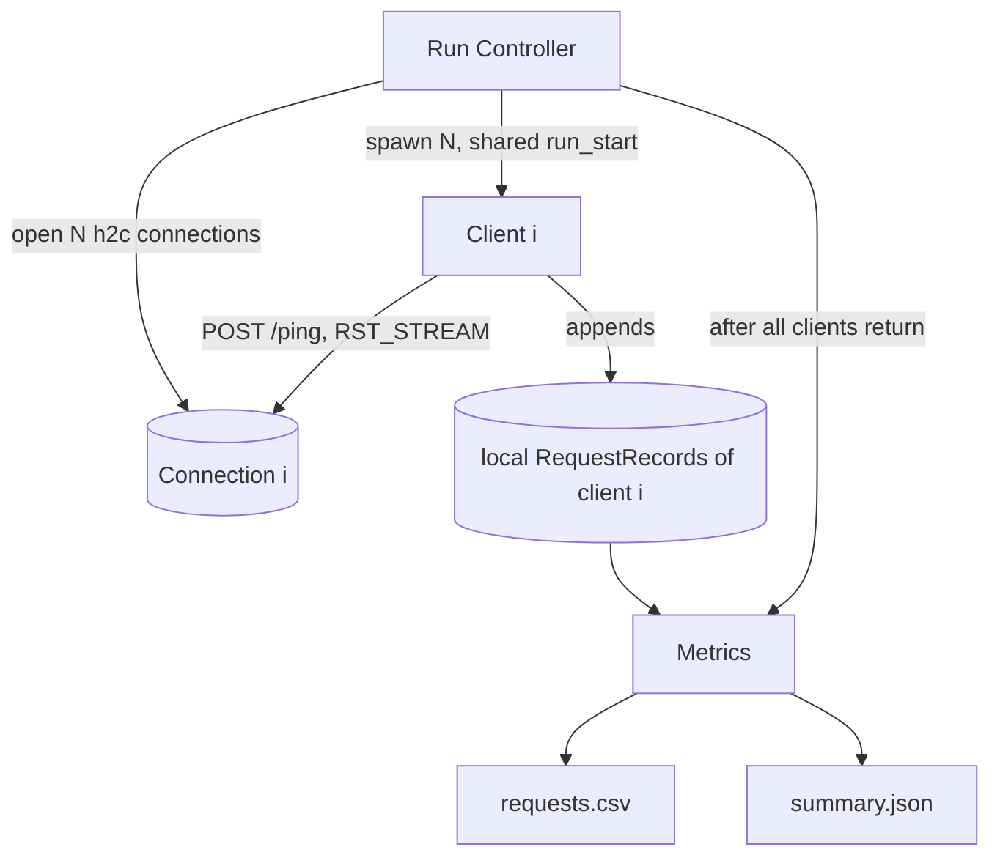

# Load Generator — Design

## Structure

| Subcomponent | Responsibility | Spec |
|---|---|---|
| Run Controller | Validate config, open connections, start clients, wait through DrainPhase, close, write outputs | [run_controller/description.md](run_controller/description.md) |
| Client | SemiOpenLoopClient: schedule, sender and receiver, GatedArrival, RetryTimer, SLOCancellation, record | [client/description.md](client/description.md) |
| Metrics | RequestRecord schema, aggregation, CSV and summary output | [metrics/description.md](metrics/description.md) |

## Time base

Every timestamp is in **integer nanoseconds since `run_start`**, a single monotonic-clock reading
taken by the Run Controller after all connections are open and just before the clients start. All
clients share this origin. Its wall-clock time, `run_start_unix_ns`, is read at the same moment. It is reported
in the summary, so the run's times can be compared with other machines' wall-clock times (their clock offset then
adds to the comparison), and it turns each request's SLO end into its RequestDeadline
([client/design.md#requestdeadline](client/design.md#requestdeadline)). No timer or measurement uses it.

## Concurrency

Each client runs as its own concurrent activities (a sender and a receiver, coroutines or threads). Clients share
no mutable state: each one owns its connection, its `Rng`, and its own list of records. Within a client, the
sender and the receiver share only the client's outstanding count and event queue
([client/design.md#semiopenloopclient](client/design.md#semiopenloopclient)). The lists are
merged only after every client has returned. Timers and sleeps must use the same monotonic clock.

## Phases

1. **Setup:** validate, open N connections. Any failure aborts with a non-zero exit.
2. **Active phase** `[0, duration_ns)`: clients send requests.
3. **DrainPhase:** clients send no new arrivals (a RetryTimer may still send a RequestCopy of an outstanding
   request). Their outstanding requests (up to `n_waiting_requests` each) resolve within `slo_ns` of their first send.
4. **Teardown:** close connections, aggregate, write files.

Details: [run_controller/design.md](run_controller/design.md).

## Design specific to Envoy

Implementation: `implementation/envoy`: vendored Envoy (`envoy/`) and Nighthawk (`nighthawk/`) with the testbed's
changes, recorded in [VENDORED.md](../../implementation/envoy/VENDORED.md) ([AGENTS.md](../../AGENTS.md#vendored-code)),
built in Docker with Bazel by `implementation/envoy/build.sh` (C++ tests: `bazel test` on the targets VENDORED.md
names); Python 3 wrappers `bin/ingress.py`, `bin/loadgen.py` and `wrappers/convert.py` (tests: `cd
implementation/envoy/wrappers && python3 -B -m unittest test_convert`). Only code written or changed for the testbed
carries `Design:` tags; unchanged upstream code does not.

### Envoy choices

- Structure: one Nighthawk process (`nighthawk_client` with the testbed's `ping` RequestSource, Poisson rate limiter
  and per-request log), started by `bin/loadgen.py`, which then writes `requests.csv` and `summary.json` from the
  per-request logs (`wrappers/convert.py`).
- Time base: Nighthawk's per-request log has wall-clock times; `convert.requests_records` takes the first scheduled
  time as `run_start` and makes every time relative to it.
- Concurrency: `--concurrency num_clients`, one Nighthawk worker per client, each with one HTTP/2 connection
  (`--connections 1`).
- Phases: `--duration duration_s` (a whole number of seconds, else rejected), then Nighthawk's `--timeout` drain.

### Traceability

Generated from the `Design:` tags in the testbed's code under `implementation/envoy` by `implementation/spec_tools/tracegen.py` (see `AGENTS.md`). Each link points at the first code line after the tag.
Regenerate from the repository root with `python3 implementation/spec_tools/tracegen.py --lang Envoy --impl implementation/envoy --ext .cc --ext .h --comment // --ext .py:# --write`.

<!-- trace:begin -->
| Design subsection | Implementation (file:line) |
|---|---|
| [Structure](#structure) | [loadgen.py:85](../../implementation/envoy/bin/loadgen.py#L85) |
| [Time base](#time-base) | [convert.py:375](../../implementation/envoy/wrappers/convert.py#L375) |
| [Concurrency](#concurrency) | [loadgen.py:100](../../implementation/envoy/bin/loadgen.py#L100) |
| [Phases](#phases) | [loadgen.py:103](../../implementation/envoy/bin/loadgen.py#L103) |
<!-- trace:end -->
