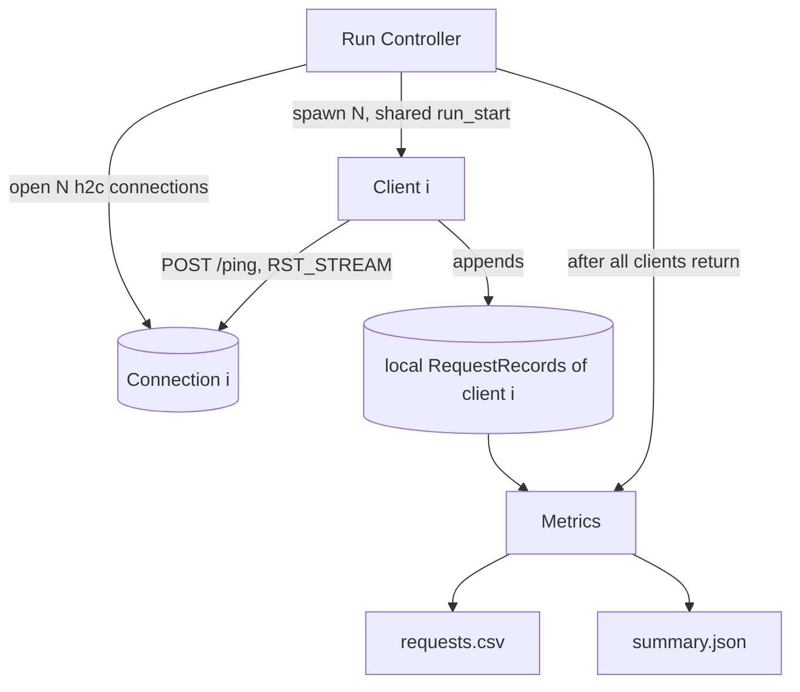

# Load Generator — Design

## Structure

| Subcomponent | Responsibility | Spec |
|---|---|---|
| Run Controller | Validate config, open connections, start clients, wait through DrainPhase, close, write outputs | [run_controller/description.md](run_controller/description.md) |
| Client | SemiOpenLoopClient: schedule, sender and receiver, GatedArrival, SLOCancellation, record | [client/description.md](client/description.md) |
| Metrics | RequestRecord schema, aggregation, CSV and summary output | [metrics/description.md](metrics/description.md) |

## Time base

Every timestamp is in **integer nanoseconds since `run_start`**, a single monotonic-clock reading
taken by the Run Controller after all connections are open and just before the clients start. All
clients share this origin.

## Concurrency

Each client runs as its own concurrent activities (a sender and a receiver, coroutines or threads). Clients share
no mutable state: each one owns its connection, its `Rng`, and its own list of records. Within a client, the
sender and the receiver share only the client's outstanding count and event queue
([client/design.md#semiopenloopclient](client/design.md#semiopenloopclient)). The lists are
merged only after every client has returned. Timers and sleeps must use the same monotonic clock.

## Phases

1. **Setup:** validate, open N connections. Any failure aborts with a non-zero exit.
2. **Active phase** `[0, duration_ns)`: clients send requests.
3. **DrainPhase:** clients send nothing new. In-flight requests resolve within `slo_ns`.
4. **Teardown:** close connections, aggregate, write files.

Details: [run_controller/design.md](run_controller/design.md).
