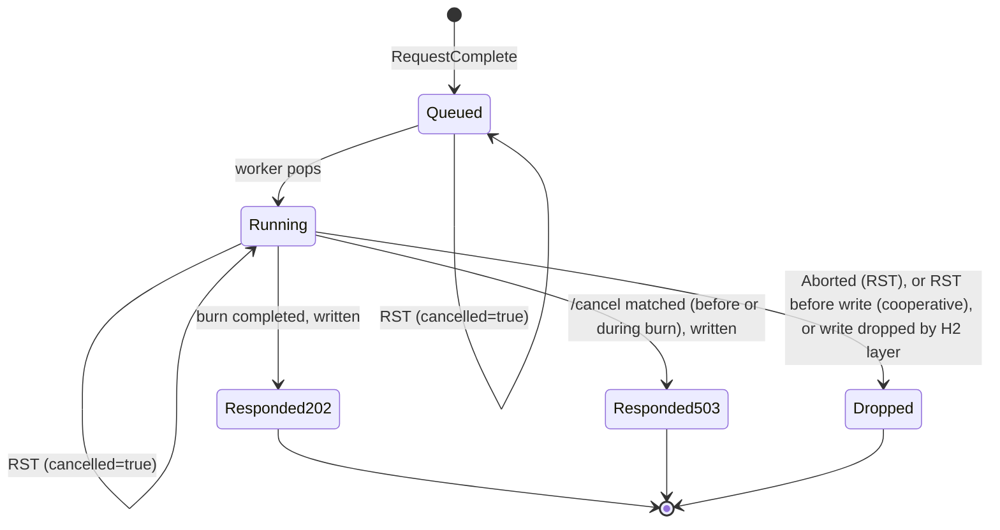

# Connection Handler — Design

## Shared state

```
queue        : FIFO of StreamTask, safe for one producer (reader) and one consumer (worker)
stream_table : map stream_id -> StreamTask, for tasks queued or running (used by the reader)
closing      : atomic boolean, initially false
cancel_ctx   : { state: ConnectionCancelState (fresh, client_id unbound),
                 registry, counters }          # state is touched only by the worker
```

`ConnectionCancelState` is defined in [../cancel_tracker/api.md](../cancel_tracker/api.md#connectioncancelstate).
`registry` and `counters` are the process-wide objects passed in by the Listener.

## FrameReader

The HTTP/2 layer (frame parsing, HPACK, flow control, SETTINGS, PING, WINDOW_UPDATE) may come from a
library. This design fixes only how **request completion** and **RST_STREAM** are handled.

```
procedure frame_reader():
    loop:
        event = next_http2_event(conn)          # blocks
        match event:
            RequestComplete(stream_id, headers, body):   # END_STREAM seen
                task = StreamTask(stream_id, headers[":method"], headers[":path"], body, cancelled=false)
                stream_table[stream_id] = task
                queue.push(task)
            StreamReset(stream_id, error_code):
                if stream_id in stream_table:
                    stream_table[stream_id].cancelled.store(true)
                # Reset of an unknown or finished stream is ignored.
            ConnectionClosed or GoAway or ProtocolError:
                closing.store(true)
                queue.wake_all()
                return
```

A request that is reset **before** END_STREAM never becomes a StreamTask, so it is never processed.

## SerialStreamWorker

```
procedure serial_stream_worker():
    loop:
        task = queue.pop_blocking()             # returns None once closing and woken
        if task is None: return
        response = route(task)
        write_response(task, response)
        remove task.stream_id from stream_table
```

Only one task is ever being worked on at a time per connection, and tasks are taken in the order
their requests completed. A client sends `/ping` ids in increasing order and the worker takes them
in that order, so the `target_id`s that CancelMatching sees on one connection increase
monotonically. This ordering is assumed, not checked.

## Routing

```
function route(task):
    if task.path == "/ping":
        if task.method != "POST":   return Response(405, empty)
        return ping_handler.handle_ping(task, config, rng, cancel_ctx)    # Response or Aborted
    if task.path == "/cancel":
        if task.method != "DELETE": return Response(405, empty)
        return cancel_tracker.handle_cancel(task.body, config, cancel_ctx.registry)
    return Response(404, empty)
```

## Response writing

```
procedure write_response(task, response):
    if response is Aborted: return                                   # RST skip/abort
    if config.cancel_mode == cooperative and task.cancelled.load(): return
    send HEADERS(:status, content-type if body non-empty, content-length)
    send DATA(body, END_STREAM)
    # If the stream was reset, the HTTP/2 layer drops these frames. Any write error
    # on a reset stream is ignored and does not close the connection.
```

`503` responses from a `/cancel` match are written like any other response. The client is still
waiting for them.

## Concurrency requirement

The FrameReader **must keep running while the worker is in a CPU burn**. If an implementation uses
cooperative coroutines on a shared thread, the burn must run on a separate OS thread (or the reader
must), or else `RST_STREAM` would not be seen until the burn ends. The RST flag is an atomic
boolean: the reader writes it and the worker or burner reads it, with no further locking.

`/cancel` requests do not need the reader of the target client's connection. They arrive on the
canceller's own connection and reach the target worker through the lock-free CancelRegistry.

## State machine (per `/ping` StreamTask)



## Connection close

`close()` or a GOAWAY/EOF from the peer sets `closing`, sends `GOAWAY` if the connection is still
open, and wakes the queue. The worker finishes its current task (a running burn is not
interrupted), then sees `None` and returns. Queued tasks are dropped. The handler returns once both
activities have ended and the socket is closed. The connection's `pending` set is thrown away
uncounted, and its registry entry stays (entries are never deleted).
