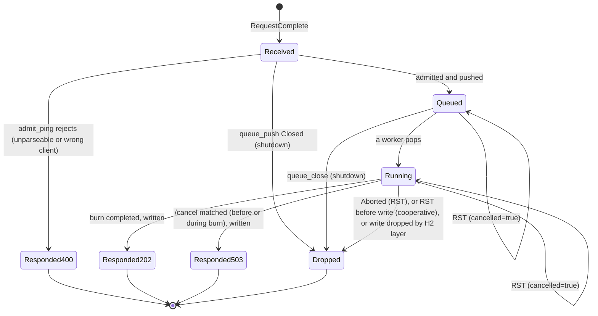

# Connection Handler — Design

## Shared state

```
stream_table : map stream_id -> StreamTask, for tasks admitted or being answered (used by the reader)
closing      : atomic boolean, initially false
rng          : this connection's Rng                      # used only by admission
conn_state   : ConnectionCancelState (client_id unbound)   # used only by admission
registry     : the process-wide CancelRegistry
queue        : the process-wide WorkQueue
```

`ConnectionCancelState` is defined in [../cancel_tracker/api.md](../cancel_tracker/api.md#connectioncancelstate).
`registry` and `queue` are passed in by the Listener. `rng` and `conn_state` are touched only by
[Admission](#admission), which runs one request at a time.

## FrameReader

The HTTP/2 layer (frame parsing, HPACK, flow control, SETTINGS, PING, WINDOW_UPDATE) may come from a
library. This design fixes only how **request completion** and **RST_STREAM** are handled.

```
procedure frame_reader():
    loop:
        event = next_http2_event(conn)          # blocks
        match event:
            RequestComplete(stream_id, headers, body):   # END_STREAM seen
                task = StreamTask(stream_id, headers[":method"], headers[":path"], body, cancelled=false)
                stream_table[stream_id] = task
                match route(task):                       # never waits for a worker
                    Immediate(response):
                        write_response(task, response)
                        remove stream_id from stream_table
                    Queued(job):
                        spawn stream_responder(task, job)
            StreamReset(stream_id, error_code):
                if stream_id in stream_table:
                    stream_table[stream_id].cancelled.store(true)
                # Reset of an unknown or finished stream is ignored.
            ConnectionClosed or GoAway or ProtocolError:
                close()
                return

procedure stream_responder(task, job):
    response = job.reply.take()                  # waits for the worker, or for queue_close
    write_response(task, response)
    remove task.stream_id from stream_table
```

A request that is reset **before** END_STREAM never becomes a StreamTask, so it is never processed.

The reader itself never waits for a worker: only the stream's responder does. A responder is anything that
runs after `job.reply` is filled without holding up the reader (a coroutine, a thread, or a completion callback).

## Admission

```
function route(task):                                     # Immediate(Response) | Queued(PingJob)
    if task.path == "/ping":
        if task.method != "POST":   return Immediate(Response(405, empty))
        r = ping_handler.admit_ping(task, config, rng, conn_state)
        if r is a Response: return Immediate(r)          # 400: never queued, no sample drawn
        if worker_pool.queue_push(queue, r) is Closed:
            return Immediate(Aborted)                    # server shutting down
        return Queued(r)
    if task.path == "/cancel":
        if task.method != "DELETE": return Immediate(Response(405, empty))
        return Immediate(cancel_tracker.handle_cancel(task.body, config, registry))   # never queued
    return Immediate(Response(404, empty))
```

- **One at a time, in completion order.** `admit_ping` and `queue_push` for one connection run as one step, one
  request at a time, in the order the requests completed. In the reference design the FrameReader does both
  itself, so this holds trivially. If an HTTP/2 library delivers each completed request on its own per-stream
  handler instead, those handlers must take a per-connection **admission lock** around `admit_ping` plus
  `queue_push`. This is what keeps the connection's ServiceTime sequence
  ([../ping_handler/design.md#sampling-order](../ping_handler/design.md#sampling-order)) and its push order
  ([../worker_pool/design.md#ordering](../worker_pool/design.md#ordering)) tied to arrival order.
- **`/cancel` is never queued.** `handle_cancel` is lock-free and short, so answering it on the reader cannot delay
  the reader by more than one registry push.

## Routing

[Admission](#admission) is the router. The table summarizes it:

| `:path` | `:method` | Handled by | Queued | Answer |
|---|---|---|---|---|
| `/ping` | `POST` | `admit_ping`, then a worker's `run_ping` | yes, if admitted | `202`, `503`, nothing, or `400` from admission |
| `/ping` | other | router | no | `405`, empty |
| `/cancel` | `DELETE` | `handle_cancel` | never | `202`, `400` or `503` |
| `/cancel` | other | router | no | `405`, empty |
| other | any | router | no | `404`, empty |

## Response writing

```
procedure write_response(task, response):
    if response is Aborted: return                                   # RST skip/abort, or dropped at shutdown
    if config.cancel_mode == cooperative and task.cancelled.load(): return
    send HEADERS(:status, content-type if body non-empty, content-length)
    send DATA(body, END_STREAM)
    # If the stream was reset, the HTTP/2 layer drops these frames. Any write error
    # on a reset stream is ignored and does not close the connection.
```

`503` responses from a `/cancel` match are written like any other response. The client is still
waiting for them. Writing hands the frames to the connection's writer; it never waits for the peer, so a write
from the reader does not stall frame reading.

## Concurrency requirement

The FrameReader **must keep running while workers burn**. Workers run on their own activities
([../worker_pool/design.md#concurrency-requirement](../worker_pool/design.md#concurrency-requirement)), and the
reader never waits on one, so `RST_STREAM` and `/cancel` are seen while every worker is busy. The RST flag is an
atomic boolean: the reader writes it and the worker or burner reads it, with no further locking.

`/cancel` requests do not need the reader of the target client's connection. They arrive on the
canceller's own connection, are answered by that connection's handler, and reach the target's worker through the
lock-free CancelRegistry.

## State machine (per `/ping` StreamTask)



## Connection close

`close()` or a GOAWAY/EOF from the peer sets `closing`, sends `GOAWAY` if the connection is still open, stops
reading, and sets the RST flag of every task still in `stream_table`. Those tasks' jobs stay in the WorkQueue or keep
running: in `cooperative` mode a worker skips or stops them at their next CancelCheckPoint, in `ignore` mode they
burn to the end. Their writes are dropped. The handler returns once the reader and every stream responder have
ended and the socket is closed. Each responder ends when its job's `reply` is filled, by a worker or by
`queue_close` at server shutdown.

The client's registry entry and its ClientCancelState stay (entries are never deleted). They are shared by the
client, not owned by the connection.

## Design specific to Go

Implementation: `implementation/go` (module `testbed`, Go 1.21, `golang.org/x/net v0.17.0`).
Build and test with `CGO_ENABLED=0 go build ./...` / `CGO_ENABLED=0 go test ./...`. On recent macOS the dynamic
loader rejects cgo-linked Go 1.21 binaries (missing `LC_UUID`), so cgo is disabled.

### Go choices

- File `internal/server/connhandler.go`.
- The FrameReader is split in two. The x/net/http2 read loop does the framing, and each stream's `http.Handler` goroutine (`frameReader`) does the rest: it runs once the body is read to END_STREAM, builds the `StreamTask`, routes it, and for a queued `/ping` acts as the stream responder. It turns `r.Context().Done()`, which fires on RST_STREAM or when the connection closes, into the RST flag. Each handler goroutine holds its own `*StreamTask`, which takes the place of `stream_table`.
- Stream handlers of one connection run concurrently, so Admission takes the per-connection admission lock `mu` around `admitPing` plus `WorkQueue.Push`, as the design requires for per-stream handlers. Go does not promise that handler goroutines reach the lock in exact END_STREAM order. Clients keep one request outstanding, so in practice this does not matter.
- The router returns `(Response, *PingJob)`; a non-nil job means queued. `/cancel` runs `HandleCancel` on the stream's goroutine and is never queued.
- The worker sends its `Response` through the job's 1-buffered `reply` channel, and the handler goroutine writes it, because x/net/http2 only allows writes from the handler goroutine. "Write nothing" (`Aborted`, or RST in cooperative mode) is `panic(http.ErrAbortHandler)`. That resets the stream instead of letting the library send an empty 200.
- Connection close: `close()` sets `closing` under `mu` and closes the socket. `run` then waits on a `sync.WaitGroup` of live stream handlers; `addStream` refuses new ones once `closing` is set, so `Add` never races with `Wait`.
- The RST flag is `sync/atomic.Bool`. `maxConcurrentStreams` (4096, advertised in SETTINGS) bounds the requests one connection can have admitted at once.

### Traceability

Generated from the `// Design:` tags in the code by `implementation/spec_tools/tracegen.py` (see `AGENTS.md`). Each link points at the first code line after the tag.
Regenerate from the repository root with `python3 implementation/spec_tools/tracegen.py --lang Go --ext .go --comment // --write`.

<!-- trace:begin -->
| Design subsection | Implementation (file:line) |
|---|---|
| [Shared state](#shared-state) | [connhandler.go:46](../../../implementation/go/internal/server/connhandler.go#L46) |
| [FrameReader](#framereader) | [connhandler.go:92](../../../implementation/go/internal/server/connhandler.go#L92), [server_test.go:133](../../../implementation/go/internal/server/server_test.go#L133) |
| [Admission](#admission) | [connhandler.go:150](../../../implementation/go/internal/server/connhandler.go#L150) |
| [Routing](#routing) | [connhandler.go:130](../../../implementation/go/internal/server/connhandler.go#L130) |
| [Response writing](#response-writing) | [connhandler.go:171](../../../implementation/go/internal/server/connhandler.go#L171) |
| [Concurrency requirement](#concurrency-requirement) | [connhandler.go:78](../../../implementation/go/internal/server/connhandler.go#L78) |
| [State machine (per `/ping` StreamTask)](#state-machine-per-ping-streamtask) | [connhandler.go:92](../../../implementation/go/internal/server/connhandler.go#L92) |
| [Connection close](#connection-close) | [connhandler.go:192](../../../implementation/go/internal/server/connhandler.go#L192) |
<!-- trace:end -->
