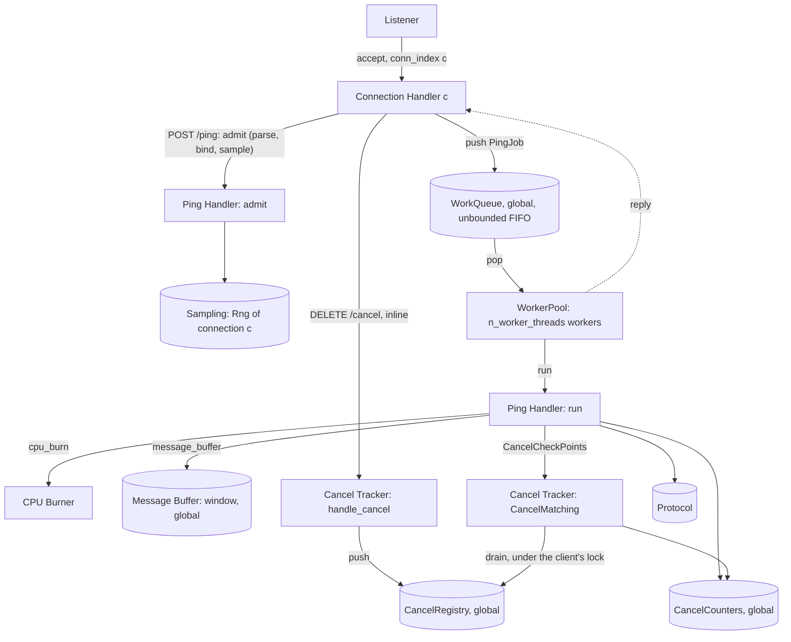

# Server — Design

## Structure



| Subcomponent | Responsibility | Spec |
|---|---|---|
| Connection Handler | HTTP/2 framing for one connection, per-stream RST flags, client binding, routing, admitting `/ping` onto the WorkQueue, answering `/cancel` inline, response writing | [connection_handler/description.md](connection_handler/description.md) |
| Worker Pool | The process-wide WorkQueue, the `n_worker_threads` workers that run PingJobs, and the QueueLengthLog sampler | [worker_pool/description.md](worker_pool/description.md) |
| Ping Handler | Admit a `/ping` (parse body, bind client id, sample ServiceTime) and run it (CancelCheckPoints, burn, build response) | [ping_handler/description.md](ping_handler/description.md) |
| CPU Burner | Busy-loop for an exact time, with optional RST and `/cancel` checks (`workload = cpu_burn`) | [cpu_burner/description.md](cpu_burner/description.md) |
| Message Buffer | The window of messages filled at startup and the per-client MessageCursors (`workload = message_buffer`) | [message_buffer/description.md](message_buffer/description.md) |
| Cancel Tracker | CancelRegistry, CancelInbox, per-client cancel state, CancelMatching, CancelCounters, `handle_cancel` | [cancel_tracker/description.md](cancel_tracker/description.md) |

## Configuration validation

```
function validate(params):
    workload in {cpu_burn, message_buffer}    else error
    if workload == cpu_burn or response_rate is given:
        response_rate > 0                     else error "response_rate must be a number > 0"
    protocol.validate_body_size(response_bytes)
    cancel_mode in {ignore, cooperative}      else error
    cancel_check_interval_us >= 1             else error
    seed parses as u64                        else error
    n_worker_threads is an integer in 1 ..= 2^32-1   else error
    queue_sample_interval_ms is an integer >= 1      else error   # checked even if queue_log_path is empty
    initial_stall_ms is an integer >= 0              else error
    window_size is an integer in 1 ..= 2^32-1        else error   # these three are checked under every workload
    message_bytes is an integer >= 1                 else error
    n_messages_per_request is an integer >= 1        else error
    queue_log_path is any string; empty means no QueueLengthLog
    return ServerConfig(params)
```

## ProcessStart

```
procedure main(argv):
    print("process_start_unix_ns " + decimal(wall_clock_unix_ns()))     # first line, before anything else
    params = parse(argv); config = validate(params)                    # errors exit non-zero, as before
    serve(config)
```

- **Why.** A runtime's own diagnostics (for example a garbage collector's per-cycle trace, the **GcTrace**) give
  times relative to the process start. The BenchmarkRunner turns them into wall-clock times with this line.
- **Accuracy.** The line is read at the start of the program's entry point. A runtime starts its own clock a
  little earlier, during its initialization; the difference is well under 1 ms and is accepted.
- This is the server's only wall-clock read; every duration still uses the monotonic clock
  ([Concurrency model](#concurrency-model)).

## Listener

```
function serve(config):
    registry = cancel_tracker.registry_new(CANCEL_REGISTRY_CAPACITY)     # one per process
    counters = cancel_tracker.counters_new()                            # one per process
    queue = worker_pool.queue_new(config.initial_stall_ms)              # one per process; StallGate
    buf = message_buffer.buffer_new(config.window_size, config.message_bytes) if config.workload == message_buffer
          else none                                                     # MessageBuffer: full before bind
    pool = worker_pool.pool_start(config.n_worker_threads, queue, config, registry, counters, buf)
    log = open_for_write(config.queue_log_path) if config.queue_log_path != "" else none   # error: exit non-zero
    socket = bind_and_listen(config.listen_addr)
    print("listening on " + config.listen_addr)
    if log is not none:
        sampler = spawn worker_pool.queue_sampler(queue, log, config.queue_sample_interval_ms)   # QueueLengthLog
    conn_index = 0
    loop until shutdown requested:
        conn = accept(socket)
        seed_c = sampling.derive_seed(config.seed, STREAM_SERVER_CONNECTION, conn_index)
        spawn ConnectionHandler(conn, config, sampling.rng_new(seed_c), registry, queue)
        conn_index = conn_index + 1
```

`conn_index` goes up in accept order, starting at 0. Each Connection Handler owns its `Rng`
exclusively and draws from it only when it admits a `/ping`, so workers never touch an `Rng`. The registry,
the counters and the WorkQueue are shared by all handlers and workers.

The canceller's connection also gets a `conn_index` and a seed, but it never uses its `Rng`,
because it carries no `/ping`. If the canceller connects before some clients, the clients' seeds
shift. Reproducing the server's random sequence therefore needs the same connection order.

## Concurrency model

| Activity | Count | Runs | Touches |
|---|---|---|---|
| Listener | 1 | accept loop | creates everything below |
| Connection Handler | 1 per connection | HTTP/2 framing, admit `/ping`, `handle_cancel` inline, response writing | its own `Rng` and binding (exclusively), its own stream table, WorkQueue (push), CancelRegistry (push, read watermark) |
| Worker | `n_worker_threads` | `queue_pop`, then run the PingJob | WorkQueue (pop), CancelRegistry (per-client state under the client's lock), CancelCounters, MessageBuffer (under its lock) |
| QueueLengthLog sampler | 0 or 1 | wake every `queue_sample_interval_ms`, append one row | WorkQueue (`queue_len`, under the queue lock), its log file (exclusively) |

Rules every subcomponent shares:

- **Time base.** Durations are measured with a monotonic clock in whole microseconds. Nothing depends on wall time; the
  only wall-clock read is the [ProcessStart](#processstart) line, which is an output, never an input.
- **No blocking on work.** A Connection Handler never waits for a worker except on the one stream whose reply it
  is writing. `/cancel` never waits for a worker or for a client's lock.
- **Locks.** The WorkQueue lock is held only to move one job. A client's cancel lock
  ([cancel_tracker/design.md](cancel_tracker/design.md)) is held only for one CancelMatching pass or one
  watermark update, never across a burn. A Connection Handler's admission lock (it keeps admit and push in one
  order per connection) is held across one `queue_push`. That is the only nesting: admission lock, then WorkQueue
  lock. A client's cancel lock never nests with another lock. The MessageBuffer lock is held only for one `push_messages`
  and never nests with another lock.
- **Lock-free paths.** RST flags (atomic booleans), CancelInbox pushes, FinishedWatermark reads and the
  CancelCounters stay lock-free.
- **Ordering.** `/ping` jobs start in global admission order
  ([worker_pool/design.md#ordering](worker_pool/design.md#ordering)).

## Cancellation semantics

RST (client SLO) cases:

| Situation | `ignore` | `cooperative` |
|---|---|---|
| RST arrives before the request starts (still in the WorkQueue, including during the StallGate's stall) | Burn the full ServiceTime anyway when its turn comes. Response write is dropped | Skipped at its turn: no burn, no write |
| RST arrives during the burn | Keep burning to the end. Response write is dropped | Burner stops within one `cancel_check_interval_us`. No write |
| RST arrives after the burn, before the write | Write is dropped by the HTTP/2 layer | Flag checked before writing. No write |

`/cancel` cases (id `X` for the request being handled):

| Situation | `ignore` | `cooperative` |
|---|---|---|
| `/cancel X` registered before X's first CancelCheckPoint (including while X waits in the WorkQueue) | Thrown away by `handle_cancel`. X completes, `202` | X is skipped, `503`, `cancelled_before_processing += 1` |
| `/cancel X` registered during X's burn | Thrown away. X completes, `202` | Burn stops within `CHECK_ITER` spin units after the registration, `503`, `cancelled_during_processing += 1` |
| `/cancel X` registered after X completed | Thrown away | X already answered `202`. At a later CancelCheckPoint of the same client, `completed_before_cancel += 1` |
| `/cancel X` for a future X | Thrown away | Kept pending until X arrives, then as the first row |

When RST and `/cancel` both apply, RST wins: no write, no counter.

In both modes every `202` answer to `/cancel` carries the target client's FinishedWatermark
([cancel_tracker/design.md#finishedwatermark](cancel_tracker/design.md#finishedwatermark)), so "thrown away" in
`ignore` mode still returns a useful reply.

With `workload = cpu_burn`, in both modes the ServiceTime is sampled for every `POST /ping` request whose body parses and
whose client id matches the connection, cancelled or not. It is drawn when the Connection Handler admits the
request, before it is queued, so the random sequence of a connection depends only on its request arrival order,
not on which worker runs what ([ping_handler/design.md](ping_handler/design.md#sampling-order)). With
`workload = message_buffer` nothing is drawn.

With `workload = message_buffer`, "burn" in the tables above means creating the request's messages: RST and
`/cancel` are checked after each message, and a cancelled request never writes to the MessageBuffer
([ping_handler/design.md](ping_handler/design.md#handle_ping)).

## Shutdown

A stall in progress (StallGate, [worker_pool/design.md#stallgate](worker_pool/design.md#stallgate)) does not delay
shutdown. When a signal arrives, the Listener stops accepting, stops the QueueLengthLog sampler (it writes no extra row and
closes the file, [worker_pool/design.md#queuelengthlog](worker_pool/design.md#queuelengthlog)) and closes the WorkQueue
([worker_pool/design.md#workqueue](worker_pool/design.md#workqueue)): jobs still queued are answered `Aborted`
and never run. Then each Connection Handler is told to close: it sends `GOAWAY`, stops reading and sets the RST
flag of each of its streams. A burn that is running is not interrupted (in `ignore` mode the process exits when the
burn finishes, or the OS ends it). Once every worker and every handler has returned, the server prints the
CancelCounters line ([api.md#cancelcounters-output](api.md#cancelcounters-output)) and exits `0`.

## Why one shared WorkQueue

The server models a CPU-bound service with a fixed number of cores: `n_worker_threads` workers fed by one line.
How long a request waits depends on all the work ahead of it, from every client, not only its own client's work.
Abandoned work therefore costs everyone: in `ignore` mode a request the client already gave up on still holds a
worker for its full ServiceTime, and that is the effect this testbed measures. Each client keeps up to
`n_waiting_requests` requests outstanding, so the WorkQueue can hold many requests per client, plus the abandoned
ones.

`/cancel` is answered by the Connection Handler and never queued, so a cancel is never stuck behind the work it is
trying to stop. It reaches the worker through the lock-free CancelInbox.

The ServiceTime is drawn on the Connection Handler, not on the worker, to keep the per-connection random
sequence independent of how jobs are spread over the workers.

## Why a MessageBuffer workload

`cpu_burn` makes every request cost CPU time and nothing else, so the server allocates almost nothing and its
garbage collector, if it has one, stays idle. `message_buffer` instead makes every request allocate: a large
window of messages stays live for the whole run, and each request replaces some of them, so the replaced ones die
after a medium lifetime. That is the pattern that makes a tracing collector work hardest
([message_buffer/description.md](message_buffer/description.md)). Its latency effects then show up in the
clients' and the Ingress's latencies, under the same WorkQueue and cancellation rules as `cpu_burn`.

The window is shared by all workers, so it needs a lock. Messages are created before the lock is taken, so
workers contend only for the slot writes.

## Design specific to Go

Implementation: `implementation/go` (module `testbed`, Go 1.21, `golang.org/x/net v0.17.0`).
Build and test with `CGO_ENABLED=0 go build ./...` / `CGO_ENABLED=0 go test ./...`. On recent macOS the dynamic
loader rejects cgo-linked Go 1.21 binaries (missing `LC_UUID`), so cgo is disabled.

### Go choices

- One Go package `internal/server` for the whole subtree. Each subcomponent is one file: `config.go`, `listener.go`, `connhandler.go`, `workerpool.go`, `pinghandler.go`, `cpuburner.go`, `messagebuffer.go`, `canceltracker.go`. Separate packages would form import cycles (`StreamTask`/`Response`/`PingJob` are shared by the handler, the pool, the ping handler and the tracker). For the same reason the subtree is synced in one commit.
- `ServerConfig` is `server.Config`, with `n_worker_threads` as `NWorkerThreads uint32`. The raw flags are `server.Params`, parsed by `cmd/server/main.go` with the standard `flag` package (`--name value`). `Listen` also refuses `NWorkerThreads == 0`, so a `Config` built without `Validate` (as in tests) fails instead of hanging with no workers.
- HTTP/2: `golang.org/x/net/http2.Server.ServeConn` on connections accepted by our own `net.Listener` loop, so the Listener matches the design exactly. h2c with prior knowledge is ServeConn's default when no TLS is present.
- The Listener creates the WorkQueue and starts the WorkerPool in `Listen`, right after the bind succeeds. `queue_log_path` is created with `os.Create` before the bind (an error makes `Listen` fail, and `main` exits `1`). The QueueLengthLog sampler starts right after `listening on`, and `Shutdown` stops it before `WorkQueue.Close()`.
- Tests: `server_test.go` `TestQueueLengthLogEndToEnd` checks that two waiting jobs appear in the log and that an unwritable path fails `Listen`. `TestValidateNWorkerThreads` also covers `queue_sample_interval_ms`. `TestInitialStallEndToEnd` checks that `/cancel` does not arm the StallGate, that the first `/ping` waits out the stall, and that a `/cancel` sent during the stall gives `503`.
- `initial_stall_ms` is `Config.InitialStallMs` (`--initial_stall_ms`, default 1000). Test fixtures that build a `Config` directly get `0`, meaning no stall.
- Shutdown: close the listener, `WorkQueue.Close()`, then GOAWAY via a `net/http.Server` configured with `http2.ConfigureServer` and passed as `ServeConnOpts.BaseConfig` (its `Shutdown` hook makes every connection send GOAWAY; best effort, because sockets are then closed), close every handler, `WorkerPool.Join()`, wait for the handlers with a `sync.WaitGroup`, then print the CancelCounters line with `fmt.Printf`.
- `workload` is `Config.Workload`, an `int` enum (`WorkloadCPUBurn` is the zero value, so test fixtures that build a `Config` directly keep the burn). `window_size` is `WindowSize uint32`, `message_bytes` and `n_messages_per_request` are `int`. `Validate` parses `response_rate` only when it is given or the workload is `cpu_burn`. `Listen` builds the MessageBuffer before `os.Create(queue_log_path)` and `net.Listen`, keeps it as `Server.buf` (nil for `cpu_burn`), and passes it to `StartWorkerPool`.
- Tests: `TestValidateWorkload` covers the new parameters and the optional `response_rate`. `TestMessageBufferEndToEnd` checks that the window is full after `Listen` and that three `/ping`s of client 1 land at its cursor (`7919 mod 100 = 19`).
- ProcessStart: `cmd/server/main.go` prints `server.ProcessStartLine(time.Now())` before parsing flags; the line is built by `ProcessStartLine` (`strconv.FormatInt(now.UnixNano(), 10)`), tested by `TestProcessStartLine`. Go's gctrace `@` counts from runtime initialization, a little before `main`, which is the accepted sub-millisecond difference.
- Locks of the Concurrency model: the admission lock is `connectionHandler.mu`, the WorkQueue lock is `WorkQueue.mu`, a client's cancel lock is `clientCancelState.mu`, all `sync.Mutex`. The MessageBuffer lock is `MessageBuffer.mu`.

### Traceability

Generated from the `// Design:` tags in the code by `implementation/spec_tools/tracegen.py` (see `AGENTS.md`). Each link points at the first code line after the tag.
Regenerate from the repository root with `python3 implementation/spec_tools/tracegen.py --lang Go --ext .go --comment // --write`.

<!-- trace:begin -->
| Design subsection | Implementation (file:line) |
|---|---|
| [Structure](#structure) | [listener.go:25](../../implementation/go/internal/server/listener.go#L25) |
| [Configuration validation](#configuration-validation) | [config.go:42](../../implementation/go/internal/server/config.go#L42), [config.go:97](../../implementation/go/internal/server/config.go#L97), [server_test.go:261](../../implementation/go/internal/server/server_test.go#L261), [server_test.go:288](../../implementation/go/internal/server/server_test.go#L288) |
| [ProcessStart](#processstart) | [main.go:20](../../implementation/go/cmd/server/main.go#L20), [listener.go:187](../../implementation/go/internal/server/listener.go#L187), [server_test.go:461](../../implementation/go/internal/server/server_test.go#L461) |
| [Listener](#listener) | [listener.go:49](../../implementation/go/internal/server/listener.go#L49), [listener.go:68](../../implementation/go/internal/server/listener.go#L68), [listener.go:90](../../implementation/go/internal/server/listener.go#L90), [listener.go:105](../../implementation/go/internal/server/listener.go#L105), [server_test.go:322](../../implementation/go/internal/server/server_test.go#L322), [server_test.go:388](../../implementation/go/internal/server/server_test.go#L388) |
| [Concurrency model](#concurrency-model) | [listener.go:86](../../implementation/go/internal/server/listener.go#L86), [server_test.go:216](../../implementation/go/internal/server/server_test.go#L216) |
| [Cancellation semantics](#cancellation-semantics) | [pinghandler.go:44](../../implementation/go/internal/server/pinghandler.go#L44), [server_test.go:75](../../implementation/go/internal/server/server_test.go#L75) |
| [Shutdown](#shutdown) | [listener.go:154](../../implementation/go/internal/server/listener.go#L154) |
| [Why one shared WorkQueue](#why-one-shared-workqueue) | [listener.go:58](../../implementation/go/internal/server/listener.go#L58) |
| [Why a MessageBuffer workload](#why-a-messagebuffer-workload) | [config.go:32](../../implementation/go/internal/server/config.go#L32) |
<!-- trace:end -->
