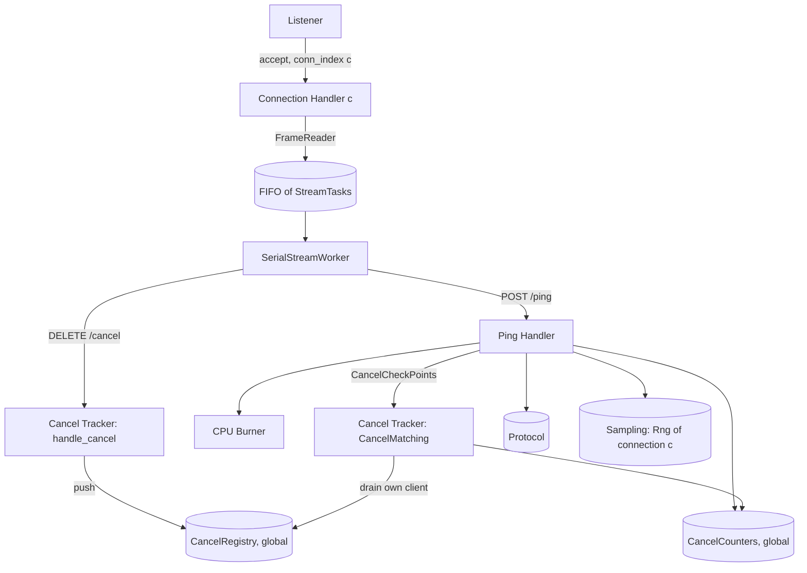

# Server — Design

## Structure



| Subcomponent | Responsibility | Spec |
|---|---|---|
| Connection Handler | HTTP/2 framing for one connection, per-stream RST flags, serial execution, routing, response writing, per-connection cancel state | [connection_handler/description.md](connection_handler/description.md) |
| Ping Handler | Parse body, bind client id, sample ServiceTime, run CancelCheckPoints, burn, build response | [ping_handler/description.md](ping_handler/description.md) |
| CPU Burner | Busy-loop for an exact time, with optional RST and `/cancel` checks | [cpu_burner/description.md](cpu_burner/description.md) |
| Cancel Tracker | CancelRegistry, CancelInbox, CancelMatching, CancelCounters, `handle_cancel` | [cancel_tracker/description.md](cancel_tracker/description.md) |

## Configuration validation

```
function validate(params):
    response_rate > 0                         else error
    protocol.validate_body_size(response_bytes)
    cancel_mode in {ignore, cooperative}      else error
    cancel_check_interval_us >= 1             else error
    seed parses as u64                        else error
    return ServerConfig(params)
```

## Listener

```
function serve(config):
    registry = cancel_tracker.registry_new(CANCEL_REGISTRY_CAPACITY)     # one per process
    counters = cancel_tracker.counters_new()                            # one per process
    socket = bind_and_listen(config.listen_addr)
    print("listening on " + config.listen_addr)
    conn_index = 0
    loop until shutdown requested:
        conn = accept(socket)
        seed_c = sampling.derive_seed(config.seed, STREAM_SERVER_CONNECTION, conn_index)
        spawn ConnectionHandler(conn, config, sampling.rng_new(seed_c), registry, counters)
        conn_index = conn_index + 1
```

`conn_index` goes up in accept order, starting at 0. Each Connection Handler owns its `Rng`
exclusively. The registry and the counters are shared by all handlers and are safe to use
concurrently without locks.

The canceller's connection also gets a `conn_index` and a seed, but it never uses its `Rng`,
because it carries no `/ping`. If the canceller connects before some clients, the clients' seeds
shift. Reproducing the server's random sequence therefore needs the same connection order.

## Cancellation semantics

RST (client SLO) cases:

| Situation | `ignore` | `cooperative` |
|---|---|---|
| RST arrives before the request starts | Burn the full ServiceTime anyway. Response write is dropped | Skip the request: no burn, no write |
| RST arrives during the burn | Keep burning to the end. Response write is dropped | Burner stops within one `cancel_check_interval_us`. No write |
| RST arrives after the burn, before the write | Write is dropped by the HTTP/2 layer | Flag checked before writing. No write |

`/cancel` cases (id `X` for the request being handled):

| Situation | `ignore` | `cooperative` |
|---|---|---|
| `/cancel X` registered before X's first CancelCheckPoint | Thrown away by `handle_cancel`. X completes, `202` | X is skipped, `503`, `cancelled_before_processing += 1` |
| `/cancel X` registered during X's burn | Thrown away. X completes, `202` | Burn stops within `CHECK_ITER` spin units after the registration, `503`, `cancelled_during_processing += 1` |
| `/cancel X` registered after X completed | Thrown away | X already answered `202`. At a later CancelCheckPoint, `completed_before_cancel += 1` |
| `/cancel X` for a future X | Thrown away | Kept pending until X arrives, then as the first row |

When RST and `/cancel` both apply, RST wins: no write, no counter.

In both modes every `202` answer to `/cancel` carries the target client's FinishedWatermark
([cancel_tracker/design.md#finishedwatermark](cancel_tracker/design.md#finishedwatermark)), so "thrown away" in
`ignore` mode still returns a useful reply.

In both modes the ServiceTime is sampled for every `POST /ping` request whose body parses and
whose client id matches the connection, cancelled or not, so the random sequence depends only on
request arrival order ([ping_handler/design.md](ping_handler/design.md#sampling-order)).

## Shutdown

When a signal arrives, the Listener stops accepting. Each Connection Handler is told to close: it
sends `GOAWAY`, stops reading, and drops its queued tasks. A burn that is running is not
interrupted (in `ignore` mode the process exits when the burn finishes, or the OS ends it). Once
every handler has returned, the server prints the CancelCounters line
([api.md#cancelcounters-output](api.md#cancelcounters-output)) and exits `0`.

## Design specific to Go

Implementation: `implementation/go` (module `testbed`, Go 1.21, `golang.org/x/net v0.17.0`).
Build and test with `CGO_ENABLED=0 go build ./...` / `CGO_ENABLED=0 go test ./...`. On recent macOS the dynamic
loader rejects cgo-linked Go 1.21 binaries (missing `LC_UUID`), so cgo is disabled.

### Go choices

- One Go package `internal/server` for the whole subtree. Each subcomponent is one file: `config.go`, `listener.go`, `connhandler.go`, `pinghandler.go`, `cpuburner.go`, `canceltracker.go`. Separate packages would form import cycles (`StreamTask`/`Response` are shared by the handler, the ping handler and the tracker).
- `ServerConfig` is `server.Config`. The raw flags are `server.Params`, parsed by `cmd/server/main.go` with the standard `flag` package (`--name value`).
- HTTP/2: `golang.org/x/net/http2.Server.ServeConn` on connections accepted by our own `net.Listener` loop, so the Listener matches the design exactly. h2c with prior knowledge is ServeConn's default when no TLS is present.
- GOAWAY on shutdown: a `net/http.Server` configured with `http2.ConfigureServer` is passed as `ServeConnOpts.BaseConfig`. Its `Shutdown` hook makes every connection send GOAWAY. This is best effort, because sockets are then closed.
- The CancelCounters line is printed with `fmt.Printf` after `sync.WaitGroup.Wait()` over all connection handlers.

### Traceability

Generated from the `// Design:` tags in the code by `implementation/spec_tools/tracegen.py` (see `AGENTS.md`). Each link points at the first code line after the tag.
Regenerate from the repository root with `python3 implementation/spec_tools/tracegen.py --lang Go --ext .go --comment // --write`.

<!-- trace:begin -->
| Design subsection | Implementation (file:line) |
|---|---|
| [Structure](#structure) | [listener.go:23](../../implementation/go/internal/server/listener.go#L23) |
| [Configuration validation](#configuration-validation) | [config.go:32](../../implementation/go/internal/server/config.go#L32), [config.go:64](../../implementation/go/internal/server/config.go#L64) |
| [Listener](#listener) | [listener.go:41](../../implementation/go/internal/server/listener.go#L41), [listener.go:72](../../implementation/go/internal/server/listener.go#L72) |
| [Cancellation semantics](#cancellation-semantics) | [pinghandler.go:23](../../implementation/go/internal/server/pinghandler.go#L23), [server_test.go:66](../../implementation/go/internal/server/server_test.go#L66) |
| [Shutdown](#shutdown) | [listener.go:120](../../implementation/go/internal/server/listener.go#L120) |
<!-- trace:end -->
