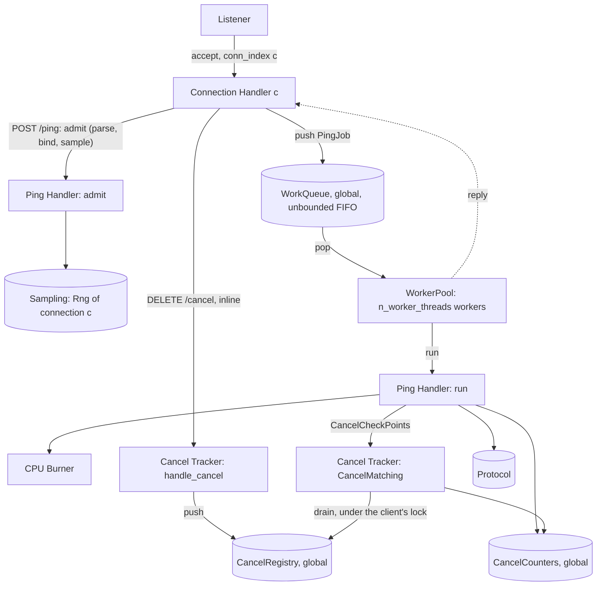

# Server — Design

## Structure



| Subcomponent | Responsibility | Spec |
|---|---|---|
| Connection Handler | HTTP/2 framing for one connection, per-stream RST flags, client binding, routing, admitting `/ping` onto the WorkQueue, answering `/cancel` inline, response writing | [connection_handler/description.md](connection_handler/description.md) |
| Worker Pool | The process-wide WorkQueue, the `n_worker_threads` workers that run PingJobs, and the QueueLengthLog sampler | [worker_pool/description.md](worker_pool/description.md) |
| Ping Handler | Admit a `/ping` (parse body, bind client id, sample ServiceTime) and run it (CancelCheckPoints, burn, build response) | [ping_handler/description.md](ping_handler/description.md) |
| CPU Burner | Busy-loop for an exact time, with optional RST and `/cancel` checks | [cpu_burner/description.md](cpu_burner/description.md) |
| Cancel Tracker | CancelRegistry, CancelInbox, per-client cancel state, CancelMatching, CancelCounters, `handle_cancel` | [cancel_tracker/description.md](cancel_tracker/description.md) |

## Configuration validation

```
function validate(params):
    response_rate > 0                         else error
    protocol.validate_body_size(response_bytes)
    cancel_mode in {ignore, cooperative}      else error
    cancel_check_interval_us >= 1             else error
    seed parses as u64                        else error
    n_worker_threads is an integer in 1 ..= 2^32-1   else error
    queue_sample_interval_ms is an integer >= 1      else error   # checked even if queue_log_path is empty
    initial_stall_ms is an integer >= 0              else error
    queue_log_path is any string; empty means no QueueLengthLog
    return ServerConfig(params)
```

## Listener

```
function serve(config):
    registry = cancel_tracker.registry_new(CANCEL_REGISTRY_CAPACITY)     # one per process
    counters = cancel_tracker.counters_new()                            # one per process
    queue = worker_pool.queue_new(config.initial_stall_ms)              # one per process; StallGate
    pool = worker_pool.pool_start(config.n_worker_threads, queue, config, registry, counters)
    log = open_for_write(config.queue_log_path) if config.queue_log_path != "" else none   # error: exit non-zero
    socket = bind_and_listen(config.listen_addr)
    print("listening on " + config.listen_addr)
    if log is not none:
        sampler = spawn worker_pool.queue_sampler(queue, log, config.queue_sample_interval_ms)   # QueueLengthLog
    conn_index = 0
    loop until shutdown requested:
        conn = accept(socket)
        seed_c = sampling.derive_seed(config.seed, STREAM_SERVER_CONNECTION, conn_index)
        spawn ConnectionHandler(conn, config, sampling.rng_new(seed_c), registry, queue)
        conn_index = conn_index + 1
```

`conn_index` goes up in accept order, starting at 0. Each Connection Handler owns its `Rng`
exclusively and draws from it only when it admits a `/ping`, so workers never touch an `Rng`. The registry,
the counters and the WorkQueue are shared by all handlers and workers.

The canceller's connection also gets a `conn_index` and a seed, but it never uses its `Rng`,
because it carries no `/ping`. If the canceller connects before some clients, the clients' seeds
shift. Reproducing the server's random sequence therefore needs the same connection order.

## Concurrency model

| Activity | Count | Runs | Touches |
|---|---|---|---|
| Listener | 1 | accept loop | creates everything below |
| Connection Handler | 1 per connection | HTTP/2 framing, admit `/ping`, `handle_cancel` inline, response writing | its own `Rng` and binding (exclusively), its own stream table, WorkQueue (push), CancelRegistry (push, read watermark) |
| Worker | `n_worker_threads` | `queue_pop`, then run the PingJob | WorkQueue (pop), CancelRegistry (per-client state under the client's lock), CancelCounters |
| QueueLengthLog sampler | 0 or 1 | wake every `queue_sample_interval_ms`, append one row | WorkQueue (`queue_len`, under the queue lock), its log file (exclusively) |

Rules every subcomponent shares:

- **Time base.** Durations are measured with a monotonic clock in whole microseconds. Nothing depends on wall time.
- **No blocking on work.** A Connection Handler never waits for a worker except on the one stream whose reply it
  is writing. `/cancel` never waits for a worker or for a client's lock.
- **Locks.** The WorkQueue lock is held only to move one job. A client's cancel lock
  ([cancel_tracker/design.md](cancel_tracker/design.md)) is held only for one CancelMatching pass or one
  watermark update, never across a burn. A Connection Handler's admission lock (it keeps admit and push in one
  order per connection) is held across one `queue_push`. That is the only nesting: admission lock, then WorkQueue
  lock. A client's cancel lock never nests with another lock.
- **Lock-free paths.** RST flags (atomic booleans), CancelInbox pushes, FinishedWatermark reads and the
  CancelCounters stay lock-free.
- **Ordering.** `/ping` jobs start in global admission order
  ([worker_pool/design.md#ordering](worker_pool/design.md#ordering)).

## Cancellation semantics

RST (client SLO) cases:

| Situation | `ignore` | `cooperative` |
|---|---|---|
| RST arrives before the request starts (still in the WorkQueue, including during the StallGate's stall) | Burn the full ServiceTime anyway when its turn comes. Response write is dropped | Skipped at its turn: no burn, no write |
| RST arrives during the burn | Keep burning to the end. Response write is dropped | Burner stops within one `cancel_check_interval_us`. No write |
| RST arrives after the burn, before the write | Write is dropped by the HTTP/2 layer | Flag checked before writing. No write |

`/cancel` cases (id `X` for the request being handled):

| Situation | `ignore` | `cooperative` |
|---|---|---|
| `/cancel X` registered before X's first CancelCheckPoint (including while X waits in the WorkQueue) | Thrown away by `handle_cancel`. X completes, `202` | X is skipped, `503`, `cancelled_before_processing += 1` |
| `/cancel X` registered during X's burn | Thrown away. X completes, `202` | Burn stops within `CHECK_ITER` spin units after the registration, `503`, `cancelled_during_processing += 1` |
| `/cancel X` registered after X completed | Thrown away | X already answered `202`. At a later CancelCheckPoint of the same client, `completed_before_cancel += 1` |
| `/cancel X` for a future X | Thrown away | Kept pending until X arrives, then as the first row |

When RST and `/cancel` both apply, RST wins: no write, no counter.

In both modes every `202` answer to `/cancel` carries the target client's FinishedWatermark
([cancel_tracker/design.md#finishedwatermark](cancel_tracker/design.md#finishedwatermark)), so "thrown away" in
`ignore` mode still returns a useful reply.

In both modes the ServiceTime is sampled for every `POST /ping` request whose body parses and
whose client id matches the connection, cancelled or not. It is drawn when the Connection Handler admits the
request, before it is queued, so the random sequence of a connection depends only on its request arrival order,
not on which worker runs what ([ping_handler/design.md](ping_handler/design.md#sampling-order)).

## Shutdown

A stall in progress (StallGate, [worker_pool/design.md#stallgate](worker_pool/design.md#stallgate)) does not delay
shutdown. When a signal arrives, the Listener stops accepting, stops the QueueLengthLog sampler (it writes no extra row and
closes the file, [worker_pool/design.md#queuelengthlog](worker_pool/design.md#queuelengthlog)) and closes the WorkQueue
([worker_pool/design.md#workqueue](worker_pool/design.md#workqueue)): jobs still queued are answered `Aborted`
and never run. Then each Connection Handler is told to close: it sends `GOAWAY`, stops reading and sets the RST
flag of each of its streams. A burn that is running is not interrupted (in `ignore` mode the process exits when the
burn finishes, or the OS ends it). Once every worker and every handler has returned, the server prints the
CancelCounters line ([api.md#cancelcounters-output](api.md#cancelcounters-output)) and exits `0`.

## Why one shared WorkQueue

The server models a CPU-bound service with a fixed number of cores: `n_worker_threads` workers fed by one line.
How long a request waits depends on all the work ahead of it, from every client, not only its own client's work.
Abandoned work therefore costs everyone: in `ignore` mode a request the client already gave up on still holds a
worker for its full ServiceTime, and that is the effect this testbed measures. Clients are closed loops, so the
WorkQueue holds at most about one request per client plus the abandoned ones.

`/cancel` is answered by the Connection Handler and never queued, so a cancel is never stuck behind the work it is
trying to stop. It reaches the worker through the lock-free CancelInbox.

The ServiceTime is drawn on the Connection Handler, not on the worker, to keep the per-connection random
sequence independent of how jobs are spread over the workers.
