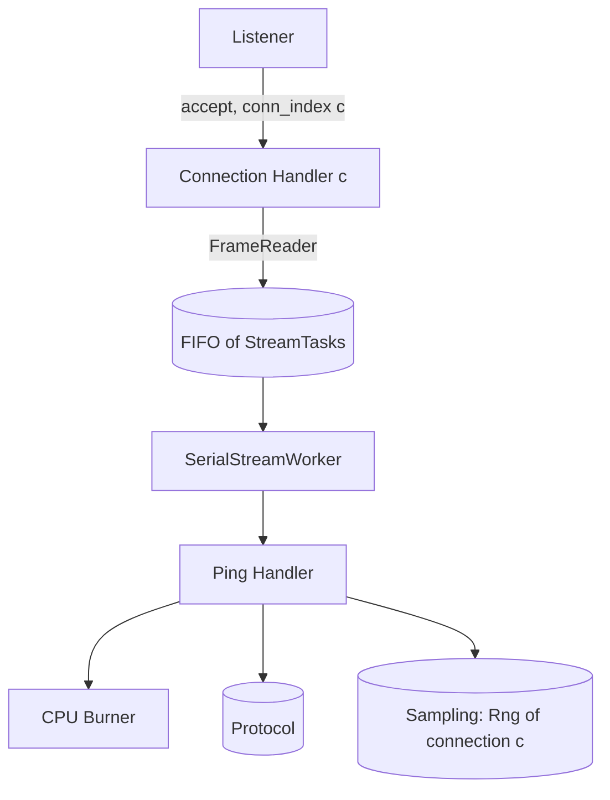

# Server — Design

## Structure



| Subcomponent | Responsibility | Spec |
|---|---|---|
| Connection Handler | HTTP/2 framing for one connection, per-stream cancel flags, serial execution, routing, response writing | [connection_handler/description.md](connection_handler/description.md) |
| Ping Handler | Parse body, sample ServiceTime, burn, build response | [ping_handler/description.md](ping_handler/description.md) |
| CPU Burner | Busy-loop for an exact time, optionally stopping on a cancel flag | [cpu_burner/description.md](cpu_burner/description.md) |

## Configuration validation

```
function validate(params):
    response_rate > 0                         else error
    protocol.validate_body_size(response_bytes)
    cancel_mode in {ignore, cooperative}      else error
    cancel_check_interval_us >= 1             else error
    seed parses as u64                        else error
    return ServerConfig(params)
```

## Listener

```
function serve(config):
    socket = bind_and_listen(config.listen_addr)
    print("listening on " + config.listen_addr)
    conn_index = 0
    loop until shutdown requested:
        conn = accept(socket)
        seed_c = sampling.derive_seed(config.seed, STREAM_SERVER_CONNECTION, conn_index)
        spawn ConnectionHandler(conn, config, sampling.rng_new(seed_c))   # own coroutine/thread
        conn_index = conn_index + 1
```

`conn_index` goes up in accept order, starting at 0. Each Connection Handler owns its `Rng`
exclusively.

## Cancellation semantics

| Situation | `ignore` | `cooperative` |
|---|---|---|
| RST arrives before the request starts | Burn the full ServiceTime anyway. Response write is dropped | Skip the request: no burn, no write |
| RST arrives during the burn | Keep burning to the end. Response write is dropped | Burner stops within one check interval. No write |
| RST arrives after the burn, before the write | Write is dropped by the HTTP/2 layer | Flag checked before writing. No write |

In both modes the ServiceTime is sampled for every `POST /ping` request whose body parses, cancelled
or not, so the random sequence
depends only on request arrival order ([ping_handler/design.md](ping_handler/design.md#sampling-order)).

## Shutdown

When a signal arrives, the Listener stops accepting. Each Connection Handler is told to close: it
sends `GOAWAY`, stops reading, and drops its queued tasks. A burn that is running is not
interrupted (in `ignore` mode the process exits when the burn finishes, or the OS ends it). Then the
process exits `0`.
